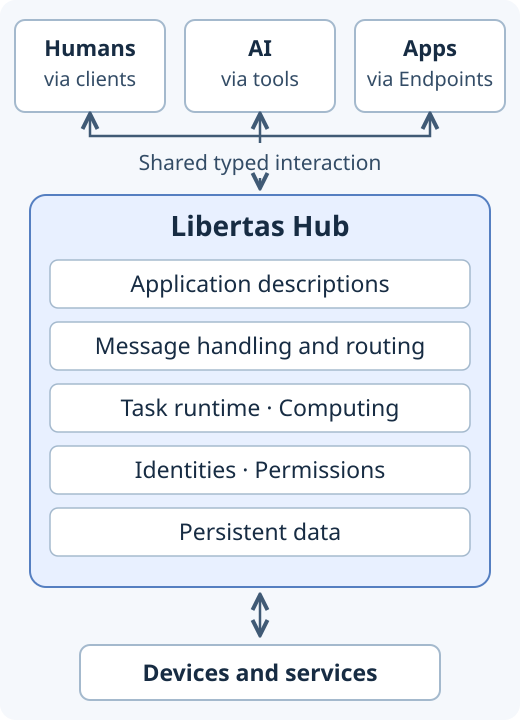

# Hub architecture: resources and interaction

Libertas Hub is the **execution and coordination core of the Libertas
platform**. It connects human users, AI and applications through managed
resources, application descriptions and typed data interactions. This is the
runtime foundation for the platform's [collaboration goal](../principles.md#collaboration-goal).

*Conceptual roles and responsibilities. Participants may share a Hub; AI
features require configured, authorized connectors.*

## Managed resources

Resource management provides the foundation for application execution:

- **Computing and task resources.** The Hub manages installed App versions and
  configured tasks, provides their runtime environments, and controls their
  lifecycles. It coordinates access to computing resources, devices and
  external services. Task isolation and declared permissions govern the
  resources an App may use; the [network access contract](../reference/network-access.md)
  defines its TCP and UDP access.
- **Security resources.** The Hub manages identities, users, groups and
  permissions, authenticates access, and authorizes resource operations.
  [Administrative admission and resource permissions](../guides/administration.md)
  govern management; [Request access](../reference/protocols.md#request-access)
  governs human and AI invocation of Endpoint operations. Task-process
  permissions separately govern an App's access to platform resources.
- **Data resources.** The Hub stores persistent configuration and application
  records and provides the Data API used by tasks. Data access and task
  lifecycle remain platform responsibilities under the
  [persistence contract](../reference/protocols.md#persistence-failure-and-the-no-status-api).

## Application descriptions and runtime interaction

Application descriptions give participants shared meaning. Studio extracts
and validates source declarations; the Hub manages and serves schemas,
localized documentation and Display Templates alongside installed App versions.
They describe data structure and constraints, operations, human-readable
meaning and presentation. The [deployment contract](../reference/deployment.md)
defines exact version bindings; the [Display Template contract](../reference/presentation.md#display-template)
explains presentation updates independently of App versions.

Runtime interaction puts these descriptions into operation. The Hub handles
and routes typed Requests, Responses, subscriptions and updates between clients
and App tasks, and between cooperating tasks. It maintains interaction ownership
and enforces applicable access checks. The [Endpoint contracts](../reference/protocols.md)
define the participant roles and message behavior; humans, AI and software
share the declared protocol while retaining their applicable lifecycles.

## Human users and AI

For **human users**, application data becomes a usable interface. Clients turn
declared values and operations into forms, choices, actions, results and live
updates. People can inspect information, make explicit decisions and complete
App-defined workflows through consistent controls. Direct GUI interaction
remains available independently of AI. See [task controls](../guides/control.md).

For **AI**, schemas and documentation describe the available operations, their
inputs and their results. The Hub projects eligible Endpoint operations into
schema-described tools. An assistant can relate a person's intent to these
operations, invoke App behavior, and use structured results to explain outcomes,
analyze data and coordinate supported sequences of work.
The Hub checks each tool invocation against the authenticated user's current
permissions. Supported features also include [AI Search](../reference/protocols.md#ai-navigation-and-ai-search)
among offered page destinations and [document import](../reference/llm-document-transformation.md)
into declared editor fields. Control AI requires an available, supported
connector assigned to the signed-in user; each feature retains its own
eligibility, confirmation and submission rules.

Human developers and coding agents maintain domain types, descriptions and
behavior that serve human interfaces, AI tools and application integration
together. Apps own domain meaning and business decisions; the Hub supplies
shared runtime services and coordination; clients present the interaction to
people. The [App model](../reference/app-contract.md#application-model) defines
this shared contract with an example; the [code organization practice](../reference/code-organization.md)
shows how to organize its implementation.

[Concepts](index.md) · [Start here](../principles.md)
