# Simple Data. Rich Semantics. Adaptive Interaction.

**Libertas bridges computational simplicity and the richness of human cognition through declarative interaction semantics.**

A Boolean field holds `true` or `false`. Add a Default, a few words of answer
text, or an optional (Nullable) type to its declaration, and every client asks
a different question, each one correct for what the field means. A Union goes
one step further: each answer brings its own questions. The App writes no UI
code. Each example below shows the declaration, what the person
sees, and why it matters.

**[Try the seven examples on an interactive phone](../assets/interactive/simple-data-rich-semantics.html)**:
step from one declaration to the next and answer each question yourself.

<section class="example" id="required-decision">

## Required decision

<div class="example-layout">
<div class="example-code">

```rust
/// Accept invitation
/// Choose whether to accept the invitation.
pub accept_invitation: bool,
```

**What the person sees:** Yes and No, neither selected. The editor cannot be
submitted until one is chosen. Yes stores `true`; No stores `false`.

**Why it matters:** an unanswered question is never quietly saved as `false`.

</div>
<div class="example-visuals">

<figure>
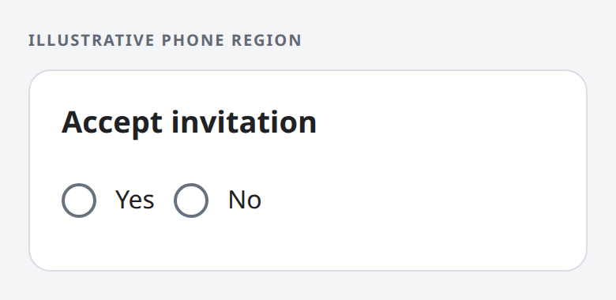
<figcaption>No Default: the person must choose.</figcaption>
</figure>

<figure>
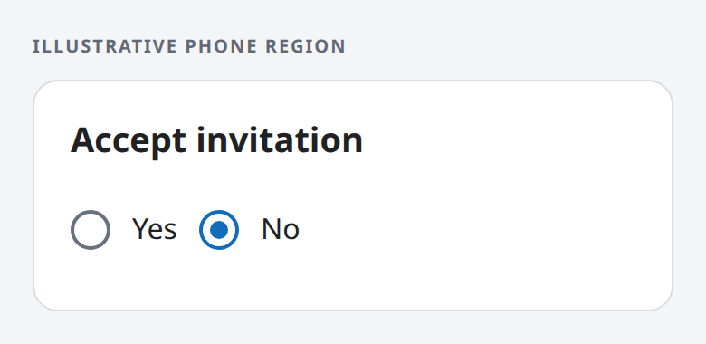
<figcaption>No selected: the value is <code>false</code>.</figcaption>
</figure>

</div>
</div>
</section>

<section class="example" id="meaningful-choices">

## Answers in the person's words

<div class="example-layout">
<div class="example-code">

```rust
/// Accept invitation
/// [TrueText]
/// I accept
/// [FalseText]
/// I decline
pub accept_invitation: bool,
```

**What the person sees:** the two answers read “I accept” and “I decline”. An
answer is still required.

**Why it matters:** the person answers in plain words, while the App still
receives `true` or `false`. Answer text never changes the stored value.

</div>
<div class="example-visuals">

<figure>
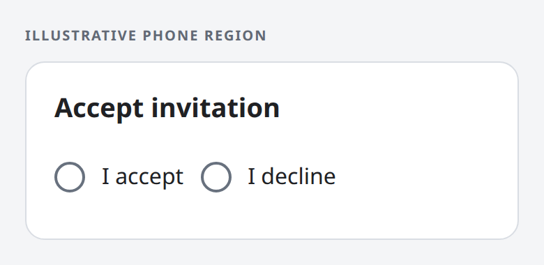
<figcaption>I accept or I decline; neither is selected yet.</figcaption>
</figure>

</div>
</div>
</section>

<section class="example" id="preset-preference">

## A preset preference

<div class="example-layout">
<div class="example-code">

```rust
/// Receive reminders
#[libertas_default(false)]
pub receive_reminders: bool,
```

**What the person sees:** an on/off switch, starting off. A switch appears
only when a Boolean has a Default and no answer text.

**Why it matters:** a setting with a sensible starting value takes one tap to
change, and needs no answer to be submitted.

</div>
<div class="example-visuals">

<figure>
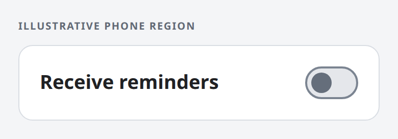
<figcaption>Off: the Default, <code>false</code>.</figcaption>
</figure>

<figure>
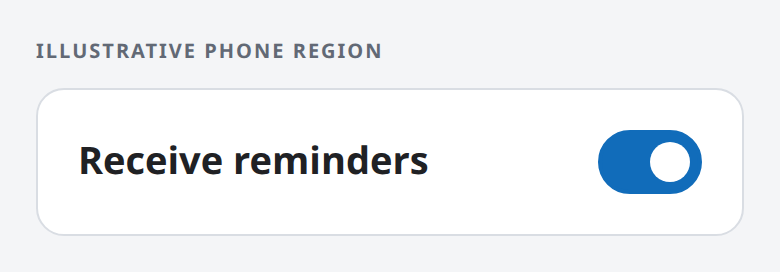
<figcaption>On: <code>true</code>.</figcaption>
</figure>

</div>
</div>
</section>

<section class="example" id="custom-default">

## A preset answer in the person's words

<div class="example-layout">
<div class="example-code">

```rust
/// Receive reminders
/// [TrueText]
/// Send me reminders
/// [FalseText]
/// Do not send reminders
#[libertas_default(false)]
pub receive_reminders: bool,
```

**What the person sees:** two worded answers, with “Do not send reminders”
already selected. Answer text keeps the two choices even with a Default.

**Why it matters:** the person sees exactly what the preset means and can
change it, rather than guessing what “on” would do.

</div>
<div class="example-visuals">

<figure>
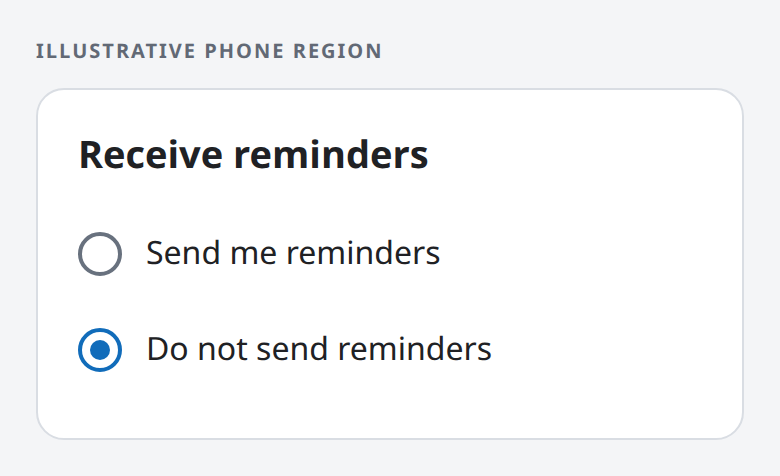
<figcaption>Do not send reminders is preselected: <code>false</code>.</figcaption>
</figure>

</div>
</div>
</section>

<section class="example" id="three-answers">

## Three answers

<div class="example-layout">
<div class="example-code">

```rust
/// Student status
/// [TrueText]
/// Yes, I am a student
/// [FalseText]
/// No, I am not a student
/// [NullText]
/// Prefer not to tell
pub student_status: Option<bool>,
```

**What the person sees:** three answers in this order, none selected. “Prefer
not to tell” stores `null`, and all three stay visible after any choice.

**Why it matters:** declining to answer is a real answer, distinct from not
having answered yet. Only an unanswered question blocks submission.

</div>
<div class="example-visuals">

<figure>
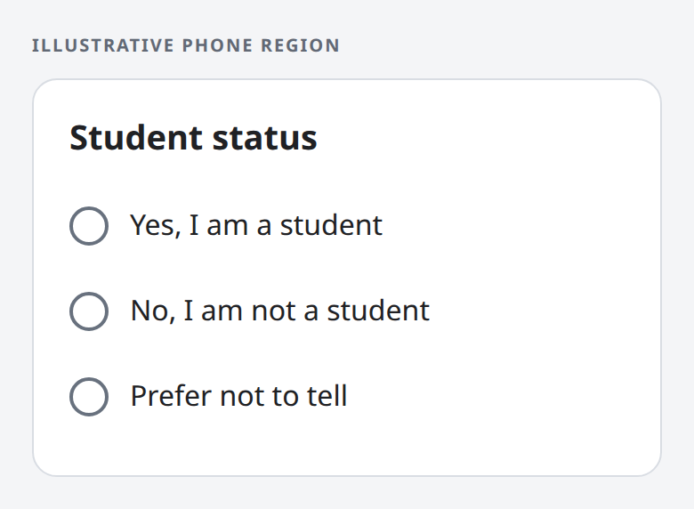
<figcaption>Three answers; none is selected yet.</figcaption>
</figure>

<figure>
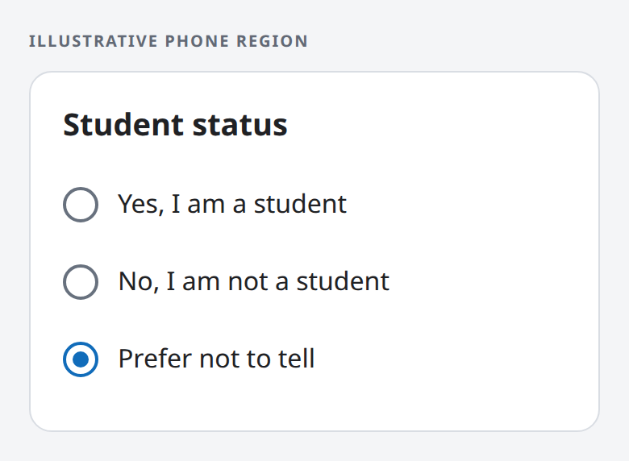
<figcaption>Prefer not to tell: the value is <code>null</code>.</figcaption>
</figure>

</div>
</div>
</section>

<section class="example example-focus" id="meaningful-null">

## Null as a complete answer

<div class="example-layout">
<div class="example-code">

```rust
/// Date of death in 2026
/// [NullText]
/// Alive at the end of 2026
/// [SetText]
/// Died in 2026 on
#[libertas_date_only]
#[libertas_number(min = 20260101, max = 20261231)]
#[libertas_default($null)]
pub death_date: Option<u32>,
```

This field comes from a tax return. Its optional date holds both the person's
status and the date.

**What the person sees:** one question with two answers. “Alive at the end of
2026” starts selected, because the Default is null. Choosing “Died in 2026 on”
opens a date editor directly below, limited to 2026. While the date is blank,
the question is unanswered and the editor cannot be submitted.

**Why it matters:** null is a complete answer here, not missing data. One
field replaces a separate status Boolean and a date that only sometimes
applies.

</div>
<div class="example-visuals">

<figure>
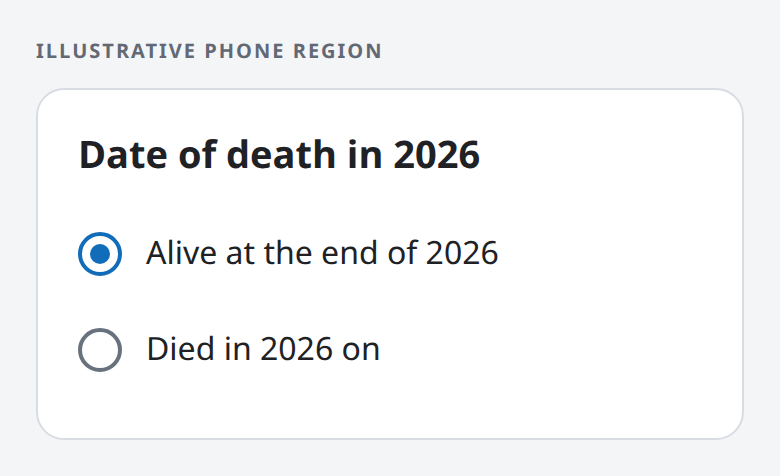
<figcaption><strong>Alive:</strong> the value is <code>null</code>.</figcaption>
</figure>

<figure>

<figcaption><strong>Died, date still blank:</strong> unanswered; submission waits for a date.</figcaption>
</figure>

<figure>
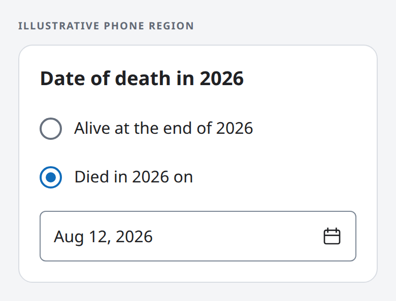
<figcaption><strong>Died on August 12, 2026:</strong> the value is <code>20260812</code>.</figcaption>
</figure>

</div>
</div>
</section>

<section class="example" id="union-answers">

## Answers that bring their own questions

<div class="example-layout">
<div class="example-code">

```rust
/// Reply to the invitation
#[libertas_inline_choices]
pub reply: Reply,

pub enum Reply {
    /// I will attend
    Attending {
        /// Guests besides me
        #[libertas_number(min = 0, max = 3)]
        guests: u32,
    },
    /// Not sure yet
    Tentative {
        /// I will confirm by
        #[libertas_date_only]
        #[libertas_number(min = 20261101, max = 20261130)]
        confirm_by: u32,
    },
    /// I cannot attend
    Declined,
}
```

A Rust enum whose variants carry data is a Union. Each variant's comment is
its answer text, and each variant's fields are the questions that answer
brings.

**What the person sees:** three answers, none selected. Choosing one draws
its own questions directly below it: a guest count under “I will attend”, a
date under “Not sure yet”, nothing for “I cannot attend”. Choosing another answer
replaces those questions.

**Why it matters:** the declaration is the whole condition, so the App writes
no show/hide logic. An impossible combination, such as declining with two
guests, cannot be stored. The editor can be submitted only when an answer is
chosen and that answer's own questions are answered; a blank guest count is
unanswered, never zero.

</div>
<div class="example-visuals">

<figure>
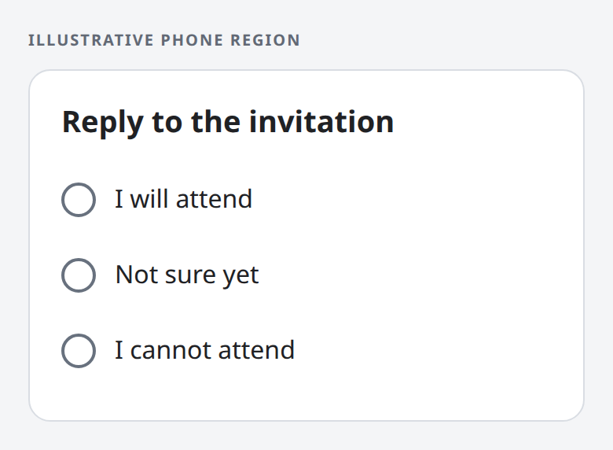
<figcaption>Three answers; none is selected yet.</figcaption>
</figure>

<figure>
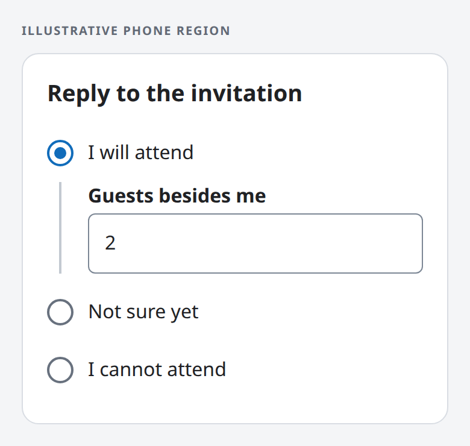
<figcaption><strong>I will attend, with 2 guests:</strong> the value is <code>Attending { guests: 2 }</code>.</figcaption>
</figure>

<figure>
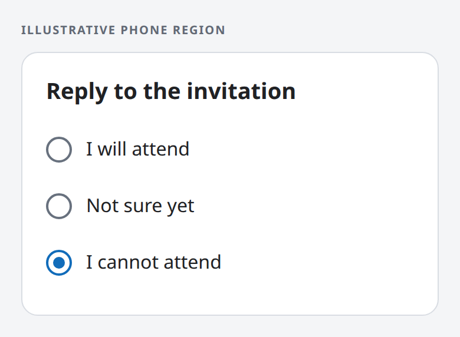
<figcaption><strong>I cannot attend:</strong> the guest count is gone; the value is <code>Declined</code>.</figcaption>
</figure>

</div>
</div>
</section>

## The same meaning in every language

Answer texts are ordinary localized documentation. Translating them changes
only the words a person reads; the stored values, the validation and the way
each question behaves stay the same, with no change to App code.

## About these examples

Each fragment is one field of an App's Rust type, not a complete App. Every
example is a fresh editable field with no value supplied by the App or copied
from earlier data. The phone regions are illustrative mockups rendered from
HTML, not product screenshots; each client draws the same controls in its own
native style.

The exact rules live in the reference:
[Boolean answer controls](../reference/presentation.md#boolean-answer-controls),
[Nullable choices](../reference/presentation.md#nullable-choices),
[inline choices for a Union](../reference/presentation.md#inline-choices),
[answer texts and other document properties](../reference/documentation.md#standard-properties),
[reserved Default values such as `$null`](../reference/schema.md#reserved-default-values)
and [validation](../reference/validation-rules.md).

[More examples](index.md)
