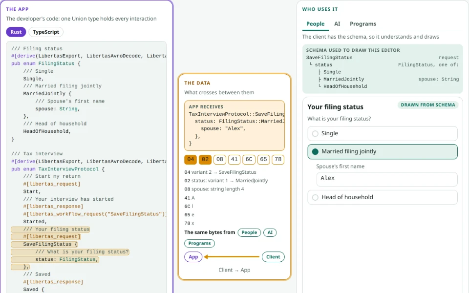
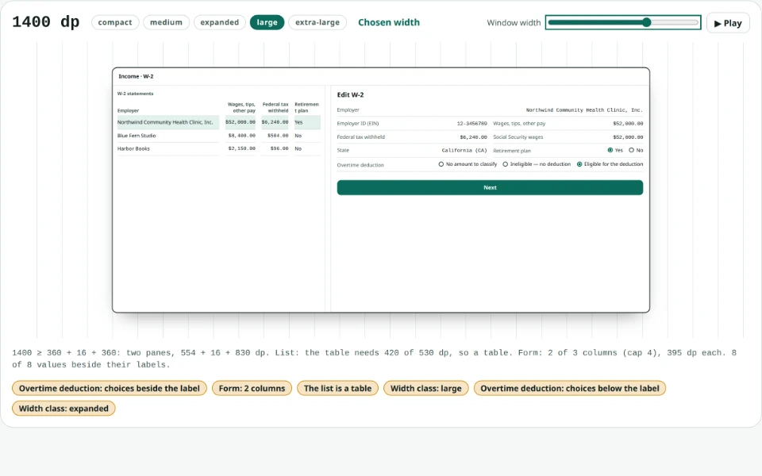
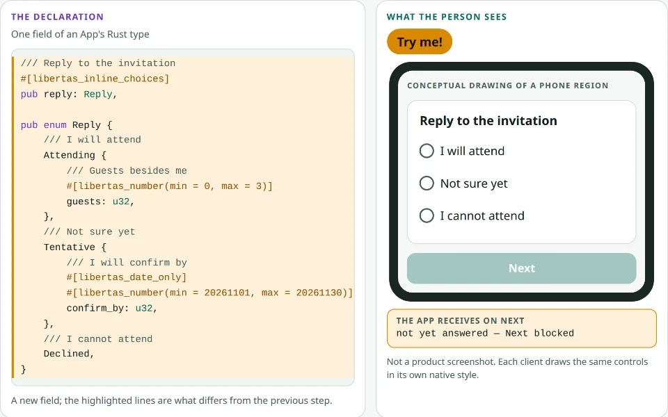

# See Libertas in Action

Three interactive pages show what an App declares and what clients draw from
it. Each runs in your browser on its own; nothing is installed and no account
is needed. Each one links to an explanation page that shows the same content
without JavaScript.

<article>
<a href="assets/interactive/declaration-to-page.html"><picture><source srcset="assets/screenshots/in-action/declaration-to-page-dark.webp" data-loop="assets/screenshots/in-action/declaration-to-page-dark-loop.webp" media="(prefers-color-scheme: dark)"></picture></a>
<h3>From Declaration to Page</h3>

Everything is in source code and its comments: a GUI for people, tool calls for AI, and the same library for other programs.

<a href="assets/interactive/declaration-to-page.html"><strong>Try it →</strong></a>

</article>
<article>
<a href="assets/interactive/data-is-everything.html"><picture><source srcset="assets/screenshots/in-action/data-is-everything-dark.webp" data-loop="assets/screenshots/in-action/data-is-everything-dark-loop.webp" media="(prefers-color-scheme: dark)"></picture></a>
<h3>Data is everything. The GUI is a given.</h3>

Every size, every device, drawn from the data. Adjust it with AI, on live data.

<a href="assets/interactive/data-is-everything.html"><strong>Try it →</strong></a>

</article>
<article>
<a href="assets/interactive/simple-data-rich-semantics.html"><picture><source srcset="assets/screenshots/in-action/simple-data-rich-semantics-dark.webp" data-loop="assets/screenshots/in-action/simple-data-rich-semantics-dark-loop.webp" media="(prefers-color-scheme: dark)"></picture></a>
<h3>Simple Data. Rich Semantics. Adaptive Interaction.</h3>

A few declared words turn one Boolean into the right question.

<a href="assets/interactive/simple-data-rich-semantics.html"><strong>Try it →</strong></a>

</article>

