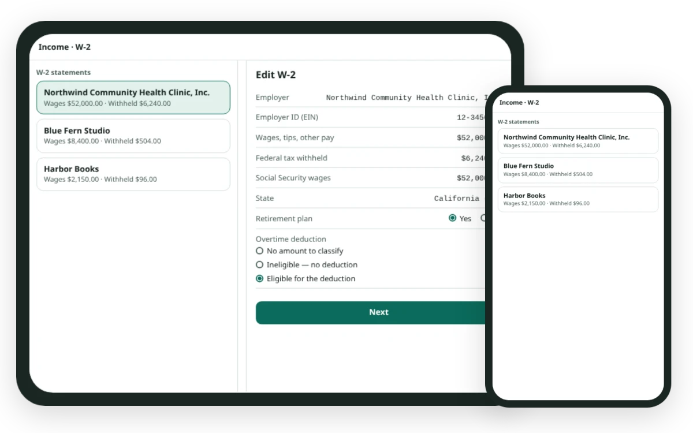
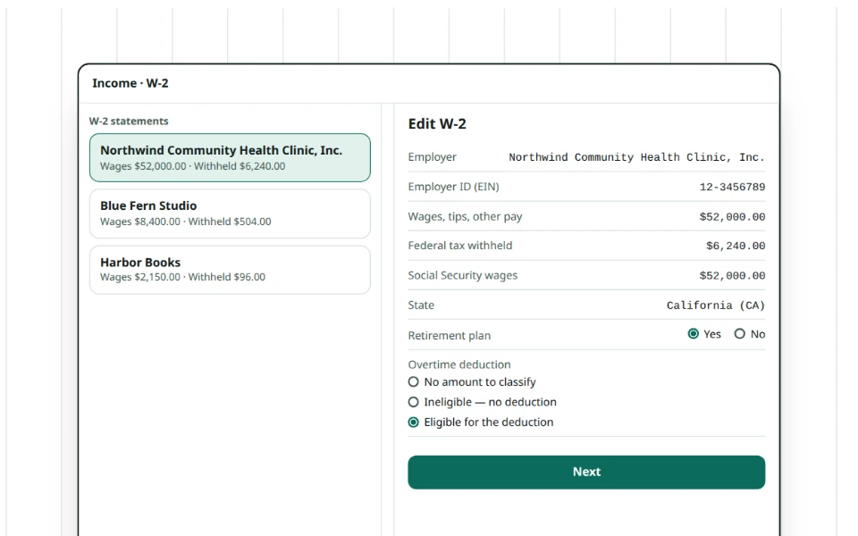
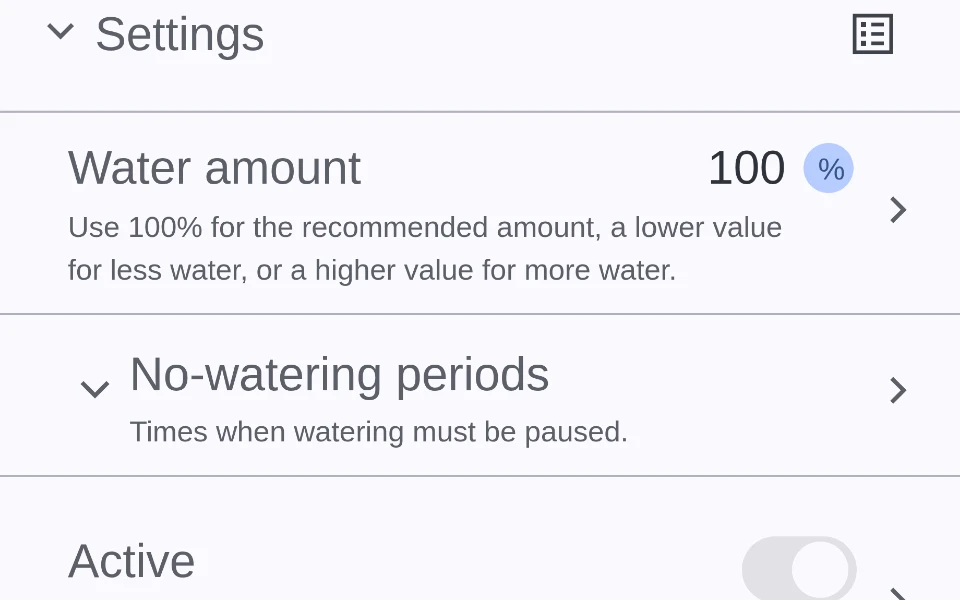
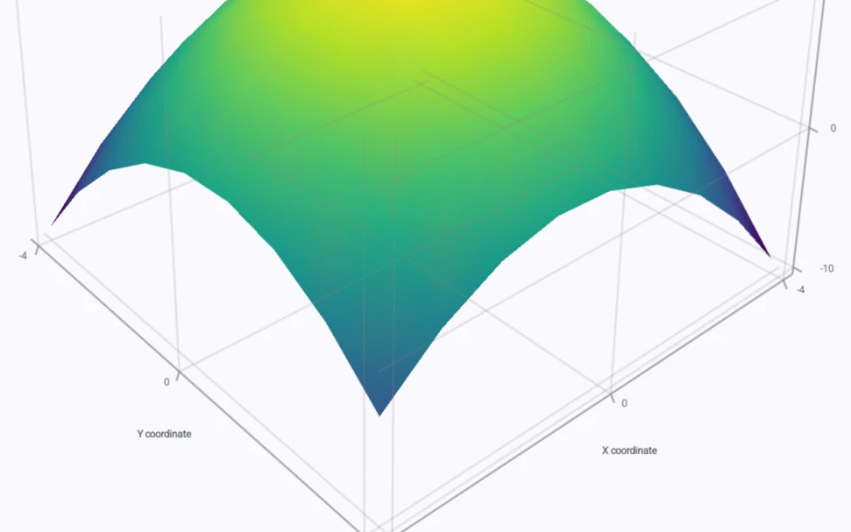

<h1 style="font-size:3rem;line-height:1.05;margin:0.6em 0 0.45em;">Libertas</h1>

<p style="font-size:2rem;font-weight:700;line-height:1.2;margin:0 0 0.65em;">The Application Platform Beyond the Web</p>

<p class="hero-subtitle" style="font-size:1.25rem;font-weight:400;line-height:1.4;">Applications for humans, AI agents, and other applications.<br>On your phone, tablet, or in your browser.</p>

<p class="hero-claim"><a href="examples/federal-tax.md"><span class="claim-ai">AI writes Apps.</span> <span class="claim-you">You can read every line.</span></a></p>

**[Try the U.S. tax return App](examples/federal-tax.md)** **[Build an App with AI →](codebot/index.md)**

<p class="release-status">Current release: <strong>Beta 2</strong>. <a href="guides/try-libertas.md">Try Libertas →</a></p>

<figure class="hero-visual"><a href="examples/federal-tax.md"><picture><source srcset="assets/screenshots/home/hero-devices-dark.webp" media="(prefers-color-scheme: dark)"></picture></a><figcaption>Conceptual drawing: one declaration, drawn for tablet and phone.</figcaption></figure>

<ul class="stat-strip">
<li><strong>2,944+</strong> <span>knowledge points that guide AI as it <a href="codebot/index.md">writes an App</a></span></li>
<li><strong>~50 KB</strong> <span>of flash for the SDK on a microcontroller, under 1 KB RAM</span></li>
<li><strong>$1.43T</strong> <span>software market Libertas is built for, <a href="https://www.gartner.com/en/newsroom/press-releases/2026-02-03-gartner-forecasts-worldwide-it-spending-to-grow-10-point-8-percent-in-2026-totaling-6-point-15-trillion-dollars">Gartner 2026 forecast</a></span></li>
</ul>

<h2 id="paradigm" style="font-size:2rem;line-height:1.2;margin:1.5em 0 0.65em;">A New Programming Paradigm. Three Differences.</h2>

<p style="font-size:1.25rem;margin:0 0 16px;"><a href="examples/federal-tax.md">Make billion-dollar projects simple to build, manage, and maintain.</a><br>With Libertas, humans focus on the code that delivers real business value. Libertas keeps everything else minimal and straightforward.</p>

<p style="font-size:1.25rem;margin:0 0 16px;"><strong>Data first. Not GUI first, not database first.</strong><br>Declare the data, and every interaction with it.</p>

<p style="font-size:1.25rem;margin:0 0 16px;"><strong>Zero frontend code. Your wire protocol is your UI.</strong><br><strong><a href="concepts/logically-complete-declarations.md">Logically complete:</a></strong> every screen, state and transition comes from your declarations. People, AI and other Apps exchange the same messages, declared in one language, such as Rust. UI is more than GUI. <a href="concepts/from-the-web.md">Coming from the web?</a></p>

<p style="font-size:1.25rem;margin:0 0 16px;"><strong>Human first. AI-native. Aimed at zero redundant code.</strong><br>Declare each piece of information once. It drives protocols, screens, checks and <a href="guides/chart-gallery.md">charts</a>; AI form filling, navigation and assistance; validation and storage. Every declaration does more.</p>

<p style="font-size:1.25rem;margin:0 0 16px;"><strong>The result: self-describing, self-contained applications.</strong><br>One App is the whole application. People, AI and other Apps use it as it is.<br><strong>You write it once. Running it everywhere is Libertas' job.</strong></p>

<p style="font-size:1.25rem;margin:0 0 16px;"><a href="concepts/paradigm.md"><strong>How it works: three paradigm innovations →</strong></a></p>

<h2 id="ask-your-chatbot" style="font-size:2rem;line-height:1.2;margin:1.5em 0 0.65em;">Any Question? Paste This into Your Chatbot</h2>

<p style="font-size:1.25rem;margin:0 0 16px;">One line, in any chatbot that can read web pages. It answers from the Libertas documentation and quotes the rule behind each answer.</p>

<div class="ai-prompt">

```text
Follow the instructions in https://raw.githubusercontent.com/LibertasIoT/libertas-doc/main/DEVELOPER-ASSISTANT.md and answer my questions about Libertas. My question:
```

</div>

<h2 id="in-action" style="font-size:2rem;line-height:1.2;margin:1.5em 0 0.65em;"><a href="in-action.md">See Libertas in Action</a></h2>

<h2 id="ai-native" style="font-size:2rem;line-height:1.2;margin:1.5em 0 0.65em;"><a href="concepts/ai-native.md">AI-Native by Design</a></h2>

<p style="font-size:1.25rem;margin:0 0 16px;"><strong>Build for people.</strong><br><strong>No AI code. No AI design. Not even a thought about AI.</strong><br>AI comes free with it.<br>AI tunes prompts so cheaper models do the job.</p>

<div class="verb-cards" style="display:grid;grid-template-columns:repeat(auto-fit,minmax(min(100%,280px),1fr));gap:24px;align-items:stretch;">
<article style="border:1px solid GrayText;border-radius:12px;padding:24px;min-width:0;display:flex;flex-direction:column;"><h3 style="font-size:1.25rem;line-height:1.25;margin:0 0 12px;">Use.</h3><p class="card-subtitle">Your App works with AI on day one.</p><p style="margin:0 0 16px;">Exactly the way you do.</p><p class="flow"><span class="flow-step">Your actions</span> <span class="flow-next"><span class="flow-arrow">→</span> <span class="flow-step">Requests</span></span> <span class="flow-next"><span class="flow-arrow">→</span> <span class="flow-step flow-result">Tool calls</span></span></p><p style="margin:auto 0 0;"><a href="concepts/ai-native.md#your-app-works-with-ai-on-day-one"><strong>How it works →</strong></a></p></article>
<article style="border:1px solid GrayText;border-radius:12px;padding:24px;min-width:0;display:flex;flex-direction:column;"><h3 style="font-size:1.25rem;line-height:1.25;margin:0 0 12px;">Test.</h3><p class="card-subtitle">No test scripts. AI tests your App.</p><p style="margin:0 0 16px;">Exactly the way users do.</p><p class="flow"><span class="flow-step">Real requests</span> <span class="flow-next"><span class="flow-arrow">→</span> <span class="flow-step">Every reply</span></span> <span class="flow-next"><span class="flow-arrow">→</span> <span class="flow-step flow-result">Checked by AI</span></span></p><p style="margin:auto 0 0;"><a href="concepts/ai-native.md#no-test-scripts-ai-tests-your-app"><strong>How it works →</strong></a></p></article>
<article style="border:1px solid GrayText;border-radius:12px;padding:24px;min-width:0;display:flex;flex-direction:column;"><h3 style="font-size:1.25rem;line-height:1.25;margin:0 0 12px;">Fill.</h3><p class="card-subtitle">AI fills in the form.</p><p style="margin:0 0 16px;">Never type the same thing twice.</p><p class="flow"><span class="flow-step">Photo or PDF</span> <span class="flow-next"><span class="flow-arrow">→</span> <span class="flow-step">Filled fields</span></span> <span class="flow-next"><span class="flow-arrow">→</span> <span class="flow-step flow-result">You check and submit</span></span></p><p style="margin:auto 0 0;"><a href="concepts/ai-native.md#ai-fills-in-the-form-never-type-the-same-thing-twice"><strong>How it works →</strong></a></p></article>
<article style="border:1px solid GrayText;border-radius:12px;padding:24px;min-width:0;display:flex;flex-direction:column;"><h3 style="font-size:1.25rem;line-height:1.25;margin:0 0 12px;">Navigate.</h3><p class="card-subtitle">One-word navigation.</p><p style="margin:0 0 16px;">Out of hundreds of screens.</p><p class="flow"><span class="flow-step">Your word</span> <span class="flow-next"><span class="flow-arrow">→</span> <span class="flow-step">AI Search</span></span> <span class="flow-next"><span class="flow-arrow">→</span> <span class="flow-step flow-result">The right screen</span></span></p><p style="margin:auto 0 0;"><a href="concepts/ai-native.md#one-word-navigation-say-a-word-and-ai-opens-the-right-screen-out-of-hundreds"><strong>How it works →</strong></a></p></article>
</div>

<h2 id="projects" style="font-size:2rem;line-height:1.2;margin:1.5em 0 0.65em;">See What You Can Build</h2>

<div style="display:grid;grid-template-columns:repeat(auto-fit,minmax(min(100%,280px),1fr));gap:24px;align-items:stretch;">
<article style="border:1px solid GrayText;border-radius:12px;padding:24px;min-width:0;display:flex;flex-direction:column;">
<h3 style="font-size:1.5rem;line-height:1.2;margin:0 0 12px;">Federal Tax Return App</h3>
<a href="examples/federal-tax.md"><picture><source srcset="assets/screenshots/home/tax-w2-dark.webp" media="(prefers-color-scheme: dark)"></picture></a>
<p style="margin:0 0 16px;">2026 federal returns on phone and web, computed from rules declared in Rust. A prototype; it does not file.</p>
<p style="margin:auto 0 0;"><a href="examples/federal-tax.md"><strong>Explore the tax App →</strong></a></p>
</article>
<article style="border:1px solid GrayText;border-radius:12px;padding:24px;min-width:0;display:flex;flex-direction:column;">
<h3 style="font-size:1.5rem;line-height:1.2;margin:0 0 12px;">Sprinkler Weather Control</h3>
<a href="examples/weather-sprinkler.md"><picture><source srcset="assets/screenshots/home/sprinkler-settings-dark.webp" media="(prefers-color-scheme: dark)"></picture></a>
<p style="margin:0 0 16px;">Forecasts and plant needs become watering schedules for Matter valves.</p>
<p style="margin:auto 0 0;"><a href="examples/weather-sprinkler.md"><strong>Explore the sprinkler App →</strong></a></p>
</article>
<article style="border:1px solid GrayText;border-radius:12px;padding:24px;min-width:0;display:flex;flex-direction:column;">
<h3 style="font-size:1.5rem;line-height:1.2;margin:0 0 12px;">Chart Gallery</h3>
<a href="guides/chart-gallery.md"><picture><source srcset="assets/screenshots/home/chart-gallery-dark.webp" media="(prefers-color-scheme: dark)"></picture></a>
<p style="margin:0 0 16px;">32 real chart views, labeled from the same data descriptions.</p>
<p style="margin:auto 0 0;"><a href="guides/chart-gallery.md"><strong>Open the chart gallery →</strong></a></p>
</article>
</div>

<h2 id="versatility" style="font-size:2rem;line-height:1.2;margin:1.5em 0 0.65em;">From Your Light Bulb to the Cloud</h2>

<p style="font-size:1.25rem;margin:0 0 16px;"><strong>The same App runs at every scale.</strong></p>

<div style="display:grid;grid-template-columns:repeat(auto-fit,minmax(min(100%,280px),1fr));gap:24px;align-items:stretch;">
<article style="border:1px solid GrayText;border-radius:12px;padding:24px;min-width:0;display:flex;flex-direction:column;"><h3 style="font-size:1.25rem;line-height:1.25;margin:0 0 12px;">In the device</h3><p style="margin:0 0 16px;">Overhead: ~50 KB flash/ROM, under 1 KB RAM.</p><p style="margin:auto 0 0;"><strong>Device SDK coming soon</strong></p></article>
<article style="border:1px solid GrayText;border-radius:12px;padding:24px;min-width:0;display:flex;flex-direction:column;"><h3 style="font-size:1.25rem;line-height:1.25;margin:0 0 12px;">In the home</h3><p style="margin:0 0 16px;">Matter protocol and 20,000+ ONVIF camera models, built in.</p><p style="margin:auto 0 0;"><a href="guides/administration.md#2-devices-tab"><strong>Your Hub's devices →</strong></a></p></article>
<article style="border:1px solid GrayText;border-radius:12px;padding:24px;min-width:0;display:flex;flex-direction:column;"><h3 style="font-size:1.25rem;line-height:1.25;margin:0 0 12px;">In the cloud</h3><p style="margin:0 0 16px;">The same Hub, on servers, for billion-dollar enterprise Apps.</p><p style="margin:auto 0 0;"><a href="concepts/hub.md"><strong>How the Hub works →</strong></a></p></article>
</div>

<h2 id="ecosystem" style="font-size:2rem;line-height:1.2;margin:1.5em 0 0.65em;">The Libertas Ecosystem</h2>

<p style="font-size:1.25rem;margin:0 0 16px;"><strong>Everything an App needs, from the first line of code to the person who uses it.</strong></p>

<div style="display:grid;grid-template-columns:repeat(auto-fit,minmax(min(100%,280px),1fr));gap:24px;align-items:stretch;">
<article style="border:1px solid GrayText;border-radius:12px;padding:24px;min-width:0;display:flex;flex-direction:column;"><h3 style="font-size:1.25rem;line-height:1.25;margin:0 0 12px;">Hub</h3><p style="margin:0 0 16px;">The runtime platform.</p><p style="margin:auto 0 0;"><a href="concepts/hub.md"><strong>Hub architecture →</strong></a></p></article>
<article style="border:1px solid GrayText;border-radius:12px;padding:24px;min-width:0;display:flex;flex-direction:column;"><h3 style="font-size:1.25rem;line-height:1.25;margin:0 0 12px;">Studio</h3><p style="margin:0 0 16px;">The development tools.</p><p style="margin:auto 0 0;"><a href="studio.md"><strong>Get Libertas Studio →</strong></a></p></article>
<article style="border:1px solid GrayText;border-radius:12px;padding:24px;min-width:0;display:flex;flex-direction:column;"><h3 style="font-size:1.25rem;line-height:1.25;margin:0 0 12px;">Plaza</h3><p style="margin:0 0 16px;">The App store.</p><p style="margin:auto 0 0;"><a href="guides/plaza.md"><strong>Explore Plaza →</strong></a></p></article>
<article style="border:1px solid GrayText;border-radius:12px;padding:24px;min-width:0;display:flex;flex-direction:column;"><h3 style="font-size:1.25rem;line-height:1.25;margin:0 0 12px;">Connect</h3><p style="margin:0 0 16px;">The clients: Android, iOS and web.</p><p style="margin:auto 0 0;"><a href="guides/try-libertas.md"><strong>Try a client →</strong></a></p></article>
</div>

<h2 id="ask-an-ai-assistant" style="font-size:2rem;line-height:1.2;margin:1.5em 0 0.65em;">Build and Learn with an AI Assistant</h2>

<div style="display:grid;grid-template-columns:repeat(auto-fit,minmax(min(100%,280px),1fr));gap:24px;align-items:stretch;">
<article class="path-codebot" style="border:1px solid GrayText;border-radius:12px;padding:24px;min-width:0;display:flex;flex-direction:column;"><p class="card-kicker">CodeBot</p><h3>Have an AI build your App. <em>Entirely.</em></h3><p>A coding agent writes, validates and hands off the whole App.</p><p><a href="principles.md#ask-an-ai-assistant"><strong>Copy the prompt →</strong></a></p></article>
<article class="path-developer" style="border:1px solid GrayText;border-radius:12px;padding:24px;min-width:0;display:flex;flex-direction:column;"><p class="card-kicker">Developer assistant</p><h3>Ask about developing Apps</h3><p>Answers that cite the exact rule.</p><p><a href="principles.md#ask-an-ai-assistant"><strong>Copy the prompt →</strong></a></p></article>
<article class="path-user" style="border:1px solid GrayText;border-radius:12px;padding:24px;min-width:0;display:flex;flex-direction:column;"><p class="card-kicker">User assistant</p><h3>Ask about using Libertas</h3><p>Plain-language steps for Hub owners and App users.</p><p><a href="principles.md#ask-an-ai-assistant"><strong>Copy the prompt →</strong></a></p></article>
</div>

<h2 id="start-building" style="font-size:2rem;line-height:1.2;margin:1.5em 0 0.65em;">Your Next App</h2>

Start with the [principles](principles.md). The [tutorial](guides/developing-apps.md)
runs one App from source to task; the [reference](reference/index.md) has every
contract.

Apps are written in Rust today; [TypeScript support is under development and not release ready](reference/languages/typescript.md#development-status).

[Public repository, license and attribution](README.md) · [Privacy Policy](legal/privacy.md) · [Support](legal/support.md).
