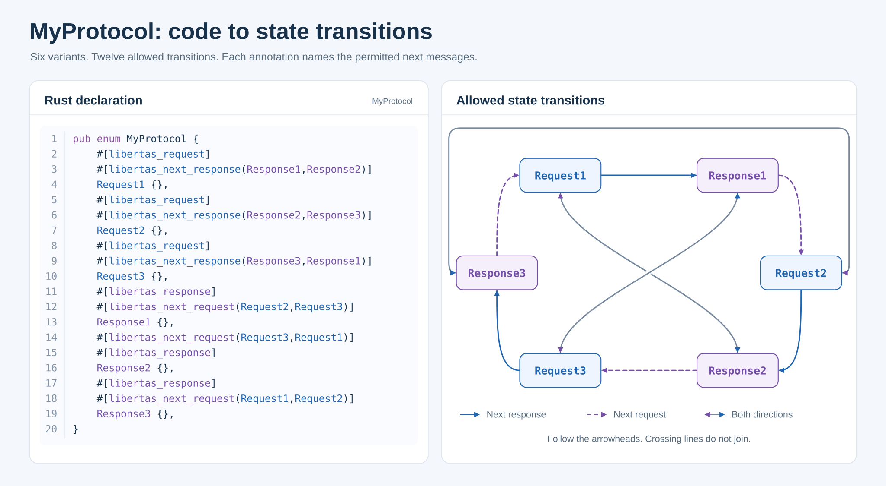

# Endpoint protocols and runtime

This page covers App-visible protocol and lifecycle rules. For exact runtime
function signatures and callback guarantees, read the installed public SDK.
Every declaration must also follow the
[schema documentation invariants](documentation.md).

Unless a block is explicitly labeled a non-copyable schematic, its declarations
are copyable into an App whose package header already has the required natural
label and description. The data-name example includes that package header
because its package-level resource declaration depends on the header.

## Declaring an Endpoint

A server Endpoint is conceptually equivalent to a conventional service endpoint: it is the interface through which an App provides a defined set of capabilities to clients. Its protocol Union declares the requests, responses, and subscription messages that clients can exchange. A client Endpoint binds to a compatible server Endpoint, and Libertas routes those interactions under the applicable access controls.

<!-- rule: endpoint.protocol-union class=hard enforced=yes tasks=endpoint-protocol title="An Endpoint field references a protocol Union; EndpointServer marks the serving side" -->
An Endpoint field references a protocol Union. `EndpointServer` marks the App
as the serving side; absence means client-side use.

```typescript
/**
 * Equipment status settings
 * Describes the equipment and service used to read its current condition.
 */
export interface Configuration {
    /**
     * Monitored equipment
     * The user chooses the equipment whose condition will be reported.
     */
    device: LibertasDevice;

    /**
     * Equipment status service
     * The App provides this service so permitted users can read the selected
     * equipment's current condition.
     * @LibertasEndpointSchema(StatusProtocol)
     * @LibertasEndpointServer
     * @LibertasEndpointBaseObjects("$.device")
     */
    endpoint: LibertasEndpoint;
}
```

```rust
/// Equipment status settings
/// Describes the equipment and service used to read its current condition.
#[derive(LibertasExport, LibertasAvroDecode)]
pub struct Configuration {
    /// Monitored equipment
    /// The user chooses the equipment whose condition will be reported.
    pub device: LibertasDevice,

    /// Equipment status service
    /// The App provides this service so permitted users can read the selected
    /// equipment's current condition.
    #[libertas_endpoint_schema(StatusProtocol)]
    #[libertas_endpoint_server]
    #[libertas_endpoint_base_objects("$.device")]
    pub endpoint: LibertasEndpoint,
}
```

`EndpointBaseObjects` uses comma-delimited Libertas Schema Paths to bind an
endpoint instance to configuration objects.

<!-- rule: endpoint.client-selectors class=hard enforced=no tasks=endpoint-protocol -->
On a client Endpoint, `Default` and `Fixed` take a
`developer-package::function` task-process identity. <!-- rule: endpoint.client-selectors.compatibility-first class=judgment enforced=no tasks=endpoint-protocol --> Every client first filters
server Endpoints by mutual protocol-schema compatibility. `Default` leaves all
compatible choices available. `Fixed` further restricts choices to servers
owned by the named task process and makes its package a mandatory logical App
dependency in finalized `AppDependencies`. Both Endpoint-ID selectors remain
editable because one process can expose multiple eligible server instances. If
the resulting set is empty, either value identifies the process to provision.
Only `Fixed` forces the package into deployed `AppDependencies`; the client
task pre-creation gate below may nevertheless require installation of the
named task process for an absolutely required Endpoint carrying either
attribute. These strings are not Endpoint IDs or schema-type references.

### Required client task-process dependencies

<!-- rule: endpoint.client-prerequisite class=judgment enforced=no tasks=endpoint-protocol -->
An App author models only the source contract: a client Endpoint carrying
`Default` or `Fixed` can become a task-creation prerequisite when that
occurrence and its complete path are non-nullable and every ancestor List
requires at least one item. <!-- rule: endpoint.client-prerequisite.truthful-bounds class=judgment enforced=no tasks=endpoint-protocol --> Keep the real optionality and List bounds truthful;
do not add App code or generated metadata to implement provisioning.

Control clients own the traversal, eligibility, installation, queue, cycle,
refresh, cancellation, and Hub-validation behavior. Its single canonical
definition is the
[task pre-creation dependency check](schema.md#62-task-pre-creation-static-dependency-check).

<!-- rule: endpoint.exclude-ui.server class=hard enforced=yes tasks=endpoint-protocol title="ExcludeUI on a server Endpoint requires a resolved ProtocolSchema" -->
Use the no-argument `@LibertasExcludeUI` or `#[libertas_exclude_ui]` marker on
an Endpoint server carrying a resolved `ProtocolSchema`.

<!-- rule: endpoint.exclude-ui.server-projection.authoring class=hard enforced=no tasks=endpoint-protocol -->
Use ExcludeUI to remove an Endpoint from Control and Hub AI projection; [it does not remove registration, routing or access checks](#required-client-task-process-dependencies).

<!-- /rule -->

<!-- rule: endpoint.exclude-ui.server-projection class=hard enforced=no tasks=client-runtime -->
With the marker, Control UI acts as though that Endpoint does not exist. The Hub Control service omits the
marked server Endpoint from its UI-device list before grouping devices, so it
cannot appear as a root or task child, cannot affect folder cardinality, and
cannot contribute LLM tool definitions. <!-- rule: endpoint.exclude-ui.still-registered class=judgment enforced=no tasks=endpoint-protocol --> The Endpoint remains registered and
available to routing, subscriptions, authorization, and administration. <!-- rule: endpoint.exclude-ui.operation class=hard enforced=yes tasks=endpoint-protocol title="ExcludeUI on an operation requires a Request or SubscriptionRequest reachable from an Endpoint protocol Union" --> The
same marker is valid on a `Request` or `SubscriptionRequest` variant reachable
from an Endpoint protocol Union.

<!-- rule: endpoint.exclude-ui.operation-projection class=hard enforced=no tasks=client-runtime -->
It removes that operation from generated Control UI and Hub LLM tool-definition generation. Admin creation, editing,
approval, persistence, Endpoint compatibility, and dependency/assignment
calculations continue to use the complete schema rather than the user-facing
projection.

<!-- rule: endpoint.exclude-ui.same-protocol-root class=hard enforced=yes tasks=endpoint-protocol title="Server Endpoints that resolve to the same protocol root use the same ExcludeUI value" -->
Runtime bindings identify an Endpoint server by its resolved `ProtocolSchema`.
If more than one server Endpoint resolves to the same protocol root, every one
of those Endpoints must use the same `ExcludeUI` value. Studio rejects mixed
visibility because the runtime binding cannot distinguish those Endpoint
declarations.
The exact projected Control surfaces and unaffected behavior are defined by the
[schema attribute contract](schema.md#45-union-endpoint-and-data-attributes).

```typescript
/**
 * Refresh current status
 * The service refreshes equipment status in the background without offering
 * this activity as a user action.
 * @LibertasRequest
 * @LibertasExcludeUI
 */
export interface InternalRefresh { kind: 0; }

/**
 * Background refresh completed
 * Reports when the background refresh finished.
 * @LibertasResponse
 */
export interface InternalRefreshComplete {
    kind: 1;
    /**
     * Completion time
     * The instant when the background refresh completed.
     */
    completed_at: LibertasDateTime;
}

/**
 * Background status activities
 * Describes automatic status refreshes and their completion.
 */
export type StatusProtocol = InternalRefresh | InternalRefreshComplete;

/**
 * Background status settings
 * Describes the service used to keep equipment status current automatically.
 */
export interface Configuration {
    /**
     * Background status service
     * The App provides this service to refresh equipment status without
     * presenting a separate user choice.
     * @LibertasEndpointSchema(StatusProtocol)
     * @LibertasEndpointServer
     * @LibertasExcludeUI
     */
    internalEndpoint: LibertasEndpoint;
}
```

```rust
/// Background status activities
/// Describes activities that keep equipment status current automatically.
#[derive(LibertasExport, LibertasAvroDecode, LibertasAvroEncode)]
pub enum StatusProtocol {
    /// Refresh current status
    /// The service refreshes equipment status in the background without
    /// offering this activity as a user action.
    #[libertas_request]
    #[libertas_exclude_ui]
    InternalRefresh,

    /// Background refresh completed
    /// Reports when the background refresh finished.
    #[libertas_response]
    InternalRefreshComplete {
        /// Completion time
        /// The instant when the background refresh completed.
        completed_at: LibertasDateTime,
    },
}

/// Background status settings
/// Describes the service used to keep equipment status current automatically.
#[derive(LibertasExport, LibertasAvroDecode)]
pub struct Configuration {
    /// Background status service
    /// The App provides this service to refresh equipment status without
    /// presenting a separate user choice.
    #[libertas_endpoint_schema(StatusProtocol)]
    #[libertas_endpoint_server]
    #[libertas_exclude_ui]
    pub internal_endpoint: LibertasEndpoint,
}
```

## Protocol roles

<!-- /rule -->
Every message-bearing protocol Union variant must have [at least one role](#protocol-conformance):

- `Request`: one-shot request input;
- `Response`: server-to-client correlated result;
- `SubscriptionRequest`: client-to-server stream establishment/renewal; or
- `SubscriptionData`: server-to-client stream data.

<a id="choosing-a-role"></a>

<!-- rule: protocol.choice.list class=judgment enforced=no tasks=app-design,endpoint-protocol,workflow,actions,links,subscriptions,calculation -->
**Choosing the role for a need.** Each need has one role; the linked section
owns its rules. Never substitute one role for another.

- <!-- rule: protocol.choice.one-shot class=judgment enforced=no tasks=endpoint-protocol,workflow --> **Do or find something once:** a `Request` whose `NextResponse` names its
  `Response` replies.
- <!-- rule: protocol.choice.offered-actions class=judgment enforced=no tasks=endpoint-protocol,workflow,actions --> **Further actions the person may choose:** the Response's `NextRequest`;
  offered, opened only by the person or the
  [automatic singleton selection](#default-request-entry-and-dynamic-actions).
- <!-- rule: protocol.choice.strict-question class=judgment enforced=no tasks=endpoint-protocol,workflow --> **Ask the person something now:** a Response declaring `WorkflowRequest`;
  a page the person chooses is an offered client-built request
  ([EditRequest or WorkflowRequest](#strict-questions-and-data-pages)).
- <!-- rule: protocol.choice.edit-existing class=judgment enforced=no tasks=endpoint-protocol,workflow --> **Edit data the service has stored:** `EditRequest`
  ([EditRequest or WorkflowRequest](#strict-questions-and-data-pages)).
- <!-- rule: protocol.choice.previous-page class=judgment enforced=no tasks=workflow --> **Return to an earlier page:** `PrevRequest` on the Request; the service
  decides what follows and the client keeps no history ([previous actions](#submit-previous-actions-and-completion)).
- <!-- rule: protocol.choice.entry class=judgment enforced=no tasks=endpoint-protocol,actions --> **Start the endpoint with one input-free request:** `DefaultRequest`;
  otherwise the default subscription or landing owns entry ([entry](#default-request-entry-and-dynamic-actions)).
- <!-- rule: protocol.choice.live-data class=judgment enforced=no tasks=endpoint-protocol,subscriptions --> **Data that changes while watched:** `SubscriptionRequest` with
  `SubscriptionData`; the first Nil SubscriptionRequest is the default
  ([subscriptions](#default-and-explicit-subscriptions), [compatible data](#compatible-subscriptiondata)).
- <!-- rule: protocol.choice.calculation class=judgment enforced=no tasks=endpoint-protocol,calculation --> **Field values computed while editing:** a calculation Request that each
  changeable input field names in `CalculationRequest`; an
  [invariant input](#invariant-calculation-inputs) needs none ([calculations](#field-calculation-requests)).
- <!-- rule: protocol.choice.link class=judgment enforced=no tasks=endpoint-protocol,links --> **Tapping a row or text invokes a request:** `Link`; a Request offered only
  through links is `LinkOnly` ([links](#links), [link-only](#link-only)).
- <!-- rule: protocol.choice.confirmation class=judgment enforced=no tasks=endpoint-protocol,actions --> **A critical request needs consent:** `RequestConfirmation`; the client
  asks Send or Cancel before a person's choice, a landing or a submission sends
  it ([critical requests](#request-confirmation)).
- <!-- rule: protocol.choice.error class=judgment enforced=no tasks=endpoint-protocol --> **Refusal or failure:** a Response marked `Error`, handled by each client's
  standard error procedure ([error results](#protocol-roles)).

<a id="protocol-role-reuse"></a>
<!-- protocol-role-reuse:start --> <!-- rule: protocol.roles.reuse class=judgment enforced=no tasks=endpoint-protocol -->
A message-bearing Protocol Variant may declare more than one role. Its declared
roles identify its permitted uses; the actual operation and interaction context
determine the applicable behavior. Additional roles do not themselves initiate
operations or combine their effects. Each declaration must satisfy the
constraints applicable to its roles. Operation-selection rules still apply when
choosing which declared use to invoke.

<!-- rule: protocol.roles.operation-variant class=hard enforced=no tasks=endpoint-protocol -->
A correlated Response operation requires a `Response` variant, and subscription
delivery requires a `SubscriptionData` variant. <!-- rule: protocol.edit-request.request-variant class=hard enforced=no tasks=workflow title="An EditRequest variant carries Request; a Request-only variant suffices" --> `EditRequest` is a correlated
server reply carrying a complete `Request` value: its variant must carry
`Request`, and a Request-only variant suffices. EditRequest is an operation,
not an additional schema role, and receiving it does not invoke the request.

<a id="interaction-reference-object"></a>
<a id="interaction-reference-context"></a>

<!-- rule: protocol.context.definition class=judgment enforced=no tasks=endpoint-protocol -->
**Reference context and request construction.** The **current request** is the
value being composed or edited. Workflow and non-workflow requests may need
related server data; a session ID is required only when the App needs one.
A **reference context** is the lookup environment of a request under
construction. It belongs to the received value that the request is built
from: a displayed Response, a delivered EditRequest, or a subscription. Its
contained schema-described values are **reference objects**.

| Context | Reference objects and request construction |
| --- | --- |
| <!-- rule: protocol.context.ordinary-response class=judgment enforced=no tasks=endpoint-protocol --> Ordinary Response | CopyFrom probes the latest non-transition acknowledgement received since the displayed Response was installed, when one exists, then the displayed Response. A transitioning Response replaces both. |
| <!-- rule: protocol.context.edit-request class=judgment enforced=no tasks=endpoint-protocol --> EditRequest | The received complete Request is the reference object. Adopt its data directly without CopyFrom or default initialization. |
| <!-- rule: protocol.context.subscription class=judgment enforced=no tasks=endpoint-protocol --> Subscription | The reply that completed the SubscriptionRequest is the first state of the SubscriptionData snapshot and is not kept as a separate object. CopyFrom probes the most recent successful correlated Response received after it, when one exists, then the current snapshot. Either object may be absent. |

<!-- rule: protocol.context.replacement class=judgment enforced=no tasks=endpoint-protocol -->
Subscription reports, including reduced-type updates, update the SubscriptionData
snapshot without replacing the retained Response. In a subscription, a
successful correlated Response replaces the Response object even when an
acknowledgement leaves the screen unchanged. Over a displayed Response, a
non-transition acknowledgement replaces only the acknowledgement object, and
the displayed Response remains the second object; a transitioning Response
replaces both. In every context, a failure status or Error-marked
Response leaves the reference context unchanged. <!-- rule: protocol.context.separate-objects class=judgment enforced=no tasks=endpoint-protocol --> The two objects of a
context remain separate and are not merged into a synthetic value. The context
of another displayed value, editor, or subscription, and historical responses,
are never searched. With no eligible received data, the
reference context has no objects.

<!-- rule: protocol.copyfrom.reference-context class=hard enforced=no tasks=endpoint-protocol title="CopyFrom on a receiving request copies already-received reference-context data without contacting the server" -->
`CopyFrom` names source paths on a receiving request node. It copies
already-received data from the reference context without contacting the server. <!-- rule: protocol.copyfrom.probe-order class=judgment enforced=no tasks=endpoint-protocol -->
For each mapping, probe objects in context order and paths within each object
in declared order under the [shared copy rules](schema.md#shared-copyfrom-and-copyto-rules).
Copied nodes override initialization; unaffected nodes retain ordinary
initialization, including defaults or undefined. Direct EditRequest adoption
preserves all received values and supplies a new context containing that Request.

For example, a non-workflow update can copy `item_id` and `revision` without a
session ID. In a subscription, a Response may supply the new revision while
another CopyFrom mapping reads a value available only in SubscriptionData. <!-- rule: protocol.context.carry-forward class=judgment enforced=no tasks=endpoint-protocol -->
An App must carry forward required continuation data; missing values are not
recovered from older responses.

<a id="hidden-protocol-context"></a>

<!-- rule: protocol.hidden.context-fields class=judgment enforced=no tasks=endpoint-protocol -->
**Hidden protocol context.** Session identifiers, continuation cookies, record
identifiers/revisions used only for application coordination, and application
data carried only to initialize a later request must be schema-defined `Hidden`
fields in the protocol payload. Apply Hidden to each such field or to its
containing cookie/context field. <!-- rule: protocol.hidden.visible-sources class=judgment enforced=no tasks=endpoint-protocol --> A visible user-facing value may also be a copy
source; do not hide that value merely because another request copies it.

<!-- rule: protocol.hidden.copy-into-requests class=judgment enforced=no tasks=endpoint-protocol -->
- The server supplies required context in the Response, complete EditRequest,
  or SubscriptionData snapshot from which the next action is constructed.
  Declare CopyFrom on receiving request nodes that need those values. Keep
  session/coordination fields Hidden in the request too; a field initialized
  for the user to review or edit remains visible. Hidden on the source is
  presentation metadata, not a command to hide the destination of a value copy. <!-- rule: protocol.hidden.typed-payload class=judgment enforced=no tasks=endpoint-protocol -->
- Hidden data remains typed payload data: it participates in reference reads,
  copying, validation, subscription updates, and encoding. Hiding a field does
  not initialize it or exempt it from completeness checks. Follow the
  [Hidden presentation rule](presentation.md#common-field-metadata). <!-- rule: protocol.hidden.every-construction-path class=judgment enforced=no tasks=endpoint-protocol -->
- Supply required data on every permitted construction path, including initial
  entry, subsequent actions, workflow navigation, and resubscription. A complete
  EditRequest already supplies its hidden values; clients must not initialize
  over them. For copied requests, copied nodes override initialization and
  unaffected nodes follow the shared initialization rules. Never rely on a
  user to fill a hidden missing value or invent a placeholder session ID. <!-- rule: protocol.hidden.continuation-replacement class=judgment enforced=no tasks=endpoint-protocol -->
- Design continuation data against the reference-context replacement rules
  above. Carry it forward when its supplying object is replaced; an ordinary
  success acknowledgement can replace the retained Response of a subscription,
  or the previous acknowledgement over a displayed Response, while the screen
  stays unchanged. SubscriptionData or the displayed Response remains the
  second reference object, but an older Response or acknowledgement is not a
  fallback. Error does not replace either
  object. <!-- rule: protocol.hidden.reduced-reports class=judgment enforced=no tasks=endpoint-protocol --> Reduced reports preserve or update hidden fields under the same
  projection rules as visible fields. <!-- rule: protocol.hidden.first-time-entry class=judgment enforced=no tasks=endpoint-protocol -->
- First-time entry has no prior reference objects. Entry requests must be
  constructible from their own valid inputs and normal initialization; the
  server then supplies any continuation context needed for later actions.
  Handle absent external validation reads under the
  [validation contract](validation-rules.md). <!-- rule: protocol.hidden.no-copy-for-validation class=judgment enforced=no tasks=endpoint-protocol --> Do not copy a value into the
  request solely to validate against it when a reference-context read suffices. <!-- rule: protocol.hidden.not-authorization class=judgment enforced=no tasks=endpoint-protocol -->
- Hidden controls presentation, not confidentiality or authorization. These
  bytes reach the client. The server must validate submitted identifiers,
  revisions, session ownership, and allowed operations; client-side invisibility
  is not evidence of trust. <!-- rule: protocol.hidden.session-id-optional class=judgment enforced=no tasks=endpoint-protocol --> A session identifier is needed only when the App's
  interaction requires one.

For example, a Response may carry a hidden `context` containing `session_id`
and `initial_limit`. A selected Request copies `$.context.session_id` into its
hidden `session_id` and `$.context.initial_limit` into its visible, editable
`daily_limit`. The user sees the limit, while the submitted payload carries both
values. An EditRequest instead supplies both request fields directly. These
are ordinary schema fields and shared CopyFrom paths, not a separate cookie
transport or client-maintained session history.

<!-- rule: protocol.context.validation-reads class=judgment enforced=no tasks=endpoint-protocol -->
`ValidationRules`, `RangeMin`, and `RangeMax` use the same reference context for
external reads, retaining their own path syntax and first-non-null rules.
Current-data reads inspect the request being edited. No matching value or an
empty context yields null, which first-time composition must handle. Reading
neither copies values nor fetches server data.

Calculation CopyFrom names its source in each alternative: root-relative
alternatives read the current request and `&` alternatives read this reference
context, tried in declaration order under the
[calculation contract](#field-calculation-requests). <!-- rule: links.editor.source-order class=hard enforced=no tasks=links --> A [link](#links) declared
in a request editor probes the bound current editor first, then the reference
objects in the interaction context's order. Within each source, it tries the
declared paths in order, using the shared copy availability and valid-null
rules. A valid editor match wins. Parent-relative paths retain the host field's
editor ancestry, and a [return](#link-return) applies to the bound
current-request destination. These logical contexts need not use separate
stored objects: a received EditRequest may be both the current request and its
reference object. PrevRequest construction retains its current-editor source
under the [path context rules](schema.md#context-and-syntax).

<a id="workflowrequest-semi-role"></a>

<!-- rule: workflow.workflow-request.opens-editor class=judgment enforced=no tasks=workflow -->
**WorkflowRequest semi-role.** `WorkflowRequest` specializes `Response` through
a schema attribute. `NextRequest` identifies available next request actions;
`WorkflowRequest` requires the client to construct and open its named request
immediately when the variant is received as a correlated Response. <!-- rule: workflow.workflow-request.declaration class=hard enforced=yes tasks=workflow title="WorkflowRequest is on a Response, names exactly one Request variant of the protocol, and excludes NextRequest and Error" --> Its variant
must carry `Response`, and its attribute value must name exactly one `Request`
variant in the same protocol Union. It cannot coexist with `NextRequest` or
`Error`.

<!-- rule: workflow.workflow-request.awaits-submission class=judgment enforced=no tasks=workflow -->
The client uses the received response under the reference context and request
construction rule above. The response may contain arbitrary valid cookie data or be empty; it is not shown
as an intermediate screen. The resulting editor may be incomplete and awaits
explicit user submission, even for Nil, already complete, or entirely
Fixed/ReadOnly payloads. Normal request visibility and access rules apply; an
unavailable target must not be silently replaced with another request.

<!-- rule: workflow.workflow-request.dual-role class=judgment enforced=no tasks=workflow -->
For example, a variant carrying both `Response` and `SubscriptionData` can use
`WorkflowRequest` to open its named editor on correlated Response delivery.
Subscription delivery of that same variant updates subscribed data without
opening the editor, under the shared role rule above.
<!-- protocol-role-reuse:end -->

<!-- /rule -->
Role-less grouping Unions and single-field Union wrappers organize capabilities
under [endpoint protocol validation](schema.md#61-endpoint-protocol-validation).
Their reachable message-bearing variants carry the roles; the grouping nodes
need not carry a role themselves.

<!-- rule: protocol.error.marker class=hard enforced=yes tasks=endpoint-protocol title="An error result is a Response marked with the no-argument Error marker" -->
An error result is still a `Response`. Mark it with the no-argument
`@LibertasError` or `#[libertas_error]` in addition to its ordinary response
role. The generated `Error=true` marker lets each client select its own
standard error procedure. <!-- rule: protocol.error.no-payload-shape class=judgment enforced=no tasks=endpoint-protocol --> It does not define an error payload shape or change
serialization, routing, transitions, or compatibility.

<!-- rule: protocol.error.out-of-band class=judgment enforced=no tasks=client-runtime -->
An Error-marked correlated Response is out-of-band of the current protocol
state transition.
Android and iOS consume the correlated response but do not install it as the
current response, use it as transaction context, navigate to it, or visualize
it as data or a chart. They preserve the current interaction and current
response data so the user can always retry. The clients inspect the complete
decoded response in deterministic depth-first response order, including hidden
fields, and show its first non-empty renderable `FormattedText` in a persistent
error dialog. When none is renderable, show a localized generalized error in
the same dialog. Server status errors and failures decoding a correlated reply
use this dialog too. Keep the full message readable, allowing scrolling when
needed, until the user explicitly dismisses it. Dismissal does not submit,
navigate, or discard editor values; the user can correct the request or retry. <!-- rule: protocol.error.first-formatted-text class=judgment enforced=no tasks=endpoint-protocol --> Therefore put the most
useful user-facing explanation in the first `FormattedText` field; the payload may
still contain any typed diagnostic or retry context required by App code.

<a id="error-field-path"></a>

<!-- rule: protocol.error-field-path.declaration class=hard enforced=yes tasks=endpoint-protocol title="At most one Nullable String ErrorFieldPath field, and only in an Error-marked Response" -->
An Error-marked Response may optionally declare one Nullable String field with
the no-argument `@LibertasErrorFieldPath` or `#[libertas_error_field_path]`
marker, which emits `ErrorFieldPath=true`. The field is optional: an error
response does not need a locator. At most one field in a response variant may
carry it, and the marker is invalid on any other host or outside an
Error-marked Response.

<!-- rule: protocol.error-field-path.value class=judgment enforced=no tasks=endpoint-protocol -->
Null means the refusal names no field. A non-null value is a square-form
[Libertas Schema Path](schema.md#libertas-schema-path) rooted at the rejected
Request value, the payload of the variant the client sent. For example,
`[incomes/2/box12/0/amount]` selects one amount in nested Lists. It is a
[locator path](schema.md#locator-paths): List members are named by position in
that sent request or, at a keyed List, by a key step such as
`[incomes/="W2-58"/box12/0/amount]`. <!-- rule: protocol.error-field-path.empty-is-null class=judgment enforced=no tasks=endpoint-protocol --> An empty string is treated as null;
Apps should send null instead. <!-- rule: protocol.error-field-path.first-failing class=judgment enforced=no tasks=endpoint-protocol --> A refusal names one field, the first failing
one.

The standard error dialog above is unchanged. After the person dismisses it,
if the path resolves in the still-open originating editor, the client scrolls
to that node and reveals it by opening collapsed or folded ancestors and
summary items, using the ordinary revealed-row behavior. It marks the row
with the error response's first renderable FormattedText, the same explanation
shown in the dialog, until the person edits it. When no FormattedText is
renderable, the mark uses the dialog's localized generalized error text.
The mark belongs to the node the path names, not to the screen showing it, so
it survives every change of view in the same editor: a summary or table row
whose item contains the marked node shows an error indicator on that row; the
item's complete editor or viewer, whether the reveal opened it or the person
opens it later, shows the mark on the field itself; closing and reopening the
item, resizing, or moving between panes keeps it. It clears only when the
person edits the marked field or the editor submits again. <!-- rule: error-field-path.hidden-target-ancestor class=judgment enforced=no tasks=client-runtime -->
A Hidden or ExcludeUI target
marks its nearest visible ancestor row instead. An unresolvable path, or a
closed editor, leaves only the dialog. The locator never navigates elsewhere,
submits a request, or changes a value. <!-- rule: protocol.error-field-path.not-output-only class=judgment enforced=no tasks=endpoint-protocol --> An App must not return a locator that
resolves into an [OutputOnly](#output-only-request-fields) node, a value it
never receives; doing so is an App defect. Clients treat it as no locator and
show only the dialog, and Studio also reports it in its developer diagnostics.

<a id="in-page-reveal-paths"></a>

#### In-page reveal paths

<!-- rule: protocol.reveal-path.declaration class=hard enforced=yes tasks=endpoint-protocol title="At most one Nullable String RevealPath field per type, on a row shown read-only or directly on a Request payload" -->
A type may declare one Nullable String field with the no-argument
`@LibertasRevealPath` or `#[libertas_reveal_path]` marker, which emits
`RevealPath=true`, in two places. A row type that is shown read-only, such as an
item in a ReadOnly list of open issues, declares it as the row's in-page target,
and the row may also declare its ordinary [Link](#links). A Request variant's
payload Table declares it directly as the Request's
[reveal path](#request-reveal-paths), the counterpart of a URL fragment. At most
one field of a type may carry it. The marker is invalid on any other host and on
a row that is not in static ReadOnly placement.

<!-- rule: protocol.reveal-path.value class=judgment enforced=no tasks=endpoint-protocol -->
Null or the empty string names no field. Any other value is a square-form
[Libertas Schema Path](schema.md#libertas-schema-path): a
[locator path](schema.md#locator-paths), formed exactly as an
[error field path](#error-field-path) is. A row's path is rooted at the Request
value of the editor that shows the row; a Request's path is rooted at the value
of the page its reply lands. Prefer key steps at keyed Lists, so the path still
names the same member after the person edits the List.

<!-- rule: protocol.reveal-path.copy class=hard enforced=no tasks=endpoint-protocol,client-runtime title="A RevealPath field takes part in CopyFrom like any String field, as destination and as source" -->
A RevealPath field is an ordinary Nullable String for
[CopyFrom](schema.md#shared-copyfrom-and-copyto-rules): it may receive its value
by `CopyFrom`, and it may be the source of another field's `CopyFrom`. Its
ReadOnly placement does not prevent either. The copied string is used
unchanged; neither copy direction rewrites, re-roots or validates the path.

<!-- rule: protocol.reveal-path.behavior class=hard enforced=no tasks=client-runtime title="A row whose reveal path resolves in its own editor reveals and briefly highlights that field without a request; otherwise its Link runs" -->
Activating the row, when its path resolves in the open editor showing it, reveals
that node with the error-field-path reveal behavior: the client scrolls to it,
opens collapsed or folded ancestors, tabs and summary items, moves focus to it and
briefly highlights the target row with a short platform-standard emphasis that
fades (under reduced motion, only the focus indication). It sends no request,
saves or discards no draft, and leaves pending operations unaffected. When the
path is null or does not resolve, for example because the field is on another
page, the row's Link, if it has one, works as an ordinary Link; with neither,
the row is not actionable. A Hidden or ExcludeUI target never resolves. A row whose path
resolves is presented as an actionable row, and its accessible action names the
target field's label.

<!-- rule: protocol.reveal-path.from-row class=judgment enforced=no tasks=endpoint-protocol -->
A row whose reveal path names a field on another page usually gives its Link
Request's reveal path an ordinary `CopyFrom` of the row's own: the row reveals in
place when its path resolves in the open editor, and otherwise the Link sends
it, so the page it opens lands on the field.

<a id="request-reveal-paths"></a>
#### Request reveal paths

<!-- rule: protocol.reveal-path.request class=hard enforced=no tasks=client-runtime,endpoint-protocol title="A sent Request's RevealPath is remembered by the operation that owns its reply, like a URL fragment" -->
A Request's reveal path names where the page its reply lands opens, as a URL
fragment (`#anchor`) names where a browser scrolls once a page loads: the client
applies it to whatever page lands, without comparing pages. It is an ordinary
field of the Request, so the Hub receives it and may read it. When the client
sends the Request, by Submit, Prev or a [Link](#links), the operation that owns
the reply remembers the field's value; a Request without the field, or with
null or an empty value, remembers none.

<a id="page-landing"></a>

<!-- rule: protocol.reveal-path.landing class=hard enforced=no tasks=client-runtime title="A page that lands opens at the remembered reveal path, else at its own LandingPath, once" -->
A page lands when a reply installs it: a displayed Response, a Response with
NextRequest, an [EditRequest](#workflow-interactions) and a WorkflowRequest,
including a page of the same variant as the one that sent the Request. The
client then reveals one node of that page once, with the
[in-page reveal behavior](#in-page-reveal-paths): it scrolls to the node, opens
collapsed or folded ancestors, tabs and summary items, moves focus to it and
briefly highlights it. The node is the remembered reveal path of the operation
whose reply landed the page, when it resolves in that page; otherwise the
page's own [landing path](#landing-paths), when it resolves; otherwise none, and
the page opens without revealing any node. A Hidden or ExcludeUI target never resolves.

<!-- rule: protocol.reveal-path.no-page class=hard enforced=no tasks=client-runtime title="An acknowledgement, error, calculation reply or subscription update lands no page and reveals nothing" -->
A [non-transition acknowledgement](#protocol-roles), an Error or failure status,
calculation replies and subscription updates land no page: they reveal
nothing, and an Error discards the remembered path, with
[error field path](#error-field-path) behavior unchanged. Later renders,
calculation updates, draft recovery and replies of other operations never
reveal it again.

<a id="landing-paths"></a>
#### Landing paths

<!-- rule: protocol.landing-path.declaration class=hard enforced=yes tasks=endpoint-protocol title="At most one Hidden String LandingPath field directly on a page's value, with no CopyFrom" -->
A page's value type, a Request variant's payload Table or a Response variant's
payload Table, may declare one Hidden String field with the
no-argument `@LibertasLandingPath` or `#[libertas_landing_path]` marker, which
emits `LandingPath=true`, naming the page's initial landing field. On a Request
payload the field may also be [OutputOnly](#output-only-request-fields), so the
Hub never receives it back; without OutputOnly, the client sends the value it
received unchanged. The marker is invalid on any other host, on a field that is
not Hidden, on a second field of the same type, and on a field with `CopyFrom`.

<!-- rule: protocol.landing-path.value class=hard enforced=no tasks=endpoint-protocol,client-runtime title="Only the server sets a LandingPath; empty names no node" -->
A landing path is set only by the server, in the page value it returns; the
client never composes, copies or edits it, so a page the client composes has
none. The empty string names no node. Any other value is a
[locator path](schema.md#locator-paths) rooted at that page's own value,
preferring key steps at keyed Lists. It applies when its page
[lands](#page-landing), after a remembered reveal path that resolves.

<a id="output-only-request-fields"></a>

<!-- rule: protocol.output-only.declaration class=hard enforced=yes tasks=endpoint-protocol title="OutputOnly goes only inside a Request, on a statically ReadOnly node with an empty value" -->
A page is a Request that both the server and the client may prepare, and some
of its nodes only show the server's output. Mark such a node with the
no-argument `@LibertasOutputOnly` or `#[libertas_output_only]` marker, which
emits `OutputOnly=true`, on a field or named type used in a Request variant's
payload, at any depth. Studio rejects it unless every use is inside a Request,
the node is statically ReadOnly (on the field, its effective type, or an
enclosing non-List node), and the node has an empty value: it is Nullable (any
type), or a String, Bytes (including FormattedText) or List. <!-- rule: protocol.output-only.no-size-min class=hard enforced=yes tasks=endpoint-protocol title="An OutputOnly node cannot have SizeMin greater than 0" --> Studio also
rejects `SizeMin` greater than 0 on it, so the empty value is always valid.

<!-- rule: protocol.output-only.no-client-validation class=judgment enforced=no tasks=endpoint-protocol -->
Clients run no client validation on an OutputOnly node or anything inside it,
incremental or final: neither its own constraints (size, Pattern, ranges,
required or undefined) nor the `ValidationRules` hosted on it. Rules hosted
elsewhere that read it evaluate normally, against its displayed value.

<!-- rule: protocol.output-only.sent-empty class=judgment enforced=no tasks=endpoint-protocol -->
Submitting the Request that carries the node sends its empty value, not its
Default: null when it is Nullable, otherwise `""`, empty bytes or `[]`. That is
the only change. Display, EditRequest, CopyTo and Default filling are
unchanged. <!-- rule: protocol.output-only.copyfrom-displayed class=judgment enforced=no tasks=endpoint-protocol --> A Prev action, a link or a calculation request is a different
request built by [CopyFrom](schema.md#shared-copyfrom-and-copyto-rules): a
CopyFrom that reads an OutputOnly node copies its current displayed value under
the ordinary copy rules, and only that request's own OutputOnly nodes, if any,
are sent empty. <!-- rule: protocol.output-only.save-path class=judgment enforced=no tasks=endpoint-protocol --> The App's save path never reads an OutputOnly node, and it
must not name one, or a node inside one, in an
[ErrorFieldPath](#error-field-path): that is an App defect, handled there.

<!-- rule: protocol.ack.optional-transition class=judgment enforced=no tasks=endpoint-protocol -->
Outside a workflow, a normal `Response` is not required to declare
`NextRequest` or `WorkflowRequest`. Omitting both is an intentional non-transition and is common for shared
acknowledgement variants such as `Success` or `Failure`. It does not mean that
every Request in the protocol becomes available. <!-- rule: protocol.ack.keeps-state class=judgment enforced=no tasks=client-runtime --> After correlating and
consuming such a response, a client completes the in-flight attempt but keeps
the existing protocol state, its displayed data, and its next-request choices.
Reference context follows the [current reference context rule](#interaction-reference-context);
the acknowledgement is not installed as the displayed protocol value.
A transient request/wait surface may complete,
but no protocol-data destination is added or replaced. <!-- rule: protocol.ack.refresh-reinstalls class=judgment enforced=no tasks=client-runtime --> The reply to a
master-detail [refresh request](presentation.md#master-detail-panes) is not
such an acknowledgement: it re-installs the leading page it refreshes.

<!-- rule: protocol.ack.transient-result class=judgment enforced=no tasks=client-runtime -->
The absence of a next state identifies an ordinary completed result without a
separate attribute marking a result variant. Present its user-facing result
message transiently while retaining the existing interactive state; do not
replace that state with a data screen offering no further actions. This
state-preservation rule does not suppress the result message. It leaves the
separate initial-entry, workflow-completion, chart-presentation, and live
subscription behavior unchanged.

Apply these response rules under the [shared role rule](#protocol-role-reuse). <!-- rule: protocol.error.regardless-of-next-request class=judgment enforced=no tasks=endpoint-protocol -->
An Error-marked correlated Response uses the separate standard error procedure
above, regardless of `NextRequest`.

```typescript
/**
 * Recording could not continue
 * Explains why the recorder could not save the latest measurement so the user
 * can correct the problem and retry.
 * @LibertasResponse
 * @LibertasError
 */
export interface Failed {
    kind: 1;

    /**
     * Problem explanation
     * Tells the user why the latest measurement could not be saved.
     * @LibertasReadOnly
     * @LibertasFormattedText
     */
    reason: Uint8Array;
}

/**
 * Measurement saved
 * Confirms when the recorder saved the latest measurement.
 * @LibertasResponse
 */
export interface Saved {
    kind: 0;

    /**
     * Saved at
     * Identifies when the recorder saved the latest measurement.
     */
    savedAt: LibertasDateTime;
}

/**
 * Recording activities
 * Describes saving measurements and reporting a problem that prevents the
 * latest measurement from being saved.
 */
export type RecordingActivity = Saved | Failed;
```

```rust
/// Recording activities
/// Describes saving measurements and reporting a problem that prevents the
/// latest measurement from being saved.
#[derive(LibertasExport, LibertasAvroDecode, LibertasAvroEncode)]
pub enum RecordingActivity {
    /// Measurement saved
    /// Confirms when the recorder saved the latest measurement.
    #[libertas_response]
    Saved {
        /// Saved at
        /// Identifies when the recorder saved the latest measurement.
        saved_at: LibertasDateTime,
    },

    /// Recording could not continue
    /// Explains why the recorder could not save the latest measurement so the
    /// user can correct the problem and retry.
    #[libertas_response]
    #[libertas_error]
    Failed {
        /// Problem explanation
        /// Tells the user why the latest measurement could not be saved.
        #[libertas_read_only]
        #[libertas_formatted_text]
        reason: Vec<u8>,
    },
}
```

The following declarations illustrate the [shared role rule](#protocol-role-reuse)
with a Nil `ReadStatus` and a `Status` payload.

```typescript
/**
 * Check equipment status
 * The user asks whether the selected equipment is available now.
 * @LibertasRequest
 * @LibertasSubscriptionRequest
 * @LibertasAccessPrivilege("Read")
 */
export interface ReadStatus {
    kind: 0;
}

/**
 * Current equipment status
 * Reports whether the selected equipment was available when its condition was
 * checked.
 * @LibertasResponse
 * @LibertasSubscriptionData
 */
export interface Status {
    kind: 1;

    /**
     * Equipment is available
     * True means the equipment can currently be reached; false means the
     * equipment is currently unavailable.
     */
    online: boolean;
}

/**
 * Equipment status activities
 * Describes checking the selected equipment and reporting its current
 * availability.
 */
export type StatusProtocol = ReadStatus | Status;
```

```rust
/// Equipment status activities
/// Describes checking the selected equipment and reporting its current
/// availability.
#[derive(Clone, Debug, PartialEq, LibertasExport, LibertasAvroDecode, LibertasAvroEncode)]
pub enum StatusProtocol {
    /// Check equipment status
    /// The user asks whether the selected equipment is available now.
    #[libertas_request]
    #[libertas_subscription_request]
    #[libertas_access_privilege("Read")]
    ReadStatus,

    /// Current equipment status
    /// Reports whether the selected equipment was available when its condition
    /// was checked.
    #[libertas_response]
    #[libertas_subscription_data]
    Status {
        /// Equipment is available
        /// True means the equipment can currently be reached; false means the
        /// equipment is currently unavailable.
        online: bool,
    },
}
```

<!-- /rule -->
TypeScript Unions must have a [stable numeric discriminator](languages/typescript.md#union-types--discriminators) as the first
property. Use a literal or enum member. Use `@LibertasDiscriminator("field")`
only when automatic detection would be ambiguous.

## Request access

<!-- rule: access.privilege.declaration class=hard enforced=yes tasks=endpoint-protocol title="AccessPrivilege on Request or SubscriptionRequest is an alternative-access bitmap: Read=1, Write=2, either=3" -->
`AccessPrivilege` is an alternative-access bitmap on Request and
SubscriptionRequest variants:

| Source value | Schema value | Meaning |
| --- | ---: | --- |
| `Read` | `1` | A user with endpoint read access may invoke it. |
| `Write` | `2` | A user with endpoint write access may invoke it. |
| `Read,Write` | `3` | Either access level may invoke it. |

<!-- rule: access.privilege.default class=judgment enforced=no tasks=endpoint-protocol -->
Omission also means `Read,Write`. A user with administrator privileges grants
a user endpoint read or write access, and the Hub keeps that grant in its
access control list. Libertas cannot infer semantic mutation. <!-- rule: access.privilege.mark-writes class=judgment enforced=no tasks=endpoint-protocol --> The
developer must mark a mutating operation `Write`; otherwise a read-only user is
allowed to issue it. <!-- rule: access.privilege.hub-authoritative class=judgment enforced=no tasks=endpoint-protocol --> Clients may hide a disallowed action, but the Hub remains
authoritative.

<!-- rule: access.privilege.every-invocation class=judgment enforced=no tasks=endpoint-protocol -->
The Hub checks native client requests and AI tool invocations against the
authenticated user's current endpoint read/write grants and the submitted
Request's `AccessPrivilege`. Every applicable Request variant selected in a
nested payload must independently accept at least one of those grants. Listing
an action in an assistant's tool catalog confers no authority: each invocation
is checked again, including after a permission change. A tool offered for a
superseded task deployment cannot invoke its replacement deployment.

<!-- rule: access.privilege.not-permissions class=judgment enforced=no tasks=endpoint-protocol -->
This is unrelated to task-process `Permissions`, which grant access to platform
resources during task configuration.

<a id="ai-tool-calls"></a>

## AI tool calls

<!-- rule: aitool.requests class=hard enforced=no tasks=endpoint-protocol -->
Whatever a person can do with an App through a client, an AI assistant can
do the same way, when the App's developer and the person let it and it is
capable of the task. The developer writes nothing to enable this, and can only
withhold a request: `LLMToolCall` `false` or `ExcludeUI`, below. The person
lets it through the access they grant and the confirmations they give. Every
`Request` variant of an Endpoint protocol is automatically an AI tool: the Hub generates it for each
user, from the same declaration and comments that clients use to draw the
request editor, and only from the server Endpoints that user can reach. <!-- rule: aitool.same-request class=judgment enforced=no tasks=endpoint-protocol --> A tool
call is one more way to send the request; the App receives the same Request
value, in the same encoding, as from a client or another program, and cannot
tell them apart.

The rest of this section describes what the Hub generates, for readers who
need to know; App authors and CodeBots write none of it.

- **Which requests.** Every `Request` variant, unless [`ExcludeUI`](#declaring-an-endpoint)
  removes it or [`LLMToolCall`](schema.md#45-union-endpoint-and-data-attributes) is `false`
  for it. <!-- rule: aitool.subscription-only class=judgment enforced=no tasks=endpoint-protocol --> A `SubscriptionRequest`-only variant is not a tool.
- **Name.** The variant's native name, such as `SaveFilingStatus`. When the
  user already has a tool of that name, the Hub lengthens it with the protocol
  Union's and the function's names, up to 64 characters. <!-- rule: aitool.description class=judgment enforced=no tasks=client-runtime -->
- **Description.** The variant's documentation, with the
  [value-representation hints](presentation.md#ai-tool-call-descriptions),
  then the documentation of each [`NextResponse`](#workflow-interactions)
  variant as what the tool returns. A
  [`RequestConfirmation`](#request-confirmation) request starts it with
  "Requires user confirmation." <!-- rule: aitool.parameters class=judgment enforced=no tasks=client-runtime -->
- **Parameters.** A Table payload's fields are the parameters, each with its
  own documentation. Any other payload is one parameter, `value`; a `Nil`
  payload has none. When the Endpoint is bound to configuration objects by
  [`BaseObjects`](#declaring-an-endpoint), the Hub merges the user's instances
  into one tool and adds one required parameter per bound object, whose
  choices are the objects' names. <!-- rule: aitool.values class=judgment enforced=no tasks=client-runtime -->
- **Values.** Each parameter takes the JSON form of its type, as the hints
  describe. A Union value is an object with exactly one member, named by the
  chosen variant's native name and holding its payload, such as
  `{"MarriedJointly": {"spouse": "Alex"}}`. A Union tag field (`UnionTagField`,
  the TypeScript discriminant) is Hidden: it is never a parameter, and the Hub
  sets it from the chosen variant. `null` is a value only of a Nullable field
  or `Nil`; a tool-call `null` for any other field cannot be encoded, and the
  Hub rejects the call. <!-- rule: aitool.authority class=judgment enforced=no tasks=endpoint-protocol -->
- **Authority and validation.** [Request access](#request-access) is checked on
  every call, and the service validates the request as it validates any other.
  Results are shown as described in [AI tool-call output](presentation.md#ai-tool-call-output).

## Request and response ordering

<!-- rule: ordering.human-task-scope.authoring class=hard enforced=no tasks=endpoint-protocol -->
Rely on platform-owned [human-task ordering](#human-task-interaction); software peers may agree other ordering within the declared protocol roles and access checks.

<!-- /rule -->

<a id="human-task-interaction"></a>

<!-- rule: ordering.human-task-scope class=judgment enforced=no tasks=client-runtime -->
**Scope: human-task interaction.** The ordering, pending-operation, waiting,
and leaving rules of this reference are the embodiment for a person
interacting with a task: a generalized interaction with predefined rules that
every generated client implements uniformly, so that one implementation serves
every App without application-specific code. Software that interacts with a
task, such as another App, a program, or a device integration, is not bound
by them: it may agree with the service on its own rules, for example several
requests in flight or its own time limits, within the endpoint's declared
protocol, its roles, and its access checks.

<!-- rule: ordering.send-order.authoring class=hard enforced=no tasks=endpoint-runtime -->
Handle human-task requests and emit correlated replies in [request send order](#request-and-response-ordering), including calculations, Error and EditRequest replies.

<!-- /rule -->

<!-- rule: ordering.send-order class=judgment enforced=no tasks=client-runtime -->
A Control session is the client's session with the Hub. It carries task
protocol messages and other Hub messages, and the Hub serializes all of its
messages. Within one Control session, the request/response transactions of
task protocols follow the exact order in which their requests were sent. Handle requests and emit and apply
their correlated replies in that order; a later transaction must not overtake
an earlier one. This includes calculation replies, Error responses, and
EditRequest replies. Correlation and stale-operation checks still apply: an
obsolete reply is discarded in its turn, never assigned to a later request.
Timeout, cancellation, and transport failure use the existing operation-lifecycle
rules; a late reply cannot revive a completed or abandoned operation.

The ordering scope is one Control session, not all clients globally. <!-- rule: ordering.subscription-updates-separate class=judgment enforced=no tasks=endpoint-protocol -->
Unsolicited SubscriptionData/DataReport updates are not correlated reply slots;
they retain their own subscription ownership and sequencing rules.

## Field calculation requests

<!-- rule: calc.request.declaration class=hard enforced=yes tasks=calculation title="CalculationRequest is field-only and lists distinct, case-sensitive calculation Request variant names" -->
`@LibertasCalculationRequest("CalculateOrder,CalculateShipping")` and
`#[libertas_calculation_request("CalculateOrder,CalculateShipping")]` declare
which calculations use a field of a protocol Request/SubscriptionRequest as
an input. One field may participate in several calculations and several fields
may participate in one calculation. Names are comma-delimited, case-sensitive,
non-empty, distinct protocol variant native names. The annotation is field-only.
A **calculation Request** is a variant that at least one `CalculationRequest`
names.

<a id="calculation-root"></a>

<!-- rule: calc.root.declaration class=hard enforced=yes tasks=calculation title="CalculationRoot goes on the root node and lists distinct, case-sensitive calculation Request names of each containing request's protocol" -->
**Calculation root.** `@LibertasCalculationRoot("CalculateLine")` and
`#[libertas_calculation_root("CalculateLine")]` go on the root node, the node a
calculation is for, and name the calculation Request variants it roots. Both
emit `{"Name":"CalculationRoot","Value":"CalculateLine"}` on that node. The value
is a comma-delimited list of names under the same rules as `CalculationRequest`:
non-empty, distinct, case-sensitive native names of calculation Requests in the
protocol of each current request that contains the node. The attribute may go on
any field, a record type, a List member type, a Union field or Union type, or
the request's own payload type, which makes the whole request the root. On a
field it marks that field's occurrence; on a type it marks every occurrence of
that type. No root path is written anywhere.

<!-- rule: calc.root.mandatory class=hard enforced=yes tasks=calculation title="Every calculation Request has a CalculationRoot, and a CalculationRoot names only calculation Requests" -->
- **Mandatory.** Studio rejects a calculation Request that no `CalculationRoot`
  names, and a `CalculationRoot` that names anything other than a calculation
  Request. Parsers only extract the attribute. A client runs no calculation
  that has no root, so a deployed App without roots is redeployed. <!-- rule: calc.root.active-requires-root class=hard enforced=yes tasks=calculation title="Each current request with a field participating in a calculation contains at least one root occurrence of it" -->
- **Active calculations.** A calculation is **active** in each current request
  that has a field participating in it, and Studio requires at least one
  occurrence of a root for it there. Each actual occurrence of a node carrying
  a root for a calculation is a **root occurrence** of that calculation. <!-- rule: calc.root.union-one-occurrence class=hard enforced=yes tasks=calculation title="A calculation's root goes on a Union field or on its branch payload, never on both" -->
- **Union roots.** A Union field and its selected branch payload are one editor
  node, so a root on either applies to that one occurrence; Studio rejects the
  same calculation's root on both. A root on a Union field or Union type stays
  the root across branch changes. A root on a branch's payload type exists
  only while that branch is selected. <!-- rule: calc.root.invocation-only class=judgment enforced=no tasks=calculation -->
- **Calculation only.** `CalculationRoot` governs only calculation invocation;
  a [link](#links) to the same variant still binds from its host field or
  tapped node.

<!-- rule: calc.target.ordinary-request class=hard enforced=yes tasks=calculation title="A calculation targets another ordinary Request with a Table payload in the same protocol and NextResponse naming correlated responses" -->
Each target is another ordinary Request with a Table payload in the same
Endpoint protocol Union. Its NextResponse names its correlated Response variants. <!-- rule: calc.target.reply-plain-or-error class=hard enforced=yes tasks=calculation title="A calculation NextResponse names no variant with NextRequest or WorkflowRequest and no Request-only variant; Error is admitted" -->
A calculation reply is plain or an Error: Studio rejects a calculation whose
NextResponse names a variant that declares NextRequest or WorkflowRequest, or
a variant that does not carry Response, such as a Request-only variant, which
only an EditRequest delivers. An Error variant is
admitted whatever it declares, because an Error assigns nothing and navigates
nowhere. <!-- rule: calc.inputs.copyfrom class=hard enforced=yes tasks=calculation title="Every direct calculation input has CopyFrom; root-relative paths read the request, & paths read reference context, first available alternative wins" -->
Every direct input field has CopyFrom relative to the
[calculation root](#calculation-root) under the
[calculation path forms](schema.md#context-and-syntax): `@`, `^` and typed
selectors read the current request from the root occurrence and are never
looked up in a reference object; `&` paths read only the
[interaction reference context](#interaction-reference-context). Comma
alternatives may mix both and are tried in declaration order; the first
available value wins. <!-- rule: calc.inputs.discriminators-and-fixed class=hard enforced=no tasks=calculation title="Native discriminators and Fixed fields need no CopyFrom and are never dependencies" --> Native
discriminators are transport metadata, not calculation inputs. Neither is a
Fixed field: it is filled by ordinary initialization, never by copying editor
data, so it needs no CopyFrom and is never a dependency. <!-- rule: calc.inputs.fixed-current-user class=judgment enforced=no tasks=calculation --> A
`Fixed("current-user")` User field is resolved from the authenticated session
and verified by the Hub on the calculation request under the
[security constraint](schema.md#fixed-current-user-security-constraint) as on
any other request; every other Fixed input takes its declared value. <!-- rule: calc.inputs.only-request-complete class=judgment enforced=no tasks=client-runtime -->
Only the constructed calculation request must be complete and valid to send;
the parent editor may still contain undefined, unencodable fields.

<!-- rule: calc.trigger.nearest-root class=judgment enforced=no tasks=calculation -->
Every copied input is a calculation dependency. Every participating field is
a **trigger**; the root need not be one. A request finds the **nearest root**:
a trigger belongs to the instance rooted at its nearest self-or-ancestor
occurrence that declares a root for that calculation. Roots of one calculation
may nest; the nearest one wins. A change to a trigger re-runs its nearest root's
instance **and** every other instance of that calculation whose bound inputs
read that trigger occurrence, so an outer instance that reads a field inside an
inner root through a whole List stays current. <!-- rule: calc.trigger.rootless class=judgment enforced=no tasks=calculation --> A trigger with no root for its
calculation at or above it re-runs every instance whose bound inputs read it; a
trigger that is an ancestor of root occurrences, such as a List read as a whole,
therefore reaches every root occurrence below it that reads it. A trigger never
creates an instance. When one change schedules several instances of one type,
they join that type's [deferred entry](#changes-resets-and-deferred-calculation)
in array order.

For example, the asset row type of an income record declares
`#[libertas_calculation_root("AssetSourceOptions")]`, and the calculation's
inputs are `@.class`, `@.source` and `^<IncomeRecordItem>.owner`. Editing a
row's `class` re-runs that row's instance, its nearest root. `owner` has no root
at or above it, so a change to it re-runs every asset-row instance of its own
record, whose inputs read that occurrence, and no other record's.

<!-- rule: calc.participation.both-directions class=hard enforced=yes tasks=calculation title="Each trigger is read by its nearest root's instance, or by some instance when no root is at or above it" -->
Studio validates current-request participation in both directions, keyed by
instance. A trigger with a root at or above it must be read by the inputs of its
nearest root's instance. A trigger with no root at or above it must be read by
some instance; Studio rejects a participating field that no instance reads. <!-- /rule -->
Every current-request source field used by CopyFrom participates in the
calculation unless it is an [invariant source](#invariant-calculation-inputs).

<a id="invariant-calculation-inputs"></a>

<!-- /rule -->
**Invariant inputs.** A source that nothing can change while the editor is open
may feed a calculation [without declaring its `CalculationRequest`](#invariant-calculation-inputs):

<!-- rule: calc.invariant.protected-value class=hard enforced=yes tasks=calculation title="An invariant value is Hidden, Fixed or ReadOnly (itself or an enclosing Table or Union) and written by no CopyTo" -->
- a current-request value that is `Hidden`, `Fixed`, or `ReadOnly` on the value
  or an enclosing Table or Union, and that no calculation or [link return](#link-return)
  `CopyTo` writes in that request. Its value then comes only from the editor's
  construction: EditRequest, construction CopyFrom, default initialization, or
  a `Fixed` declaration or session value. <!-- /rule -->
  `ReadOnly` on a List protects its membership and order, not its member
  values, so an undeclared List source also needs its [elements protected](#invariant-calculation-inputs). <!-- rule: calc.invariant.copyto-destinations class=hard enforced=yes tasks=calculation title="A CopyTo destination, including a calculated allowed set and its constrained fields, is never invariant" --> A `CopyTo` destination, including
  a [calculated allowed set](#calculated-allowed-sets) and the fields it
  constrains, is not invariant even when hidden or read-only; <!-- rule: calc.invariant.reference-context class=judgment enforced=no tasks=calculation -->
- a value in the interaction's [reference context](#interaction-reference-context),
  whose reference objects the editor never changes. Only their replacement
  under that rule is an input change, as described under
  [changes](#changes-resets-and-deferred-calculation).

<!-- rule: calc.invariant.never-triggers class=judgment enforced=no tasks=calculation -->
An invariant current-request input never triggers the calculation. Its value is
read when a trigger schedules an instance and resolves from that instance's root
occurrence, so a page-level hidden list is available to a per-row calculation
rooted at the row. Declaring participation on an invariant field is
unnecessary, and only makes it a trigger that never fires. <!-- /rule --> Every other
current-request source, including every user-editable field, [must declare the
calculation](#invariant-calculation-inputs). <!-- rule: calc.inputs.reference-candidates class=hard enforced=no tasks=calculation title="A reference object is a Response or SubscriptionData that offers the current request, or the EditRequest-delivered request itself" --> Reference-object candidates follow the same
[interaction context](#interaction-reference-context): a Request variant is
never a reference object, except the complete request that an EditRequest
delivers, which is the reference object of its own editor, and a Response or
SubscriptionData variant is a candidate only when its own NextRequest or WorkflowRequest actually offers the
current request; Studio does not treat an unrelated variant that merely
resolves the same path as a source. <!-- rule: calc.inputs.whole-container class=judgment enforced=no tasks=calculation --> A containing Table or List may participate as a whole;
changes below it are changes to that input. <!-- rule: calc.inputs.literal-indices class=judgment enforced=no tasks=calculation --> Paths support named fields and
zero-based literal array indices, such as `@.items[0].quantity`. Whole-list copies
remain available. Indices denote positions, never persistent row identities. <!-- rule: calc.inputs.alternatives-resolve class=hard enforced=yes tasks=calculation title="Every required input resolves in each instance, and every declared alternative resolves somewhere" -->
Every required input has at least one alternative that resolves in each
instance, and every declared alternative resolves somewhere: a root-relative
alternative from the root, a `&<Variant>` alternative in that variant, which must
be a reference-object candidate of the current request, and a bare `&`
alternative in some candidate. Input projection follows the [shared CopyFrom rules](schema.md#shared-copyfrom-and-copyto-rules).

### Typed ancestor paths and per-item calculations

Calculation mappings use [Libertas Schema Path](schema.md#libertas-schema-path)
in the root-relative forms of its [context table](schema.md#context-and-syntax):
`@` for the root occurrence and its subtree, parent-relative `^` steps that start
at the root, relaxed and strict typed selectors bound self-or-ancestor from the
root, and `&` for the reference context. That section owns the syntax and
ancestor-resolution rules; the following rules own calculation-instance binding
and lifecycle.

<!-- rule: calc.instance.per-root-occurrence.authoring class=hard enforced=no tasks=calculation -->
Place CalculationRoot at the logical scope: [each occurrence has an independent instance](#typed-ancestor-paths-and-per-item-calculations) whose current-request inputs and CopyTo destinations resolve from that root.

<!-- /rule -->

<!-- rule: calc.instance.per-root-occurrence class=hard enforced=no tasks=client-runtime -->
A **calculation root** is a node that declares `CalculationRoot` naming the
calculation; it belongs to no participating field. Each actual root occurrence
in the current request has **one calculation instance**. There is no instance outside a root occurrence.
Each transaction captures that immutable root occurrence and its ancestor
bindings. Every current-request CopyFrom input and every CopyTo destination
resolves relative to the root occurrence. The binding does not depend on which
trigger fired. Different root occurrences, such as different List items, have
separate instances. A shared ancestor input invalidates every instance that
reads it. Do not coalesce different instances merely because they name the same
variant. Current-request bindings are retained for the entire transaction,
including after a later input change; a deferred execution is a new transaction.
Reference-object inputs retain their distinct logical source under the
[interaction rule](#interaction-reference-context); this does not require a
separate stored object.

<!-- rule: calc.instance.retained-binding class=hard enforced=no tasks=client-runtime -->
Clients retain the bound root and ancestor identities while waiting. Resolve
output paths against the original binding of the root, never the currently
selected row. Removing or replacing the root occurrence, or one of its
ancestors, invalidates its pending work before a reply can write. A positional
mapping which would now address another item is also invalid; never retarget
it. Surviving item-local bindings follow the
[array-removal rule](#array-removal-and-calculation-scope), rather than treating
an index shift alone as changed item data. Rediscover affected current instances
and defer/reschedule still-needed work using the ordinary calculation rules. A
root occurrence that appears while the editor is open acquires its own instance
under the [appearance rule](#changes-resets-and-deferred-calculation). Reset only
the destinations belonging to affected instances. This adds no wire opcode or
persistent row identity requirement.

<!-- rule: calc.union.inapplicable.authoring class=hard enforced=no tasks=calculation -->
Use branch-specific CopyTo destinations knowing a Union-root calculation is [inapplicable when none has a destination](#union-calculation-roots).

<!-- /rule -->

<a id="union-calculation-roots"></a>

<!-- rule: calc.union.branch-alternatives class=judgment enforced=no tasks=calculation -->
**Union roots and inapplicable instances.** With a [Union root](#calculation-root),
inputs read branch fields through CopyFrom alternatives, such as
`"@.Business.limit,@.Farm.limit"`. Only the selected branch resolves, so the
first available value is that branch's value; no reduced Union copy is needed,
and Union identity rules are unchanged. <!-- rule: calc.union.branch-change class=hard enforced=no tasks=client-runtime --> A branch change is an input change to
the same instance, so a pending reply whose retained destinations were in the
deselected branch is [obsolete](#changes-resets-and-deferred-calculation). <!-- rule: calc.union.inapplicable class=judgment enforced=no tasks=client-runtime --> An
instance with at least one output is **inapplicable** while none of its CopyTo
alternatives has a destination in the root occurrence, such as while a branch outside those the
calculation serves is selected. An inapplicable instance sends nothing, shows no
marker and does not hold Submit. Its becoming applicable is an input change.
A calculation whose reply has no output fields is always applicable. <!-- rule: calc.union.one-destination-per-output class=hard enforced=yes tasks=calculation title="Wherever a calculation instance is applicable, every reply output has exactly one destination" -->
In every root occurrence where an instance is applicable, every output must have
exactly one destination; Studio rejects an output that lacks one there. An output
that exists only in some branches belongs to a separate calculation Request rooted
where it applies.

<!-- /rule -->
Studio validates every current request in which the calculation has a
participating field. It validates each `@` path once against the type of each
root node, and each `^` and typed path in every reachable root occurrence,
including reusable record types and nested arrays. It resolves named types and each declared ancestor selector symbolically
under the [Libertas Schema Path rules](schema.md#typed-ancestors-and-bound-occurrences),
then validates suffixes, input coverage, type and nullability compatibility,
money and number semantics, projection, Fixed protection, and direct/indirect
cycles, counting the implicit writers of [calculated allowed sets](#calculated-allowed-sets). <!-- /rule -->
Every CopyTo is `@`-relative and lies in the root's subtree, and [exactly one](#applying-calculation-results) of
its alternatives matches symbolically for each selected-branch shape. <!-- /rule --> A per-row
input that reads its own List as a whole projects away the row's destinations,
or it [forms a cycle](#applying-calculation-results). <!-- rule: calc.copyto.overlapping-writers class=judgment enforced=no tasks=calculation -->
Overlapping writers are permitted (the later applied assignment wins); a
calculation instance writing its own array item and an enclosing whole-list
write may both apply.
Runtime checks still enforce actual values, bounds, and stale-instance ownership.

### Dynamic permissions and calculations

<!-- rule: dynamic.calculation.lifecycle class=hard enforced=no tasks=calculation title="Dynamic reads calculation values and reuses rooted producer lifecycle without invoking requests" -->
[Dynamic schema properties](schema.md#dynamic-schema-properties) read available
data locally. App logic may supply their input values through ordinary rooted
calculations; `Dynamic` itself names or invokes no Request. Its expression binds
to its host occurrence, except List-field Removable binds to each member, even
when the producing calculation has a different root. Existing input participation,
output ownership, deferred execution, stale-response rejection, and submission
gating apply. Dynamic Editable=false never qualifies as an invariant input.

Reevaluate affected properties after committed input changes, calculation
assignments, and reference-context replacement. Apply one calculation result
before exposing newly enabled operations. Retain previous output values, but
withhold a dependent permission while its relevant producer is invalidated,
pending, or failed. Use the existing bound instance lifecycle; unrelated producers
leave unrelated permissions available. An expression with only available local
inputs needs no calculation completion gate.

<!-- rule: dynamic.calculation.no-trigger class=hard enforced=no tasks=calculation title="Dynamic property changes never trigger calculations" -->
Property changes never become calculation inputs or trigger requests.
Calculations remain runnable while a control is unavailable. Authors provide an
entry path through initial values, reference data, or an explicit local condition
when a policy would otherwise depend on input that the same policy prevents
entering. The App's save path remains authoritative.

### Array removal and calculation scope

<!-- rule: calc.removal.item-local class=judgment enforced=no tasks=client-runtime -->
For removal, "outside an item" means outside that item's data subtree, not
later in array order. A calculation is item-local only when its root occurrence
lies in that item and all fields actually copied as inputs lie in that same
item; its CopyTo destinations always lie in the root's subtree. Include
nested fields and the actual projected fields of reduced copies when determining
this scope; the spelling of a path alone does not establish locality.

Removing an item has these effects:

<!-- rule: calc.removal.cancel-removed class=judgment enforced=no tasks=client-runtime -->
- Cancel that item's pending and deferred calculations. A reply cannot recreate
  the item or write into the item which now occupies its former index. <!-- rule: calc.removal.preserve-surviving class=judgment enforced=no tasks=client-runtime -->
- Preserve surviving item-local results and work when their bound nodes and
  copied inputs remain unchanged. Do not reset or recalculate them merely
  because their array indices decreased. A pending typed-ancestor calculation
  may retain its original surviving item binding; a literal positional mapping
  which no longer addresses the original nodes must instead be invalidated. <!-- rule: calc.removal.recalculate-external class=judgment enforced=no tasks=client-runtime -->
- Recalculate instances associated with the changed array which involve fields
  outside the individual item, such as a shared parent/root rate. This applies
  even if that external rate's value did not
  change. Reschedule through the ordered deferred queue's remove-then-append
  rule; outputs keep their values until a result is copied. <!-- rule: calc.removal.recalculate-whole-array class=judgment enforced=no tasks=client-runtime -->
- Recalculate calculations consuming the array as a whole or a reduced array
  projection. Membership is an input change, including removal of the last
  item, even when no surviving element's individual field value changed.

For example, removing one line preserves another line's `quantity × unit_price`
subtotal when both inputs and the subtotal belong solely to that surviving
line. A line calculation which also copies the order's shared `rate` is
recalculated, as is the order total calculated from the array of subtotals.
Calculations belonging to unrelated arrays are not affected by this rule.

### Reduced record and array copies

<!-- rule: calc.projection.destination-type class=judgment enforced=no tasks=calculation -->
Calculation copies use the [shared field projection](schema.md#shared-copyfrom-and-copyto-rules).
The destination type of calculation CopyFrom specifies the projection; no extra
attribute is needed. A calculation input type selects
the fields relevant to the calculation. Unrelated fields can be omitted even when
complete or immutable, including large descriptive name strings that do not
contribute to the result. Omitting these values reduces serialized payload size
and avoids repeatedly transmitting them. A required field remains included
regardless of its size or immutability. <!-- /rule --> Primitive semantic types,
currency, and union branch identities/discriminators [must remain compatible](#applying-calculation-results).
A union-valued field retains its complete union payload type; record projection
does not reduce its branches, authorize conversion, or filter branches.

<!-- rule: calc.projection.construction.authoring class=hard enforced=no tasks=calculation -->
Choose reduced input types deliberately: [only projected fields participate and block calculation](#reduced-record-and-array-copies), while arrays retain every element in order.

<!-- /rule -->

<!-- rule: calc.projection.construction class=judgment enforced=no tasks=client-runtime -->
Construct the destination under the shared initialization rules. A destination
field absent from the source type is unaffected by the copy and retains ordinary
initialization. By contrast, a matching source field whose value is unfinished
remains unfinished in the projection: do not replace it with a default. An
unfinished required projected field blocks the calculation.
Once the required inputs are complete and the constructed request is valid,
unrelated excluded fields do not block sending, whether complete or unfinished.
Valid null is preserved when permitted. Arrays retain
every element in its original order, including incomplete elements; never filter
or compact them. Changes to projected fields and array membership/order are
inputs; excluded fields are not direct triggers.

<!-- rule: calc.projection.reduced-copyto class=judgment enforced=no tasks=calculation -->
CopyTo may apply a reduced record to an existing record, or a reduced array to
an existing array, under that same field projection. An existing destination
field with an unavailable value is not an extra field. Reduced arrays require
the original length and order, use zero-based
positional correspondence, and cannot insert, remove, or reorder elements.
Nested projections follow the same rule. Validate all mapped fields, bounds,
protected destinations, and retained bindings before applying any assignment.
A membership change invalidates a pending whole-array result. This is a merge
into existing data, not permission to create missing parents or replace a union
with an incompatible branch. Full-type assignments retain their existing meaning.

### Applying calculation results

<!-- rule: calc.copyto.every-field class=hard enforced=yes tasks=calculation title="Every direct successful Response payload field has CopyTo; discriminators and Error responses are exempt" -->
`@LibertasCopyTo("@.orderTotal")` and `#[libertas_copy_to("@.orderTotal")]`
on a successful calculation Response payload field assign that field to one
field of the originating editor. Every direct successful response payload field
has CopyTo; discriminators and Error responses are exempt. The source may be a
whole Table or List. <!-- /rule --> In this [calculation context](schema.md#context-and-syntax), every destination is `@`
followed by an optional field/index suffix, including zero-based array indices,
inside the [root](#calculation-root) occurrence's subtree; CopyTo never accepts
`$` or `&`, and `@` alone does not replace the request root. A calculation that
writes a page-level value is rooted at that level. Comma alternatives keep the
shared exactly-one-match rule. <!-- rule: calc.copyto.no-navigation class=judgment enforced=no tasks=client-runtime --> Applying a calculation result does not navigate or replace
any object in the editor's reference context. The [reduced SubscriptionData design
pattern](#reduced-subscriptiondata-design-pattern) uses variant-level CopyTo
lists in a stable subscription context.

<!-- rule: calc.copyto.type-checks class=hard enforced=yes tasks=calculation title="Studio checks mapping types, nullability, numeric semantics and money currency" -->
Studio checks mappings in each current request where the calculation is
active, including reusable types,
field types, nullability, numeric semantics and money currency. <!-- rule: calc.cycle.no-self-trigger class=hard enforced=yes tasks=calculation title="Calculations cannot read fields they write, directly or through other calculations; composite reads include membership and projected descendants" --> **A
calculation may perform any assignment that cannot trigger itself.** Apart
from the protected destinations named below, Studio
rejects only direct and indirect calculation cycles: a calculation that reads,
directly or through other calculations, a field it writes. Reading a Table, a
List, or a reduced projection reads its membership and the descendants its
[projection](#reduced-record-and-array-copies) includes, and only those. Writing a
Table/List also writes its descendants, and writing a ConstrainedBy source
counts as writing every field it constrains, because re-filtering can reset
that field ([calculated allowed sets](#calculated-allowed-sets)). <!-- rule: calc.copyto.overlap-order class=judgment enforced=no tasks=calculation --> Overlapping
destinations are otherwise permitted: distinct calculations, a link return
and a calculation, or assignments within one response may write the same or
nested destinations. Assignments within one response apply in declaration
order; distinct transactions apply in the order their replies are applied
under the [ordering guarantee](#request-and-response-ordering), so the later
assignment wins. The platform guarantees that order and nothing more: the
settled value of a destination that several calculations write follows the
order of the edits that triggered them. Designing calculation requests whose
overlapping results agree is the App developer's responsibility. <!-- rule: calc.copyto.readonly-writable class=judgment enforced=no tasks=calculation -->
ReadOnly prevents user edits, not calculation assignments. <!-- rule: calc.copyto.protected-destinations class=hard enforced=yes tasks=calculation title="Fixed and CacheIdentity destinations, and data containing them, cannot be overwritten" --> Fixed destinations and Fixed descendants
cannot be overwritten (Union discriminators remain transport metadata), nor can
a [CacheIdentity](annotations.md#cacheidentity) field or data containing it,
which stays immutable for the editor's lifetime. <!-- rule: calc.copyto.app-owns-defaults class=judgment enforced=no tasks=calculation --> Applications own meaningful default values and whether
an editable destination is appropriate for an automatically assigned result.

<!-- rule: calc.apply.atomic class=judgment enforced=no tasks=client-runtime -->
The client checks the complete mapping before applying it atomically. A null
result assigns null to a nullable destination. An unavailable union branch,
null parent, or out-of-bounds array destination rejects the complete update;
CopyTo never creates missing parents or extends arrays. A rejected update is a
calculation failure: it is reported, it is not sent again automatically, and
Submit stays disabled until a retry settles under the
[failure rule](#changes-resets-and-deferred-calculation). No unrelated field,
default initialization, or navigation is changed by a successful assignment. <!-- rule: calc.apply.only-successful-copyto class=judgment enforced=no tasks=client-runtime -->
**A calculation changes the editor only through the CopyTo of a successful
result.** An Error response, timeout, transport failure, rejected update or
obsolete reply copies nothing and leaves every output as it was. <!-- rule: calc.apply.ordinary-change class=hard enforced=no tasks=client-runtime --> An assigned
value is an ordinary editor change: the editor re-lays out exactly as for the
same edit by the user, under the [presentation rules](presentation.md#display-template), with no
calculation-specific layout handling. <!-- rule: calc.apply.link-return class=judgment enforced=no tasks=client-runtime -->
A [link return](#link-return) applies these rules to a plain reply to an ordinary
link sent from an editor; it may write a calculation's destinations, and the later
assignment wins.

### Changes, resets, and deferred calculation

<!-- rule: calc.schedule.triggers class=judgment enforced=no tasks=calculation -->
Editor initialization alone does not trigger calculations. EditRequest values
are supplied by the service. Changes to participating inputs, including results
assigned by another calculation or changed reference context inputs, trigger
their calculations. <!-- rule: calc.schedule.root-appears class=judgment enforced=no tasks=client-runtime --> A [root](#calculation-root) occurrence that appears while
the editor is open, an added List member or a selected Union branch whose
payload carries the root, creates its instance and schedules it, also when every
input has a Default; it is sent once its inputs are complete. <!-- rule: calc.schedule.typed-changes class=hard enforced=no tasks=client-runtime --> Changes are measured
as typed editor values, including becoming undefined; formatting alone is not
a new input. Invalid intermediate input still invalidates pending work. <!-- rule: calc.schedule.buffered-edits class=hard enforced=no tasks=client-runtime -->
Native inline editors may buffer text until Done. Buffered changes invalidate
pending replies immediately and defer sending until the local edit finishes.
Submit requires that edit to finish; an independently valid Prev request, when
offered in the current presentation, remains available to discard it. <!-- rule: calc.submit.disabled-while-pending class=judgment enforced=no tasks=client-runtime -->
While any calculation is pending or deferred, Submit is temporarily disabled;
nothing is queued to send later. An output always shows its value, never
placeholder text; only the [`:pending`](presentation.md#display-template) style
state of the node that owns the operation marks the wait. The fields stay editable, and an edit starts a
new calculation round that keeps Submit disabled. Submit becomes active again
when the calculations settle, and then validates and sends its snapshot; a
[RequestConfirmation](#request-confirmation) dialog comes after that
validation, and its Send sends the validated snapshot. A calculation failure
shows its error and keeps the editor open. <!-- rule: calc.submit.app-error class=judgment enforced=no tasks=calculation --> An App Error response does not
block Submit: the save path then rejects the request and marks the field
through ErrorFieldPath. <!-- rule: calc.editor.links-during-pending class=judgment enforced=no tasks=client-runtime --> Links, an offered Prev action, and
exit stay available during calculations: leaving the editor discards the
round and its unfinished values. A link chosen while a calculation is pending
constructs its request from the values as displayed, including a calculated
value whose newer result has not arrived. The
[pane contract](presentation.md#master-detail-panes) still suppresses Prev in
an embedded trailing pane. <!-- rule: calc.blocked.map-to-owner class=hard enforced=no tasks=client-runtime -->
When a required output is still undefined because its calculation has never run, an
input being incomplete or invalid, reconstruct and validate the calculation
request from its current inputs. Preserve the concrete failure's explanation
and map its field or rule-owning group through the input
[projection](schema.md#shared-copyfrom-and-copyto-rules) to the exact original
current-request occurrence, including List positions, field names and the
selected Union branch. Present that owner under the
[validation result contract](validation-rules.md#18-validation-result).
For example, a List inside an income document that violates `SizeMin` shows
the size error on that List, even when the calculation copies the whole
income-documents collection.

<!-- rule: calc.blocked.fallback-marker class=hard enforced=no tasks=client-runtime -->
Only when there is no concrete current-request owner to map, such as an
unavailable copy, a reference-context input, an input without a matching source
field, or a function-wide rule, report the blocked calculation on the trigger
that last scheduled the instance, or on the root occurrence when its appearance
scheduled it, and name the input it needs. Do not infer field blame from a rule
expression. After an accepted edit, recheck the marked input in a freshly
constructed calculation request and clear its marker when that input passes
or its original occurrence is removed or replaced; do not wait for the output
or transfer the marker to another List row or Union branch. A fallback marker
for an undefined required output remains until that output is usable. An
output that holds any value, whether its initial default, an EditRequest value
or an earlier result, is never marked because of its calculation.

<!-- rule: calc.outputs.keep-until-copyto class=judgment enforced=no tasks=client-runtime -->
Changing an input does not reset any output. An output keeps its last value
until the next successful CopyTo. A dependent calculation runs again only when
a CopyTo actually changes one of its inputs; a failed upstream calculation
therefore schedules nothing. Result assignments are atomic editor changes.

<!-- rule: calc.queue.one-in-flight class=judgment enforced=no tasks=client-runtime -->
Clients permit continued editing. **An editor has at most one calculation
request in flight**, whatever its calculation and whatever its instance: two
calculation requests are never in flight together, even when they are of
different types or belong to different List items. Every other scheduled
calculation is deferred. A change that schedules the root occurrence of the
request in flight makes that request **obsolete**: its reply is discarded in its turn
and assigns nothing. Obsolete work is never queued again on its own account;
the change that made it obsolete has scheduled that occurrence by the ordinary
rule below, in the ordinary order. A change that schedules nothing for that
occurrence leaves the request valid and its reply is applied. Array removal
cancels or preserves item-local work under the
[scope rule](#array-removal-and-calculation-scope). <!-- rule: calc.queue.ordered-entries class=judgment enforced=no tasks=client-runtime -->
Deferred calculations form one ordered queue for the editor, with **at most
one entry per calculation type**, a type being one calculation Request
variant. The queue orders the types. An entry records the root occurrences of
its type that await evaluation, such as the List items whose inputs changed;
array items of one type share that type's entry. Whenever a change schedules a
calculation, add its root occurrence to the entry of its type, creating the entry
when absent, and move that entry to the tail. Do not retain its old queue
position or append a duplicate. For example, with the types queued as
`[A, B, C]`, a change that schedules B produces `[A, C, B]`; one that
schedules A next produces `[C, B, A]`. When one change schedules several
types together, their entries move to the tail in the order in which the
changed field's `CalculationRequest` lists them: a field declaring `"A,B"`
leaves A ahead of B. When one atomic editor change alters several fields,
such as the assignments of one reply, the fields are taken in assignment
order and each field's types in its listed order.

<!-- rule: calc.queue.dispatch-order class=hard enforced=no tasks=client-runtime -->
The in-flight transaction keeps its immutable root occurrence and ancestor
bindings. A new change
queues a deferred execution; it cannot rewrite the transaction already sent,
and it cannot be sent before that transaction's reply has arrived.
Only after the in-flight transaction completes, with its result applied, its
failure reported, or its obsolete reply discarded, is the queue head
reevaluated and, when still valid, sent. Dispatch deferred work from the queue
head in order, one at a time, never by schema declaration order or response
completion speed, and never past a head that cannot be sent yet. Replies are
therefore applied in the order of the queue, which is the order in which
[overlapping assignments](#applying-calculation-results) take effect.
Calculation transactions also obey the
[request/response ordering guarantee](#request-and-response-ordering).

<!-- rule: calc.queue.rebuild-at-dispatch class=hard enforced=no tasks=client-runtime -->
A deferred entry represents work to reevaluate, not a previously encoded
request. At dispatch, take the awaiting occurrences of the head entry in array
order. Reconstruct each from the current input contexts and check validity.
If it is invalid or its root occurrence no longer exists, drop that occurrence
without sending; a relevant later input change can schedule valid work again.
Otherwise send it, one request at a time. The entry leaves the queue when its
last occurrence has been sent or dropped; an entry whose every occurrence was
dropped sends nothing. Result assignments which
trigger calculations use the same remove-and-append rule after dependency
propagation. Scheduling never changes the bindings of an in-flight transaction.

<!-- rule: calc.failure.no-auto-retry class=judgment enforced=no tasks=client-runtime -->
A failed calculation, whether a timeout, a transport failure, or a
[rejected update](#applying-calculation-results), changes no output and is not sent again
automatically: the next edit or Submit runs it again. That Submit sends
nothing; Submit stays disabled until the retry settles and is then pressed
again. Obsolete errors do
not report against a newer edit. Leaving or replacing the editor abandons its
pending/deferred calculations; late replies cannot reopen it or update array
positions that have changed ownership.

<!-- rule: calc.submit.own-snapshot class=judgment enforced=no tasks=client-runtime -->
Submit and Prev send their own validated, immutable snapshots and own their
navigation. Calculation replies cannot mutate a submitted snapshot. If the
operation fails and the editor remains, reevaluate unfinished calculations.
No partially filled parent request is transmitted. <!-- rule: calc.app-owns-business-rules class=judgment enforced=no tasks=calculation --> Applications remain
responsible for backend business rules and meaningful defaults; Studio proves
structural declarations, while clients validate actual runtime values.

### Reusing a variant for reading and editing

<!-- rule: protocol.reuse.read-and-edit class=judgment enforced=no tasks=endpoint-protocol -->
A variant may carry both `Request` and `Response`. Add `NextRequest` naming that
variant to offer editing after receiving it, and `CopyFrom("$")` on the request
payload to initialize the complete editor from the
[current reference context](#interaction-reference-context). `NextResponse` may name the same variant for the server's updated
result. Root copying copies nested values into an independent editing value;
changing the editor does not mutate the received response.

<!-- rule: protocol.reuse.cycle class=judgment enforced=no tasks=endpoint-protocol -->
This supports a receive, edit, submit, and receive cycle using the same data
shape. It does not automatically turn response display into an inline editor.
The existing [protocol navigation rules](endpoint-presentation.md#protocol-transaction-stack)
control presentation under the [shared role rule](#protocol-role-reuse). The
[shared copy rules](schema.md#shared-copyfrom-and-copyto-rules) determine
initialization when no reference context is available.

## Workflow interactions

<!-- rule: workflow.mix-state-machine class=judgment enforced=no tasks=workflow -->
This is the unreleased workflow interaction contract. A protocol Union may mix
state-machine interactions, whose stable screen is a response or subscription
report, and workflows, whose stable screen is a request editor. The service
selects every resulting transition. There is no separate machine-type marker.

### Valid data and editor state

<!-- rule: workflow.valid-data class=judgment enforced=no tasks=workflow -->
Every transmitted value must be structurally valid for its Avro schema. An
editor can also contain an undefined field: it has neither a valid value nor
an encoded null. A required undefined field prevents submission. A validation
rule that reads an undefined value is aborted and reports a missing answer
([validation rules](validation-rules.md)); undefined never changes the wire
schema or makes the field nullable. <!-- rule: workflow.no-partial-requests class=judgment enforced=no tasks=workflow --> No partially filled request is transmitted
for initialization or backend draft persistence. The
[CacheIdentity contract](annotations.md#cacheidentity) defines opt-in local
recovery of committed field values on large workflow pages, independently of
backend persistence. Uncommitted control text is discarded on exit. Without
CacheIdentity, all unfinished page edits are discarded and the application
resumes from its own saved, valid data.


<a id="strict-questions-and-data-pages"></a>

<!-- rule: workflow.entry.undefined-not-encoded class=judgment enforced=no tasks=app-design,workflow,endpoint-protocol -->
**EditRequest or WorkflowRequest.** A node is
[undefined until it is initialized](schema.md#undefined-and-its-sources), and
undefined cannot be encoded, so no message carries an unanswered field. An
editor opened by either one carries the platform's two workflow buttons, **Go
Back** (when the Request declares `PrevRequest`) and **Next/Submit**, whose
captions a Display Template may customize through
[`button_labels`](presentation.md#button-labels); the App adds no buttons of its
own for them ([submit and previous actions](#submit-previous-actions-and-completion)).
What the page needs decides how it opens:

- <!-- rule: workflow.edit-request.why class=judgment enforced=no tasks=app-design,workflow,endpoint-protocol --> **Nothing would start undefined: EditRequest.** It carries a Request the
  service has stored, or an unsaved page's value equal to its ordinary
  initialization; the client adopts it as it is. Its Nullables are true
  optionals whose null is a real answer with the meaning its `NullText` names,
  such as "None" or "Does not apply".
- <!-- rule: workflow.client-built.why class=judgment enforced=no tasks=app-design,workflow,endpoint-protocol --> **Fields left undefined and the person chooses the page: a client-built
  request.** The client constructs it from an offered action: a `NextRequest`
  action, a link (available while its target is in that action set), or a
  landing request. Like a WorkflowRequest editor, it commonly copies known facts
  by `CopyFrom` from the displayed Response, and every field nothing initializes
  stays undefined. An offered request opens only when the person chooses it, or
  by the [automatic singleton selection](#response-action-constraints). Who opens
  the page, not copying, separates it from WorkflowRequest.
- <!-- rule: workflow.workflow-request.why class=judgment enforced=no tasks=app-design,workflow,endpoint-protocol --> **Fields left undefined and the service opens the page at once:
  WorkflowRequest**, with or without copied facts, and only then. The service
  sends a Response; the client constructs the named Request, copies any known
  facts by `CopyFrom`, and leaves the rest undefined. An
  unanswered source path is absent, never null: CopyFrom stops at a valid null,
  which a non-Nullable field cannot take.
- <!-- rule: workflow.strict-question.required class=hard enforced=no tasks=app-design,workflow,data-model --> **A must-answer question** is a required field with no `Default` on a
  request the client constructs (an offered action, link or landing request,
  or a `WorkflowRequest` editor): it starts unanswered, shows no error, and blocks
  submission. Never model it as a `Nullable` whose `NullText` means "not
  answered yet", and never send it in an EditRequest.

### Entering and continuing a workflow

<!-- rule: workflow.leading-page-row class=judgment enforced=no tasks=workflow -->
A resolved editing Request can identify its leading-page row through an [enum/protocol association](schema.md#enumeration-protocol-associations), including direct entry; see [master-detail panes](presentation.md#master-detail-panes).

The server has two ways to open the next editor:

<!-- rule: workflow.edit-request.complete-value class=hard enforced=no tasks=workflow -->
- **EditRequest:** a server-to-client opcode carrying one complete, structurally
  valid Request variant from the Endpoint protocol Union. It is a correlated
  reply to the pending request that owns the next transition, for example
  Start, Submit, Prev, Resume, an action, or a link, and completes that
  operation under the [shared role rule](#protocol-role-reuse). The client uses
  the supplied value directly, without running CopyFrom or default
  initialization over it.
- **WorkflowRequest:** applies the [Response semi-role](#workflowrequest-semi-role).
  `@LibertasWorkflowRequest("EditProfile")`
  and `#[libertas_workflow_request("EditProfile")]` emit
  `WorkflowRequest=EditProfile`.

<!-- rule: workflow.edit-request.awaits-submission class=judgment enforced=no tasks=workflow -->
EditRequest also awaits explicit user submission, including Nil, already complete,
or entirely Fixed/ReadOnly values; it must not automatically resubmit them.
Its reference context follows the [current reference context rule](#interaction-reference-context). <!-- rule: workflow.edit-request.replaces-editor class=judgment enforced=no tasks=workflow -->
EditRequest replaces the active editor even when the returned variant
is the same variant as the previous step; variant identity is not step identity.

<!-- rule: workflow.delivered-editor-access class=judgment enforced=no tasks=workflow -->
When a delivered editor, whether the target of a WorkflowRequest or the variant
of an EditRequest, is beyond the user's [AccessPrivilege](#request-access), the
client refuses the reply by the error procedure and keeps the originating
surface, its reference context, and its draft. `ExcludeUI` and
[`LinkOnly`](#link-only) govern what a client offers, not what the service
delivers: a delivered editor that carries either is installed.

<!-- rule: workflow.next-response.kinds class=hard enforced=yes tasks=workflow title="NextResponse on a Request or SubscriptionRequest lists Response, SubscriptionData or Request variants" -->
On Request/SubscriptionRequest variants, NextResponse may list Response,
SubscriptionData, or Request variants. On SubscriptionData it instead declares
[directional compatible updates](#compatible-subscriptiondata). Permitted
delivery follows the [shared role rule](#protocol-role-reuse). <!-- rule: workflow.next-response.reply-membership class=judgment enforced=no tasks=workflow -->
When NextResponse is declared,
a successful transition reply must be one of its named variants. Error responses
and standardized failure statuses use the shared error/retry path and do not
need to appear in this navigation list. These declarations constrain the
possible replies; the client never selects the service's reply for it. <!-- rule: workflow.reply-refusal class=judgment enforced=no tasks=client-runtime -->
A reply that the client refuses before it takes effect is handled as a
failure: the client reports the refusal by the error procedure, and the
originating surface, its reference context, its actions, and its draft stay.
The client refuses a correlated reply that cannot be decoded, whose variant the
request's NextResponse does not admit, or whose variant carries only
SubscriptionData; an EditRequest value that is not a valid value of its Request
variant; a delivered editor beyond the user's access, as above; a
[link return](#link-return) that cannot be applied; and a reply whose
[allowed-action list](#response-action-constraints) is malformed.

### Submit, previous actions, and completion

<!-- rule: workflow.submit.button class=judgment enforced=no tasks=client-runtime -->
The workflow's **Next/Submit** button validates and sends the current request.
It is not a chooser for the state machine's NextRequest actions. <!-- rule: workflow.submit.captions class=judgment enforced=no tasks=workflow -->
These are control roles: a page's Display Template may supply localized
[button captions](presentation.md#button-labels) without changing their
behavior, eligibility, or request names inside a chooser.

<!-- rule: workflow.prev.declaration class=hard enforced=yes tasks=workflow title="PrevRequest goes on a Request variant and names distinct Request variants of the same protocol" -->
`@LibertasPrevRequest("ReopenProfile,ReopenAddress")` and
`#[libertas_prev_request("ReopenProfile,ReopenAddress")]` belong on a Request
variant and emit `PrevRequest` containing one or more distinct Request variant
native names in the same protocol Union. <!-- rule: workflow.prev.order class=judgment enforced=no tasks=workflow --> Their declared order is presentation
order. With one eligible target, Back selects it directly; with several, Back
opens a chooser using their ordinary localized names. This is the workflow's
in-app **Go Back** action, distinct from screen-navigation and system Back.
With none, there is no workflow Back action.

<!-- rule: workflow.prev.master-detail-suppressed class=judgment enforced=no tasks=workflow -->
While the editor is embedded in a master-detail trailing pane, clients
suppress all workflow Back controls, including the chooser and shortcuts,
under the [pane contract](presentation.md#master-detail-panes). The pane offers
Close and Next; the leading pane owns navigation for the two-panel arrangement,
and the App must make that navigation complete. <!-- rule: workflow.prev.composer-none class=judgment enforced=no tasks=client-runtime -->
A [transient request composer](endpoint-presentation.md#protocol-transaction-stack)
likewise never offers a workflow Back control: it was opened above a displayed
page by the person's own choice, and its Cancel already closes it while idle.
The declaration remains available for ordinary full-page workflow presentation.
Suppression depends on the editor's actual placement, never on inferred
equivalence between requests.

<!-- rule: workflow.go-to-composer class=judgment enforced=no tasks=workflow -->
A request whose purpose is to choose where to go, such as a section chooser
offered as a "Go to" action, belongs in a composer above the page it leaves.
There is no reason to deliver it as a workflow editor through WorkflowRequest
or EditRequest: such a page would exist only to be left, and the service
already opens the chosen destination as the reply to the composed request.

<!-- rule: workflow.prev.not-history class=judgment enforced=no tasks=workflow -->
`PrevRequest` names this action declaration, not a stored previous request or
reference context. Its declared target list is not dynamically filtered by
`ConstrainedBy`.

<!-- rule: workflow.prev.construction class=judgment enforced=no tasks=workflow -->
Each selected Back action constructs an ordinary request using the
[shared CopyFrom rules](schema.md#shared-copyfrom-and-copyto-rules). Its reference
object is the current editor's selected payload, independently of
the unfinished editor's validity. <!-- rule: workflow.cookie.app-owned class=judgment enforced=no tasks=workflow --> A hidden application-defined cookie can
identify any of several concurrent workflows. Cookie design and historical selection belong to the application. Accepting
a historical edit must follow the [saved-page consistency rule](#saved-page-consistency-after-historical-edits). Studio validates declarations and statically decidable mapping
rules; it does not prove that cookie fields are initialized on every path. <!-- rule: workflow.prev.complete-or-not-sent class=judgment enforced=no tasks=client-runtime -->
The client refuses to encode or send an incomplete or invalid previous action.
Only the newly constructed action request is encoded; the current draft is not.

<!-- rule: workflow.back.abandonment class=judgment enforced=no tasks=workflow -->
Back expresses abandonment of the current edit. The backend decides what to
return, including a complete historical request through EditRequest. The client
does not navigate through cached historical requests. Construct and validate
the action before sending it; a rejected selection or failed attempt follows
the ordinary error/retry procedure. There is no server-side undo implied by
discarding the current edit.

<!-- rule: workflow.completion.terminal class=judgment enforced=no tasks=workflow -->
For a workflow Submit or Prev operation, a non-error response without
WorkflowRequest ends the editor and is presented as the resulting stable
response. NextRequest, if present, offers its declared state-machine actions.
With no NextRequest, the response is a valid terminal screen, for example a
FormattedText congratulations message. The state-machine acknowledgement rule
for ordinary requests outside a workflow remains unchanged.

<!-- rule: workflow.native-back.no-prev.authoring class=hard enforced=no tasks=workflow -->
Design server entry and resumption for [local Back or Close without PrevRequest](#submit-previous-actions-and-completion); leaving cannot undo an already received submission.

<!-- /rule -->

<!-- rule: workflow.native-back.no-prev class=judgment enforced=no tasks=client-runtime -->
Only the explicit workflow Prev and Next/Submit buttons have workflow semantics.
Native Back, dismissal, or leaving the interaction sends no previous action.
Local draft retention follows [CacheIdentity](annotations.md#cacheidentity);
Control endpoint navigation follows
[the landing rule](#control-endpoint-landing-and-native-back). Closing a field picker or nested
editor returns to the same parent editor. Cancelling an action chooser changes
neither data nor workflow state.

### Saved-page consistency after historical edits

Later pages can depend on earlier accepted answers, so a workflow service keeps
its stored pages consistent with one another when an earlier page changes.

<!-- rule: workflow.saved-pages.compare class=judgment enforced=no tasks=workflow -->
Compare the submitted page answers with the saved answers before changing any
stored page. Ignore transport cookies, navigation metadata, and
presentation-only values in this comparison. An unchanged Next is
review/navigation: preserve all saved pages and completion state. Opening,
canceling, or rejecting an edit also preserves saved history.

<!-- rule: workflow.saved-pages.reconcile class=judgment enforced=no tasks=workflow -->
When the backend accepts a changed page, it **must**, for each stored page that
the changed answers affect, do one of the following: recompute and revalidate
that page's data against the revised answers and save the consistent result;
erase that page's data; or keep the page's answers and mark the page
unanswered, so that it is asked again, with those answers, before the workflow
can complete. This is a mandatory application rule, not an optional client
navigation policy. <!-- rule: workflow.saved-pages.atomic class=judgment enforced=no tasks=workflow --> Do not erase before validation or leave a partially updated
state visible. No page remains answered for resume, calculation, or completion
merely because it was valid before the change; derived results, cookies,
allowed-choice sets, and saved progress must agree with the revised answers as
well.

<!-- rule: workflow.saved-pages.before-continuing class=judgment enforced=no tasks=workflow -->
Complete this reconciliation before continuing or resuming the workflow. Resume
and EditRequest use only the consistent stored state; retries, concurrent
editors, and late submissions must not restore data from before the change.
The backend owns persistence and consistency; the client and Studio cannot
infer application dependencies or repair saved pages.

<!-- rule: workflow.saved-pages.opening-changes-nothing class=judgment enforced=no tasks=workflow -->
Opening a historical editor does not itself change anything. An abandoned or
rejected draft changes no saved history; the rule applies when the backend
accepts and saves the change. For example, changing a saved filing status from
joint to single erases the spouse data that no page of a single filer owns, and
asks again each affected page whose stored answers no longer validate, before
the interview can complete.

### Validation context and progress

<!-- rule: workflow.validation-context class=judgment enforced=no tasks=workflow -->
Editable requests use the [shared path contract](schema.md#context-and-syntax).
Supported references use the [current reference context](#interaction-reference-context),
including on inherited types and hidden fields. CopyFrom remains separate
initialization metadata with its defined invocation source. EditRequest context
follows that same owner; it does not retain an older response in its place.

<!-- rule: workflow.progress.formatted-text class=judgment enforced=no tasks=workflow -->
Progress is an ordinary FormattedText field following the
[static read-only placement and request-value contract](presentation.md#static-read-only-placement-and-request-values).
For example, the service can supply it in EditRequest or response data copied
into a WorkflowRequest editor. There is no progress opcode, percentage schema,
fixed step count, or client inference from previous-action lists or history.

### Operation ownership

<!-- rule: ops.one-pending-transition class=judgment enforced=no tasks=client-runtime -->
EditRequest uses the same correlation, status envelope, transport failures,
and error/retry procedures as an ordinary reply. Allow only one pending Submit,
Prev, or [link](#links) transition per editor; while one is pending, the others
are blocked. Until its reply arrives, the editor accepts no edit, link,
document import, or second transition, so a link return never arrives after
the user edited its destination. A displayed value likewise has at most one
pending operation: a second action or link is blocked until the reply. Each
[stacked page](#links) retains its own operation and subscription owners;
releasing it drops later replies and updates without affecting another page.
A duplicate or late reply cannot replace an
editor after its operation was consumed, its editor superseded, or the
interaction exited. Subscription updates and auxiliary calculation responses
keep their own owners and cannot perform workflow navigation or overwrite a
replacement editor. <!-- rule: ops.no-retraction class=judgment enforced=no tasks=endpoint-protocol --> Leaving the UI cannot retract a submission already received
by the backend. Persistence, retry idempotency, and resume selection belong to
the application; the client never serializes an incomplete draft to supply them.

<a id="waiting-presentation"></a>

**Waiting presentation.**

<!-- rule: waiting.surface.operation-owner class=hard enforced=no tasks=client-runtime -->
Mobile Control uses one shared blocking progress presentation per client, with
screen and panel scopes. Waiting follows the operation that owns the surface,
never a count of in-flight messages.

- <!-- rule: waiting.screen.shared-progress class=hard enforced=no tasks=client-runtime --> **Screen progress** covers connection and required device/schema loading,
  endpoint landing preparation, and an ordinary committed protocol Request
  awaiting its correlated reply. Required Matter schema is settled before
  rendering a returned Matter device.
- **Panel progress** is reserved for a link Request awaiting its correlated
  reply, within the panel that owns that linked interaction. Opening a linked
  Request for editing is interactive composition, not waiting, and shows no
  waiting spinner. Its origin retains transition ownership to prevent a
  duplicate action, independently of progress presentation.
- <!-- rule: waiting.cancel.unsubmitted-only class=hard enforced=no tasks=client-runtime --> After commitment, the entire covered screen or panel is disabled: fields,
  links, Commit/Next, and draft Cancel/Close. Cancel discards an unsubmitted
  draft; it must not be offered as cancellation of an already submitted
  Request. Endpoint exit retains the [leaving rule](#exit-while-pending).
- <!-- rule: waiting.reply.ignore-unrelated-traffic class=hard enforced=no tasks=client-runtime --> Only the owning reply or a terminal operation/connection failure settles the
  wait. Duplicate, stale, subscription and calculation traffic cannot clear it
  or navigate a replacement surface.
- Auxiliary calculations are normal operation. Pending or deferred calculations
  alone show neither screen nor panel progress. They retain field-level
  pending presentation and [submission gating](#field-calculation-requests).

<a id="exit-while-pending"></a>

<!-- rule: exit.pending-never-abandoned class=judgment enforced=no tasks=client-runtime -->
**Leaving while an operation is pending.** For
[human-task interaction](#human-task-interaction), protocol interaction is strictly
ordered and proceeds request by request: every Request has its correlated
reply, and only SubscriptionData arrives outside that order. A pending Request
is therefore never abandoned on its own. A surface whose operation awaits its
reply cannot be dismissed by itself: not a transient composer, and not an
editor with a sent Submit, Prev, or link. For a person, every sent Request
waits for its reply: a client offers no control that gives up one pending
Request and stays in the endpoint. On a waiting surface, native Back or
explicit endpoint exit leaves the endpoint; it never returns to the surface beneath, to a landing, or to another
pane. Draft Cancel and panel Close are disabled under the
[waiting presentation rule](#waiting-presentation).

<!-- rule: exit.leaving-and-session-loss class=judgment enforced=no tasks=client-runtime -->
Leaving an endpoint is part of normal interaction. A person may leave at any
time, whether or not a reply is outstanding, and a task with several endpoints
follows the same rule as a task with one. The Control session continues
unless its transport breaks or times out. Every connection is a new
connection: when the session is lost, the data of every endpoint in it is
cleared, including surfaces, reference contexts, snapshots, and pending
operations and calculations, and after reconnecting an endpoint starts again
from its entry request when the person opens it again. In mobile Control, connection loss returns
to the task's endpoint list when that root remains a list. If the task root
automatically enters a landing, including a task with one endpoint, the client
exits the task to its parent Control screen. Reconnection does not reopen that
task or endpoint; a retained endpoint list may reload its inline default
subscriptions. Every attempt to open a task or an endpoint from its task root
first checks that task's Hub connection. If it is unavailable, the client
reports an error and stays on the current screen. An endpoint protocol Error
preserves the current screen and displays the error. Leaving abandons the endpoint's
surfaces with their pending operations and calculations and queues the
release of its explicit subscriptions; a reply that arrives afterwards is
discarded, and nothing the backend already received is retracted. Entering
the endpoint again repeats its
[entry](#default-request-entry-and-dynamic-actions) request, and
[CacheIdentity](annotations.md#cacheidentity) governs any draft recovery. <!-- rule: exit.app-admits-entry class=judgment enforced=no tasks=endpoint-protocol -->
Keeping the exchange consistent for a person across leaving and entering
again is the App developer's responsibility: the service admits the entry
request in every state in which the endpoint can be left.

<!-- rule: exit.waiting-initiator class=judgment enforced=no tasks=endpoint-protocol -->
**Waiting is the initiator's decision.** The protocol defines no timeout. The
initiator of a Request decides how long to wait for its reply: a program or an
AI participant applies its own limit, and a person dismisses when they choose
to. Giving up is leaving the endpoint as above; it never produces a reply of
its own and never moves the exchange to another state. A client that initiates
auxiliary requests itself, such as field calculations or a document
transformation, is their initiator and may bound them; an expired auxiliary
request is a failed one and changes no data.

## Chaining, caching, and copied values

<!-- rule: protocol.names.native class=hard enforced=yes tasks=endpoint-protocol title="NextRequest, NextResponse and CopyFrom variant references use native variant names" -->
Use variant native names, not type aliases or localized labels:

| TypeScript | Rust | Meaning |
| --- | --- | --- |
| `@LibertasNextRequest("A,B")` | `#[libertas_next_request("A,B")]` | Allowed next client variants. |
| `@LibertasNextResponse("A,B")` | `#[libertas_next_response("A,B")]` | Allowed replies on requests; directional compatible updates on SubscriptionData. |
| `@LibertasCopyFrom("$.value,$.legacy.value")` | `#[libertas_copy_from("$.value,$.legacy.value")]` | Populate request data using the [shared copy rules](schema.md#shared-copyfrom-and-copyto-rules) and [reference context](schema.md#context-and-syntax). |

<!-- rule: protocol.next-request.non-empty class=hard enforced=yes tasks=endpoint-protocol title="NextRequest is optional on a Response; when present it is non-empty" -->
`NextRequest` is optional on a Response. When present, its value must be
non-empty and names the choices installed with that response. <!-- rule: protocol.next-request.absence-not-all class=judgment enforced=no tasks=endpoint-protocol --> With neither
NextRequest nor WorkflowRequest outside a workflow, the response is the
non-transition acknowledgement defined under
[Protocol roles](#protocol-roles); absence is never expanded to every Request
in the protocol Union.

The following non-copyable schematic uses a compact Rust enum to illustrate
the transition annotations. Each Request names two possible Responses, and
each Response names two allowed next Requests.

[](../assets/diagrams/my-protocol-state-transitions.svg)

*Each state appears once. Double-headed links allow both directions;
crossing lines do not join.*
[Open the full-size SVG](../assets/diagrams/my-protocol-state-transitions.svg)
or [download the PNG](../assets/diagrams/my-protocol-state-transitions-six-states.png).

The [shared copy rules](schema.md#shared-copyfrom-and-copyto-rules) define path
selection, initialization, and field projection. The [context table](schema.md#context-and-syntax)
identifies the reference context for each operation, including workflow Back and
calculation construction. <!-- rule: protocol.copyfrom.editor-keeps-context class=judgment enforced=no tasks=endpoint-protocol --> Copying from the current editor does not replace the
interaction's [reference context](#interaction-reference-context).

## Protocol conformance

### Protocols describe capabilities

A protocol is a declaration of capabilities: the operations and message payloads
that a participant can send, receive, or support. Client/server matching
establishes which of those capabilities correspond and whether mandatory
requirements are satisfied. Serialization then carries a value for the matched
capability. Protocol translation should be understood in that order, not as
arbitrary substitution of bytes or conversion of unrelated data structures.

<!-- rule: conformance.prefix-capability class=judgment enforced=no tasks=endpoint-protocol -->
A protocol path prefix identifies a payload capability through its enclosing
protocol Union variants. It is not a path to every field inside that payload.
Once the capability is selected, ordinary serialization/deserialization handles
the payload under its compatible schema. Capability correspondence and encoding
are separate concerns; finding a matching prefix does not make incompatible
payload definitions compatible.

<a id="capability-prefixes"></a>

### Capability prefixes across nesting depths

<!-- rule: conformance.prefix.role-less-variants class=hard enforced=yes tasks=endpoint-protocol title="A role-less prefix variant is a Union or holds exactly one Union field; a role-less cycle is invalid" -->
A capability may sit at a different Union depth in each peer. Its prefix is the
chain of protocol variants from the protocol root to the variant that carries a
role; that variant is the capability, and a Union inside its payload is ordinary
payload data, not a further capability. A variant without a role extends the
prefix when it is itself a Union or holds exactly one field whose type is a
Union; a chain of such variants that returns to itself without a role is
invalid. Matching follows a partial prefix while a supported complete path
remains possible, and an unsupported path is rejected.

<!-- rule: conformance.unique-correspondence class=hard enforced=yes tasks=endpoint-protocol title="Each endpoint protocol exposes a capability identity at most once; duplicates reject the match" -->
Correspondence must be unique. A capability's identity is the materialized
Union that owns it together with the role-bearing variant of that Union, so
aliases and enclosing wrappers do not change it. Each endpoint protocol exposes
at most one occurrence of an identity: duplicate occurrences, such as
Primary / OnOff and Backup / OnOff exposing the same OnOff identity, reject the
match before connection, even when their enclosing paths differ. The matcher
never chooses the first occurrence. Distinct identities that share a short name
are not duplicates, and conformance is evaluated in the corresponding
capability context, not by requiring identical outer grouping.

Every prefix element without a role is a Union, or a record whose only field is
a Union, so its Avro encoding is that Union's discriminator alone. A message is
therefore its prefix's discriminators followed by the capability's payload. The
client task host builds a translation plan in both directions, using the server
schema as the wire representation. It translates a message by reading the
sender's discriminators up to the capability, writing the receiver's
discriminators for the corresponding capability, and copying the payload bytes
unchanged. For example, client Manual / OnOff / SetState corresponds to server
OnOff / SetState: the client's three discriminators become the server's two,
and the Boolean payload passes through.

<!-- rule: conformance.server-discriminants class=judgment enforced=no tasks=endpoint-protocol -->
Integers in a payload that name protocol choices, a response's
[allowed-action list](#response-action-constraints) and
[named action-control](#named-action-controls) lists, always name
discriminants of the server schema, the wire representation. The translator
copies them unchanged with the payload, and a client App reads them against
the server's schema, never its own arrangement.

### Required and optional capabilities

<!-- rule: conformance.versionless-union class=judgment enforced=no tasks=endpoint-protocol -->
Protocol declaration and optional runtime support solve different problems.
The protocol Union itself has one versionless, lifetime-invariant name. New App
versions append new protocol payload variants to that same Union; they do not
replace it with a `V2` Union. The complete evolution contract is in the
[App data-type design guidelines](data-type-evolution.md).

<!-- rule: conformance.protocol-conformance class=hard enforced=no tasks=endpoint-protocol title="ProtocolConformance on a protocol Union is evaluated against the peer; both sides must pass" -->
`ProtocolConformance` may be declared on a protocol Union on either client or
server. During task configuration, the client expression is evaluated against
the server declaration and the server expression is evaluated against the
client declaration; both must pass. Operators are:

- `&` AND;
- `|` OR;
- `!` NOT; and
- `^` XOR.

<!-- rule: conformance.default-all-mandatory class=judgment enforced=no tasks=endpoint-protocol -->
Without an expression, every direct variant in that Union context is mandatory.

<!-- rule: conformance.pass-through-payloads class=judgment enforced=no tasks=endpoint-protocol -->
Matching variants must also have pass-through-compatible payloads. Libertas
translates only the [capability prefix](#capability-prefixes); inside a
payload, positional fields and overlapping nested Union slots must remain
aligned, and nested optional variants may only extend the tail of a smaller
Union. Payload bytes are not decoded by the translator; the receiving
server or client App decoder validates them against its own schema.

<!-- rule: protocol.examples.complete-authored-declarations class=hard enforced=no tasks=endpoint-protocol -->
The following focused snippets are non-copyable schematics: the referenced
variants and their required natural-language documentation are omitted so the
placement of `ProtocolConformance` remains visible. A generated App must use the
complete declaration style shown in the preceding role example.

```typescript
/**
 * Equipment status activities
 * Describes checking current equipment, changing its target, and reporting its
 * current condition.
 * @LibertasProtocolConformance("ReadStatus & Status")
 */
export type StatusProtocol = ReadStatus | SetTarget | Status;
```

```rust
/// Equipment status activities
/// Describes checking current equipment, changing its target, and reporting its
/// current condition.
#[derive(LibertasExport, LibertasAvroDecode, LibertasAvroEncode)]
#[libertas_protocol_conformance("ReadStatus & Status")]
pub enum StatusProtocol {
    // Fully documented variants are omitted from this non-copyable schematic.
}
```

<!-- /rule -->
If a direct variant's payload is itself a Union, the conformance attribute may
be placed on that variant. That [nested expression](schema.md#61-endpoint-protocol-validation) becomes the variant's
evaluation. Libertas cannot infer that an arbitrary Union is protocol-related,
so append-only protocol policy is a publishing/tooling contract rather than a
universal Union validator.

<!-- rule: conformance.optional-runtime-check class=judgment enforced=no tasks=endpoint-runtime -->
Configuration matching proves only mandatory compatibility. The server does
not know the client's complete declaration. A client that wants to use an
optional server payload must check the configured server's runtime variant
index before sending the request. In Rust use `VariantIndex` and
`variant_index!`; a nested optional payload may require a chain of variant-index
checks.

<!-- rule: protocol.no-caching-attribute class=judgment enforced=no tasks=endpoint-protocol -->
No attribute enables protocol Request/Response or subscription-payload caching.
`CacheIdentity` concerns local editor drafts only.

## Compatible SubscriptionData

<!-- rule: sub.compatible.declaration class=hard enforced=yes tasks=subscriptions title="A SubscriptionData NextResponse names compatible SubscriptionData variants of the same protocol; compatibility is directional" -->
A SubscriptionData variant A may declare `NextResponse(B,C)` naming other
SubscriptionData variants in the same protocol. A and these named variants form
A's **Compatible SubscriptionData** group. Compatibility is directional: B and C
may update an existing A working value; this declaration does not authorize A
updates to B, B updates to C, or transitive membership.

<!-- rule: sub.compatible.table-payloads class=hard enforced=yes tasks=subscriptions title="Every compatible group member has a non-null Table payload" -->
Every member must have a non-null Table (struct) payload. <!-- rule: sub.compatible.name-merge class=judgment enforced=no tasks=subscriptions --> On an incoming compatible
SubscriptionData report, retain A as the working type and screen, including its
presentation attributes and NextRequest actions. A report with explicit CopyTo
uses the [reduced subscription design pattern](#reduced-subscriptiondata-design-pattern).
For the name-matched form without CopyTo, match fields by exact native
name at the struct root. Replace each matching field's complete value; do not
recursively patch nested records or merge array elements. Preserve fields present
only in A and ignore fields present only in the incoming report. <!-- rule: sub.compatible.null-and-hidden class=judgment enforced=no tasks=subscriptions --> Valid null is a
value and clears a matching nullable field; undefined is never transmitted.
Hidden fields participate in this merge like visible fields.

<!-- rule: sub.compatible.atomic-merge.authoring class=hard enforced=no tasks=subscriptions -->
Ensure compatible updates preserve the [complete working value’s constraints and meaning](#compatible-subscriptiondata).

<!-- /rule -->

<!-- rule: sub.compatible.studio-checks class=hard enforced=yes tasks=subscriptions title="Studio checks the declaration, Table payloads and matching-field assignability" -->
Studio validates the declaration, Table payloads, and assignability of matching
fields, including numeric/semantic types, nullability, and nested shapes. <!-- rule: sub.compatible.atomic-merge class=judgment enforced=no tasks=client-runtime --> Clients
prepare and validate the complete merged value before publishing it atomically;
an invalid update leaves the working value unchanged. The App must ensure that
its updates preserve the complete working value's constraints and meaning.

<!-- rule: sub.compatible.every-live-screen class=judgment enforced=no tasks=client-runtime -->
Every incoming SubscriptionData report is offered to every live screen for its
source Hub, including covered screens. Each independently decides whether it
needs the report. Acceptance or rejection by one screen never stops traversal.
Compatibility changes data application, never ownership: Hub, task, endpoint,
schema context, subscription lifetime, and stale-message checks still apply.
A current A may accept its explicitly named compatible reports even when the
original SubscriptionRequest names only A. <!-- rule: sub.compatible.initial-snapshot-first class=hard enforced=no tasks=client-runtime title="Initial data satisfies the SubscriptionRequest NextResponse; a compatible report before it is discarded" --> Before any working value exists,
initial data must satisfy the SubscriptionRequest's NextResponse. If it names A,
B arriving before A is discarded, never deferred or replayed after A arrives.
Process reports in arrival order; schema-loading buffers cannot reorder them. Ordinary
non-compatible reports retain existing acceptance and replacement semantics. <!-- rule: sub.compatible.reference-context class=judgment enforced=no tasks=subscriptions -->
For actions originating from that subscription screen, the merged A supplies
the SubscriptionData object in the [reference context](#interaction-reference-context),
which also retains the latest successful correlated Response received in that
subscription. A report does not replace the Response object or the context of
another subscription or displayed value. A compatible update does not
navigate, submit a request, or execute the incoming variant's actions.
Its delivery scope follows the [shared role rule](#protocol-role-reuse).

<!-- rule: sub.compatible.app-choice class=judgment enforced=no tasks=subscriptions -->
Sending compatible reports is entirely the App's choice and responsibility.
Declaring compatibility never instructs the Hub or clients to generate, request,
or synthesize such reports. Apps may continue sending complete snapshots only. <!-- rule: sub.compatible.complete-initial-snapshot class=judgment enforced=no tasks=subscriptions -->
Every SubscriptionRequest, including a repeated default subscription, must return
the current complete initial snapshot. The App owns snapshot/update ordering and
must not rely on a new subscriber having seen earlier reports.

### SubscriptionData array append

#### Relationship to compatible SubscriptionData

This extends the [compatible SubscriptionData contract](#compatible-subscriptiondata).
Existing directional acceptance, all-live-screen delivery, ownership, ordering,
initial snapshot, and atomic publication rules continue to apply. <!-- rule: sub.append.no-delivery-permission class=judgment enforced=no tasks=subscriptions --> AppendTo does
not grant permission to deliver a report to a screen. A compatible append report
arriving before its required initial snapshot is discarded, never replayed later.

#### Attribute declarations

<!-- rule: sub.append.declaration class=hard enforced=yes tasks=subscriptions title="AppendTo is declared on an incoming SubscriptionData root array field" -->
- `AppendTo("Entries.entries")` is declared on an incoming SubscriptionData's
  root array field. <!-- /rule --> <!-- rule: subscription.append.destination-root-array class=hard enforced=no tasks=subscriptions --> Its value is exactly one `Variant.field` destination, using
  native names in the same protocol. The named variant is a working
  SubscriptionData that admits this report through NextResponse. Its named
  field must be a root array. Nested paths and per-item targets are out of scope. <!-- rule: sub.append.index class=hard enforced=yes tasks=subscriptions title="AppendIndex is declared on the AppendTo array field and requires AppendTo" -->
- Optional `AppendIndex("$.start_index")` is declared on that same array field
  and requires AppendTo. <!-- /rule --> Its root-field Libertas Schema Path references one
  field in the incoming report. <!-- rule: sub.append.index-length class=hard enforced=no tasks=subscriptions --> That field must be a non-nullable integer Number, carrying the expected
  destination length before the append. Its value must be non-negative. <!-- rule: sub.append.index-hidden class=judgment enforced=no tasks=subscriptions -->
  The index field should be Hidden; visibility has no effect on validation. <!-- rule: sub.append.non-nullable-arrays class=hard enforced=yes tasks=subscriptions title="Append source and destination arrays are non-nullable, with assignable element types" -->
- Both source and destination arrays must be non-nullable. Elements may be
  nullable where assignment to the destination element type permits it.
  Element types must satisfy the existing compatible-field assignability rules.

Use `@LibertasAppendTo("Entries.entries")` and optional
`@LibertasAppendIndex("$.start_index")` on the incoming array in TypeScript.
Rust uses `#[libertas_append_to("Entries.entries")]` and optional
`#[libertas_append_index("$.start_index")]` on that field. The index is an
ordinary integer, not a date, duration, money amount, enumeration index, or
bitmask.

Schematic schema notation:

```text
Entries: Response, SubscriptionData, NextResponse("MoreEntries")
    entries: Array<Entry>
    cursor: String

MoreEntries: SubscriptionData
    added_entries: Array<Entry>
        AppendTo("Entries.entries")
        AppendIndex("$.start_index")
    start_index: Integer, Hidden
    cursor: String
```

#### Applying a report

1. Qualify the report for the current working SubscriptionData using its existing
   directional compatibility and ownership checks. <!-- rule: sub.append.apply-index-check class=judgment enforced=no tasks=client-runtime -->
2. For each append targeting that working variant, compare the optional index
   against the destination array's exact current length, before applying any
   changes from the report. A zero-based append position of zero therefore
   requires an empty destination. Perform this check even for an empty append.
3. Append the incoming elements in their supplied order. An empty array changes
   no elements; duplicates are retained. Without AppendIndex, append without
   the position check.
4. Exclude AppendIndex control fields from copied data. Without variant-level
   CopyTo, apply ordinary compatible root-field replacement to other unannotated
   fields; with CopyTo, apply its typed reduced projection. <!-- rule: sub.append.no-name-replacement class=judgment enforced=no tasks=client-runtime -->
   A field carrying AppendTo never also participates in name-based replacement,
   even if its name matches a destination field. If its AppendTo names another
   working variant, ignore that field for this screen; do not fall back to
   ordinary replacement.
5. Validate the complete resulting working value, then publish the report's
   changes atomically. Retain the working type, screen, and actions.

<!-- rule: sub.append.mismatch-rejects class=judgment enforced=no tasks=client-runtime -->
A negative or mismatched index rejects the entire report, preserves the original
working value, and reports a protocol error. Never pad, truncate, overwrite,
adjust an index, partially apply other fields, or infer automatic recovery.
Other assignment or resulting-value validation failures also reject the entire
report. A full snapshot continues to replace its arrays normally.

#### Studio validation and App responsibilities

<!-- rule: sub.append.conflicting-writers class=hard enforced=yes tasks=subscriptions title="Studio rejects two appends to one root array, or an append and a replacement or CopyTo write to it, in one report" -->
Studio validates attribute placement, destination and index references, array
and element types, and index integer type. For each possible working variant,
reject conflicting writers: two appends to the same root array, or an append
and an ordinary replacement or CopyTo write to that array within one report.
Actual index values and current array lengths are runtime checks.

<!-- rule: sub.append.app-owns-ordering class=judgment enforced=no tasks=subscriptions -->
The App owns ordering, duplicate-report prevention, retention, and complete
initial snapshots for new subscriptions. If one append report serves multiple
working screens, the App must ensure each intended recipient has the required
array prefix. Under the ordered-delivery contract, an index mismatch exposes a
breach of that expected append sequence. Matching lengths do not prove equal
contents; AppendIndex is a position-consistency check, not a content checksum.

#### Combined copy and append

<!-- rule: sub.append.combined-copy.authoring class=hard enforced=no tasks=subscriptions -->
Combine CopyTo with AppendTo only with unique copy destinations, excluding append and index control fields from the [ordinary copy projection](#combined-copy-and-append).

<!-- /rule -->

<!-- rule: sub.append.combined-copy class=hard enforced=no tasks=client-runtime title="A report combining CopyTo with AppendTo resolves exactly one CopyTo destination per recipient, without append fields" -->
A report may combine variant-level CopyTo with AppendTo. Each admitted recipient
must still resolve exactly one CopyTo destination; multiple matches are an App
design flaw even when append destinations are unambiguous. Exclude AppendTo
fields and their AppendIndex control fields from that projection. Its remaining
fields follow the typed reduced-copy rules. Resolve all destinations and check
indices before applying the report to one candidate working value. Any copy,
append, index, or resulting-value failure rejects the whole recipient update.

<!-- rule: sub.append.actual-projection-conflicts class=judgment enforced=no tasks=client-runtime -->
Compute conflicting writes from the actual projection, including descendants
replaced by complete values. Selecting a Table does not itself write omitted
fields retained there. <!-- /rule --> Two appends, or an append and a copied write, must not
modify the same array or its contents. Appended elements must be [complete values](#subscriptiondata-array-append),
not reduced projections of existing elements.

#### Live chart use

<!-- rule: sub.chart.append-extends class=hard enforced=no tasks=client-runtime -->
Append reports can supply live chart data. A chart
starts with its complete subscription snapshot; accepted atomic appends extend
the chart-bearing working array and refresh its presentation. Optional
AppendIndex checks the expected sample count. Rejection leaves data unchanged. <!-- rule: sub.chart.app-responsibilities class=judgment enforced=no tasks=subscriptions -->
Ordering, retention, and fresh-subscriber snapshots remain App responsibilities. <!-- rule: sub.chart.complete-initial-snapshots class=hard enforced=no tasks=subscriptions -->
Sending only new elements and update metadata reduces update-message size
compared with retransmitting the complete accumulated array; initial snapshots
remain complete. This is a use of the shared SubscriptionData mechanism, not a separate chart
patch format or an automatic scrolling requirement.

### Reduced SubscriptionData design pattern

<!-- rule: sub.reduced.optional class=judgment enforced=no tasks=subscriptions -->
**Reduced SubscriptionData** is an optional design pattern an App can adopt
using Libertas subscriptions, `NextResponse`, `CopyTo`, and typed copying. It
introduces no new protocol message role or schema attribute. An App may instead
publish complete snapshots for every update.

<!-- rule: sub.reduced.stable-next-response class=hard enforced=yes tasks=subscriptions title="Each stable variant NextResponse names the reduced variants it accepts" -->
An App adopting this pattern maintains a complete stable SubscriptionData value.
Each stable Protocol Variant declares `NextResponse` naming the reduced Protocol
Variants it accepts. <!-- rule: sub.reduced.copyto class=hard enforced=no tasks=subscriptions title="Each reduced variant declares CopyTo with one or more stable-value paths" --> Each reduced Protocol Variant declares `CopyTo` with one
or more comma-delimited Libertas Schema Paths identifying the stable values or
subtrees it updates.

<!-- rule: sub.reduced.native-name-vocabulary class=judgment enforced=no tasks=subscriptions -->
The pattern also reuses source-code field identifiers as a shared semantic
vocabulary. An App can give a Native Name one consistent documented meaning
across full state, partial requests, and reduced reports. Compatible types and
explicit paths establish valid field correspondence and select the intended
occurrences; the same identifier can appear in several structures. The App
authors these semantic relationships. See [static and runtime validation](schema.md#9-static-and-runtime-validation)
for the shared checks on declarations and the separate validation of values.

#### Acceptance and destination are separate

<!-- rule: sub.reduced.acceptance-separate class=hard enforced=no tasks=subscriptions title="CopyTo grants no delivery; a reduced report needs the subscription checks and the stable variant acceptance" -->
The SubscriptionRequest's `NextResponse` selects its complete initial snapshot.
The stable SubscriptionData's `NextResponse` admits later reduced reports.
The reduced SubscriptionData's `CopyTo` specifies where its payload is copied.
CopyTo does not grant delivery permission or infer an acceptance relationship.
A reduced report must satisfy both the existing subscription/ownership checks
and the stable variant's explicit acceptance declaration.

<!-- /rule -->
CopyTo is one positional string containing a [non-empty path list](schema.md#shared-copyfrom-and-copyto-rules). For example:

```text
ZoneState: Response, SubscriptionData, NextResponse(NoWaterPeriodsChanged)
ZoneSettings: Response, SubscriptionData, NextResponse(NoWaterPeriodsChanged)
NoWaterPeriodsChanged: SubscriptionData
    CopyTo("^<ZoneState>,^<ZoneSettings>")
```

The example is schematic. <!-- rule: sub.reduced.same-protocol class=hard enforced=yes tasks=subscriptions title="Reduced and stable variants belong to the same protocol" --> The named Protocol Variants belong to the same
protocol; their complete Table definitions and user documentation are required
in an App. A path may instead descend explicitly from the stable variant, such
as `^<ZoneState.schedule>`, when the reduced payload targets that subtree. <!-- /rule -->
Use [strict variant-rooted paths](schema.md#context-and-syntax) to identify the entire destination occurrence;
intermediate schema nodes must not be skipped.

#### Per-destination resolution and typed copying

<!-- rule: sub.reduced.per-recipient class=judgment enforced=no tasks=subscriptions -->
Resolve CopyTo against each eligible **stable working value** under the
[shared mapping and destination-uniqueness rules](schema.md#shared-copyfrom-and-copyto-rules).
One publication may reach both a ZoneState screen and a ZoneSettings screen;
each independently resolves one destination while retaining its type and actions.
Each recipient retains its own Endpoint, schema, subscription identity/parameters,
and lifetime. There is no global atomic transaction across different recipients.

<!-- /rule -->
Schema compilation checks each declared report/destination pair: the stable
variant admits the report, every path names an unambiguous reachable destination,
and [source-to-destination type copying](schema.md#shared-copyfrom-and-copyto-rules) is valid. No match does not authorize
name-based fallback.

<!-- rule: sub.reduced.whole-array-replace class=hard enforced=no tasks=subscriptions -->
A field carrying a complete array with the destination's element type replaces
that whole array, including removals and an empty array. This differs from a
reduced-element array projection, which retains the correspondence required by
its copy contract. CopyTo does not imply AppendTo, insertion, or arbitrary
recursive JSON patch semantics.

<!-- rule: sub.reduced.atomic-update class=hard enforced=no tasks=client-runtime -->
Prepare and validate the complete resulting working value before publishing
any assignments. An invalid applicable path, stale binding, incompatible value,
or violation of schema-expressible value constraints rejects that working
value's update atomically.
Unrelated fields, the stable Protocol Variant, presentation, and actions remain
unchanged. The reduced Protocol Variant carries CopyTo for its whole payload;
the selected destination type determines the checked field projection.

#### Snapshot, mutation, and publication consistency

<!-- rule: sub.snapshot.fresh-each-subscription class=hard enforced=no tasks=subscriptions -->
Every SubscriptionRequest, including repeated subscription and resubscription,
receives a fresh complete current stable snapshot. A reduced report arriving
before its required baseline is discarded, not saved for later replay. <!-- rule: sub.snapshot.capture-no-loss class=judgment enforced=no tasks=subscriptions --> Snapshot
capture and the transition to subsequent reports must not lose a committed
change or reorder publication. Renew the baseline through a subscription request
when the object, filter, or subscription context changes.

<!-- rule: sub.partial-update.acknowledgement class=judgment enforced=no tasks=subscriptions -->
A partial-update Request changes authoritative App state after validation and
recomputes affected derived values. Its correlated Response acknowledges that
request; subscription publication is a separate operation. Use an ordinary
non-transition success acknowledgement when the working screen should remain,
and Error for a rejected request. A rejection must not publish the proposed
values as accepted state.

<!-- rule: sub.consistency.app-owned class=judgment enforced=no tasks=subscriptions -->
The App is responsible for designing its protocol and transactions to preserve
data consistency across every permitted interaction and state-transition path.
This includes partial/full requests, concurrent clients, devices, timers,
background work, restored state, subscriptions, and restart recovery. The App
coordinates authoritative state changes, affected derived or hidden values,
and publication order; fields that must change together belong in one atomic
report, or the protocol must explicitly coordinate their transition.
NextResponse and CopyTo describe acceptance and typed placement. Schema and
runtime checks enforce their declared structural constraints, but do not prove
application-level consistency across all paths or supply missing transaction
logic. <!-- rule: sub.consistency.reports-equal-snapshot class=judgment enforced=no tasks=subscriptions --> For the same committed state and subscription context, the ordered
reports must produce the complete working value that a fresh snapshot would
describe. App verification must cover the snapshot boundary, concurrent changes,
rejected requests, other mutation paths, changed subscription contexts, and
restart/resubscription. The Hub routes reports without retaining their payloads
or merging them.

## Default and explicit subscriptions

<!-- rule: sub.default.first-nil class=hard enforced=no tasks=subscriptions -->
If a protocol declares multiple SubscriptionRequest variants with effective
Nil payloads, only the first one in Union declaration order is the automatic
default subscription. Declaration order therefore matters.

<!-- rule: sub.default.per-user-access class=judgment enforced=no tasks=subscriptions -->
Other subscriptions, including later Nil variants and every argument-bearing
variant, require explicit invocation. The Hub does not retain default-subscription payloads or merge compatible
reports. Each Control tracking admission or reconnect obtains a fresh initial
snapshot from the App through the default SubscriptionRequest. The default may
share one underlying stream, but each user is independently checked against that variant's
`AccessPrivilege` before receiving current or subsequent data. A privileged
user cannot authorize another user's subscription. Apps must not infer peer
identity from how that stream is shared.

For native-client screen lifetime and endpoint-wide explicit release behavior,
see [endpoint presentation](endpoint-presentation.md#protocol-transaction-stack).

<!-- rule: sub.server.start-on-callback class=hard enforced=no tasks=endpoint-runtime -->
The server starts/renews its application stream state only after receiving the
current SubscriptionRequest callback. Host or App restart does not authorize a
server to emit data from remembered application state without a fresh routed
subscription callback.

## Endpoint runtime rules

The public SDK provides operations to:

- register an Endpoint callback;
- send Request or SubscriptionRequest data;
- send a correlated Response;
- publish SubscriptionData; and
- publish the standardized `PeerAlive` signal.

Follow these invariants:

<!-- rule: runtime.branch-on-action class=hard enforced=no tasks=endpoint-runtime -->
- Branch on the callback action before decoding `data`. `PeerUp`, `PeerDown`,
  `PeerAlive`, and `PeerTimeout` are signals and carry no application payload. <!-- rule: runtime.peer-opaque class=hard enforced=no tasks=endpoint-runtime -->
- A server-side peer value is opaque. Retain it and pass it back unchanged.
  Never interpret it as an App, task, user, endpoint, session, or object ID. <!-- rule: runtime.echo-transaction class=hard enforced=no tasks=endpoint-runtime -->
- Return the exact nonzero transaction ID and peer supplied with a Request when
  sending its Response. <!-- rule: runtime.subscription-snapshot-response class=hard enforced=no tasks=endpoint-runtime title="A SubscriptionRequest completes with a correlated complete-snapshot Response; a partial-report variant carries SubscriptionData only" -->
- Complete an accepted SubscriptionRequest with a correlated Response carrying
  the complete current snapshot, echoing its transaction ID and peer. A
  complete snapshot is therefore always a `Response`. When the same variant
  also delivers later complete reports, declare both `Response` and
  `SubscriptionData` on it. A variant that delivers only partial reports, such
  as a [reduced](#reduced-subscriptiondata-design-pattern) or
  [appended](#subscriptiondata-array-append) report, carries `SubscriptionData`
  alone and need not be a `Response`. Publish later changes through the report API. <!-- rule: runtime.report-not-reply class=hard enforced=no tasks=endpoint-runtime -->
  Sending only a report does not complete the opening transaction and can leave
  the client waiting indefinitely. Rejection also requires a correlated reply. <!-- rule: runtime.peer-fanout class=hard enforced=no tasks=endpoint-runtime -->
- Omit the peer for normal common reports/liveness and let the host fan out.
  Target a peer only with a currently valid callback-provided handle. <!-- rule: runtime.peer-alive class=hard enforced=no tasks=endpoint-runtime -->
- Use `PeerAlive` when a liveness cadence is required without changed data.
  Never fabricate a schema-level “no change” value or resend unchanged data
  merely to reset a watchdog. <!-- rule: runtime.peer-alive-no-state class=judgment enforced=no tasks=endpoint-runtime -->
- `PeerAlive` does not update data, cache, UI, sequence, cursor, or recovery
  state. Protocols that need loss detection carry sequence/revision/snapshot
  information in real application messages.
- <!-- rule: endpoint.restart.no-retained-stream class=hard enforced=no tasks=client-runtime --> A client resubscribes after a delivered server `PeerUp`. It must not assume a
  previous server process retained stream state.

The full normative lifecycle and authorization rules are documented on
`LibertasEndpoint`/`LibertasEndpointCallback` in the public SDK. <!-- rule: runtime.no-private-records class=judgment enforced=no tasks=endpoint-runtime --> Do not model
private acknowledgements or host subscription records in App code.

## Persistent data schemas

### Persistence failure and the no-status API

<!-- rule: data.failure.stop-task class=hard enforced=no tasks=data-api -->
By default, **a Data API operation succeeds or the Hub runtime stops the
affected task**. Reads can also report ordinary absence. Writes and removals
retain their existing no-status signatures. Failures must never appear as
success, missing records, empty collections, or default values. Termination is
owned and enforced by the Hub runtime, not by an SDK or App recovery handler.

<!-- rule: data.failure.no-disable-or-auto-restart class=hard enforced=no tasks=client-runtime -->
The Hub distinguishes data failures internally and reports the existing runtime
`Error` status while preserving the persisted enabled/configured status. It must
not permanently disable the task in the database or automatically restart it.
Starting, restarting, and enabling use the same sufficient `Enable` primitive. <!-- rule: data.failure.third-party-enable class=judgment enforced=no tasks=data-api -->
Only a third party may issue `Enable` after a data failure; preserving the
configured enabled state never schedules it automatically.
If restarted after storage repair, the App follows ordinary startup and loads
persisted data. No additional recovery logic is required for an ordinary App.

Most Apps depend on persistence having succeeded before acknowledging a change
or making subsequent decisions. They cannot repair the storage device, and
requiring all Apps to maintain consistency across storage failure is impractical.
Network interruption is different: a client can lose contact while the server
still maintains authoritative state. Stopping remains the default for data
failures, without erasing stored data or substituting defaults.

#### Explicit error-status opt-in

<!-- /rule -->
A public task function may declare the marker `DataErrorStatus=true` using
`@LibertasDataErrorStatus` in TypeScript or `#[libertas_data_error_status]` in
Rust. Omission retains the default. It is [function-only](schema.md#42-function-attributes), takes no arguments,
and cannot be inherited from a type, package, or dependency. Studio validates
placement, multiplicity, and marker value; the Hub runtime enforces the selected
task function's opt-in.

<!-- rule: data.error-status.checked-requires-marker class=hard enforced=no tasks=data-api -->
The opt-in permits checked counterparts of every Data API operation:
`try…` methods in TypeScript and `try_…` methods in Rust. They perform
the same operation and return its status synchronously or through the async result. Existing
ordinary calls retain their behavior, including Hub-owned termination on failure.
Using a checked call without the marker is a task error, not an alternative way
to bypass termination. A matching Hub and SDK with checked-operation support
are required.

| Status | Meaning |
| --- | --- |
| Success (0) | The operation completed; read results may contain ordinary absence. |
| InvalidRequest (2) | Invalid operation arguments, target, or transaction handle. |
| StorageError (3) | The backing storage operation failed. |
| DataIntegrityError (4) | Stored bytes could not be interpreted as valid data. |
| ResourceLimit (5) | The operation exceeded available resources. |

<!-- rule: data.error-status.return-shapes class=hard enforced=no tasks=data-api -->
Rust checked calls return `Result<T, DataError>`; missing records are `Ok(None)`.
TypeScript checked calls return `{ status: DataStatus.Success, value: T }` or
`{ status: errorStatus }`; a missing record is successful `undefined`. Writes
and removals return a successful unit/void value. Removing an absent record is
successful. <!-- rule: data.error-status.no-partial-results class=judgment enforced=no tasks=data-api --> Failure never carries usable partial read results. A failure is
not a durability receipt or a guarantee that retrying an operation is safe.

<!-- rule: data.error-status.app-owns-consistency class=judgment enforced=no tasks=data-api -->
An opted-in App owns deciding how to proceed after a reported failure and must
preserve its own consistency: it cannot acknowledge failed persistence as
saved data or treat failure as absence. The flag does not repair storage,
provide a cross-call transaction, or authorize automatic task restart.

### Declaring the data schema

#### Storage schema declarations

<!-- /rule -->
Every exported task function declares [exactly one complete storage schema](schema.md#63-function-data-schemas):
`@LibertasDataSchema(key=DataKey,value=StoredData)` in TypeScript, or
`#[libertas_data_schema(key = DataKey, value = StoredData)]` in Rust. Both named
arguments are mandatory and must resolve to unions. Argument order is immaterial.
The canonical schema attribute is
`FunctionDataSchema=key=DataKey,value=StoredData`; both references retain their
own dependency bindings. <!-- rule: data.schema.value-union-marked class=hard enforced=no tasks=client-runtime title="Studio marks only the value union LibertasData=true" --> Studio marks only the value union `LibertasData=true`. <!-- rule: data.schema.types-only class=hard enforced=no tasks=data-api -->
TypesOnly packages have no task functions requiring this declaration.

<!-- rule: data.key.variant-tags class=hard enforced=yes tasks=data-api title="Key union variant indexes are two-byte u16 tags: at most 65,536 variants per union" -->
All persistent records select variants of the value union. The key union
selects key layouts. Its zero-based variant indexes provide the two-byte `u16`
tags, allowing at most 65,536 variants per union. <!-- rule: data.key.fixed-width class=hard enforced=yes tasks=data-api title="Every key field has a fixed width; recursive key layouts are invalid" --> A root uses the selected
variant's length; a union field reserves the largest variant's payload width.
Every field has a fixed width. Recursive key layouts, including indirect
recursion through referenced types, are invalid.

<!-- rule: data.key.system-identities class=hard enforced=no tasks=data-api title="System identity key fields keep their semantic types and use the signed 64-bit key codec" -->
System identity fields (`User`, `Device`, `VirtualDevice`, `Endpoint`, and
`LanDevice`) retain their semantic types and use the signed 64-bit key codec:
big-endian with the sign bit flipped, occupying eight bytes and preserving
numeric order. `User` also represents group IDs. No `NumberType` attribute is
needed. The same representation applies through named aliases; nullable
identity fields add the ordinary one-byte presence flag. <!-- rule: data.key.durable-identities class=judgment enforced=no tasks=data-api --> Negative IDs are
runtime dynamic identities, not durable references; durable keys must use a
stable App identity or a durable allocated system ID.

Keys reuse these existing attributes and the existing field/type attribute
resolver; they introduce no separate precedence rules:

| Attribute | Meaning in a key |
| --- | --- |
| <!-- rule: data.key.number-type class=hard enforced=yes tasks=data-api title="A key Number needs a fixed-width NumberType" --> `NumberType` | Fixed numeric representation: u8–u128, i8–i128, f32, or f64. |
| <!-- rule: data.key.size-max class=hard enforced=yes tasks=data-api title="A key String or Bytes needs SizeMax; the field occupies SizeMax + 4 bytes" --> `SizeMax=N` | Required String/Bytes payload capacity; the fixed field occupies N + 4 bytes. String sizes count UTF-8 bytes. |
| <!-- rule: data.key.exact-size class=hard enforced=no tasks=data-api title="Equal SizeMin and SizeMax give an exact-length key payload without a length suffix" --> Explicit `SizeMin=N, SizeMax=N` | Exact N-byte String/Bytes payload without a length suffix. |
| <!-- rule: data.key.minimum-size class=hard enforced=no tasks=data-api title="A smaller SizeMin sets a minimum present length; the field still occupies SizeMax + 4 bytes" --> `SizeMin<M`, with `SizeMax=M` | Minimum present payload length; the bounded field still occupies M + 4 bytes. |
| <!-- rule: data.key.nullable-slot class=hard enforced=no tasks=data-api title="A nullable key field is one presence byte plus the complete payload slot" --> `Nullable=true` | One presence byte plus the complete fixed payload slot. Absence bypasses content bounds. |

<!-- rule: data.key.static-bounds class=hard enforced=yes tasks=data-api title="Key bounds are static nonnegative integers within the 32-bit encoded-size limit" -->
Bounds are static nonnegative integers; complete layouts must fit the common
32-bit encoded-size limit. A maximum of zero alone still selects the bounded
layout. Explicit equal zero bounds select an empty payload. <!-- rule: data.key.unsupported-fields class=hard enforced=yes tasks=data-api title="Unbounded fields, variable collections, machine-width integers and unsupported types are rejected in keys" --> Unbounded fields,
variable collections, machine-width integers, and unsupported types are rejected. <!-- rule: data.key.one-nullable-layer class=hard enforced=yes tasks=data-api title="A key field has one nullable layer; nested Option and Box are invalid in Rust keys" -->
A nullable field has one nullable layer; Rust nested Option types and Box types
are invalid in keys. <!-- rule: data.key.rust-derives class=hard enforced=yes tasks=data-api title="Rust key and value types carry the expected codec derives" --> Rust derives enforce native codec requirements, and the
schema traversal checks expected derives on all reached payload definitions.

<!-- rule: data.key.utf8-bytes class=hard enforced=no tasks=data-api -->
Key strings and ordinary value String size constraints both count UTF-8 bytes
under the [shared size contract](schema.md#43-value-constraint-and-presentation-attributes). <!-- rule: data.key.no-layout-attributes class=hard enforced=no tasks=data-api --> Do not add a discriminator, byte-order,
or padding attribute: variant order, type, and the common codec determine them. <!-- rule: data.schema.append-only class=hard enforced=no tasks=data-api -->
Published key and value roots follow the
[append-only evolution rule](data-type-evolution.md#append-only-evolution).
Existing key payload layouts, including field unions and their bounds, stay fixed.

<a id="key-encoding-and-ordering"></a>

**Key encoding and ordering**

<!-- rule: data.key.byte-order class=hard enforced=no tasks=data-api -->
SQLite and TiKV compare the same encoded keys in unsigned lexicographic byte
order. Compare the first unequal byte; if every shared byte matches, the shorter
key comes first. Key equality is encoded-byte equality. No locale, database
collation, or host endianness participates. Avro is the value/message codec;
the ordered key codec has its own representation.

| Field | Fixed representation and ascending order |
| --- | --- |
| Unsigned integer | Big-endian bytes at the declared width; ordinary numeric order. |
| Signed integer | Flip the most significant sign bit of the two's-complement word, then write big-endian; ordinary signed numeric order. |
| System identity | Signed i64, eight bytes, with the signed-integer transform. |
| DateTime | Unsigned u64 epoch seconds, eight big-endian bytes. |
| TimeOnly | Unsigned u32 seconds since midnight, four big-endian bytes. |
| Nil | Zero bytes. |
| Boolean | One byte: false = 0, true = 1. |
| f32 / f64 | Transform the IEEE word: complement every bit for negative values, otherwise flip the sign bit; write big-endian. Order matches Rust `total_cmp`. |
| Exact String / Bytes | Exactly N payload bytes; String uses UTF-8. No length suffix or padding. |
| Bounded String / Bytes | N-byte payload slot, zero-padded, followed by a four-byte big-endian actual length. Width is N + 4. Order is lexicographic by payload bytes, with shorter equal prefixes first, including payloads containing zero bytes. |
| Nullable field | One byte, 0 for null or 1 for present, followed by the complete payload slot. Null uses all-zero padding and sorts before every present value. |
| Struct | Field encodings concatenated in declaration order; first differing field decides order. |
| Union at key root | Two-byte big-endian u16 discriminator followed by selected fields. Width is 2 + the selected variant's payload width; no root padding. |
| Union as a field | Two-byte big-endian u16 discriminator followed by selected fields and zero padding to the maximum variant payload width. |

<!-- rule: data.key.prefix-boundaries class=hard enforced=no tasks=data-api -->
Each union supports discriminator values 0 through 65,535. Tags decide union
order before payloads. Root variant lengths can differ, but each variant and
every embedded field have a statically known width. Generated key length
selection is O(1). A prefix at a field boundary selects all keys with the same
leading fields; the root discriminator is part of that prefix.

<a id="per-user-key-design-pattern"></a>

<!-- rule: data.key.per-user-prefix class=judgment enforced=no tasks=data-api -->
**Per-user key design pattern.** This applies only when an App stores data
that belongs to a person; an App that keeps no per-person data adds no `User`
field. When it applies, make the record owner's `User` the first field of
every key variant that stores a person's data, directly after the root
discriminator. Then each such variant keeps one user's records in one
prefix, `(variant, user)`, so the App can find or remove all of a person's
data at that person's request with one prefix target per variant. Putting
all of a person's records under one variant, with the record kind as a later
field, makes it a single prefix. A key whose owner appears after another
field scatters that person's records across the key space.

<!-- rule: data.key.float-and-string-exact class=hard enforced=no tasks=data-api -->
Floating-point keys preserve every IEEE bit. Negative and positive zero are
different keys; NaN signs and payloads remain distinct. Ordinary floating-point
equality is therefore not key equality. Strings are neither normalized nor
truncated. Reject values outside declared byte bounds. <!-- rule: data.key.dateonly class=hard enforced=no tasks=data-api -->
DateOnly remains a Number with its declared fixed numeric representation;
ordered `yyyyMMdd` values follow calendar order. Enumeration and List are not
supported key field kinds.

<!-- rule: data.key.decode-strict class=hard enforced=no tasks=data-api -->
Decoders require the exact selected layout length, known tags, valid Boolean
and presence bytes, valid UTF-8 for String, valid payload lengths, and zero
padding. Malformed encodings are errors, never absent records. Apps can retain
encoded scan keys without decoding them. Rust's separate encode/decode derives
and buffer interfaces are specified in the
[Rust storage section](languages/rust.md#persistent-data-schemas) and
[encoding buffers](languages/rust.md#encoding-buffers).


The following declaration names both persistent unions:

```typescript
/**
 * Recording choices
 * Describes the sensor whose measurements the recorder saves.
 */
export interface Configuration {
    /**
     * Measurement sensor
     * The user chooses the sensor that supplies recorded temperatures.
     */
    sensor: LibertasDevice;
}

/**
 * Saved temperature
 * Represents one temperature retained from the selected sensor.
 */
export interface StoredSample {
    kind: 0;

    /**
     * Measured temperature
     * Records the temperature observed by the selected sensor.
     * @LibertasPhysicalUnit("celsius")
     */
    temperature: number;
}

/**
 * Saved recording position
 * Marks how many temperatures were safely retained before recording paused.
 */
export interface StoredCheckpoint {
    kind: 1;

    /**
     * Saved temperature count
     * Records how many temperatures were retained before recording paused.
     * @LibertasNumber(type=u64)
     */
    sampleCount: number;
}

/**
 * Saved temperature record
 * Describes recorded temperatures and the position from which recording can
 * continue.

 */
export type StoredData = StoredSample | StoredCheckpoint;

/** Persistent key kinds */
export type DataKey = { kind: 0 } | { kind: 1 };

/**
 * Record sensor temperatures
 * The recorder saves temperatures so the user can continue the same record
 * after recording starts again. The user chooses the sensor to observe. The
 * user can stop and restart recording without discarding saved temperatures.
 * The recorder automatically saves each new temperature and the latest saved
 * position. The recorder shows the latest temperature and saved count and
 * warns the user when the selected sensor is unavailable. A compatible
 * temperature sensor must remain available while recording. Developed by
 * Example Developer (example_developer).
 * @param configuration Recording choices
 * The user chooses the sensor whose temperatures the recorder saves.
 * @LibertasDataSchema(key=DataKey,value=StoredData)
 */
export function startRecording(configuration: Configuration): void {}
```

```rust
/// Recording choices
/// Describes the sensor whose measurements the recorder saves.
#[derive(LibertasExport, LibertasAvroDecode)]
pub struct Configuration {
    /// Measurement sensor
    /// The user chooses the sensor that supplies recorded temperatures.
    pub sensor: LibertasDevice,
}

/// Saved record identities
/// Identifies the latest temperature and the saved recording position.
#[derive(LibertasKeyCodec)]
pub enum DataKey {
    /// Latest temperature
    /// Identifies the most recently recorded temperature.
    Latest,
    /// Recording position
    /// Identifies the saved count from which recording continues.
    Checkpoint,
}

/// Saved temperature records
/// Describes temperatures and the position from which recording continues.
#[derive(LibertasExport, LibertasAvroDecode, LibertasAvroEncode)]
pub enum StoredData {
    /// Saved temperature
    /// Represents one temperature retained from the selected sensor.
    Sample {
        /// Measured temperature
        /// Records the temperature observed by the selected sensor.
        #[libertas_physical_unit("celsius")]
        temperature: f64,
    },

    /// Saved recording position
    /// Marks how many temperatures were safely retained before recording
    /// paused.
    Checkpoint {
        /// Saved temperature count
        /// Records how many temperatures were retained before recording paused.
        sample_count: u64,
    },
}

/// Record sensor temperatures
/// The recorder saves temperatures so the user can continue the same record
/// after recording starts again. The user chooses the sensor to observe. The
/// user can stop and restart recording without discarding saved temperatures.
/// The recorder automatically saves each new temperature and the latest saved
/// position. The recorder shows the latest temperature and saved count and
/// warns the user when the selected sensor is unavailable. A compatible
/// temperature sensor must remain available while recording. Developed by
/// Example Developer (example_developer).
#[libertas_export]
#[libertas_data_schema(key = DataKey, value = StoredData)]
pub fn start_recording(
    /// Recording choices
    /// The user chooses the sensor whose temperatures the recorder saves.
    configuration: Configuration,
) {}
```

`@LibertasDataSchema(key=DataKey,value=Type)` associates the function with both
unions. Studio marks the value union `LibertasData`, matching the Rust declaration. <!-- rule: data.schema.example-identity class=judgment enforced=no tasks=data-api --> Replace the example developer identity before publication.

<!-- rule: data.schema.external-unions class=hard enforced=no tasks=data-api title="DataSchema key and value unions may be local or external resolved App unions" -->
Each target may be local or an external resolved App union. For payload design, follow the
[formatted record-payload guidance](presentation.md#persisting-formatted-record-payloads).

<!-- rule: data.schema.versionless-union class=hard enforced=no tasks=data-api -->
Keep that persistent-data Union's name versionless and invariant across App
versions. Append each new persistent payload type as a new final variant of the
same Union so newer App versions continue to recognize all older stored values.
Do not replace it with a version-named Union or mutate an existing payload case.
See the [App data-type design guidelines](data-type-evolution.md).

### Transactional key-value API

<!-- rule: data.api.matching-runtime-abi class=hard enforced=no tasks=data-api -->
This specification describes the current development API and requires matching
Hub and SDK builds with storage runtime ABI 0.4.0. The API is not yet released.
There is one KV API; experimental predecessor APIs and encodings have no
compatibility requirement.

<!-- rule: data.kv.context class=hard enforced=no tasks=data-api -->
A task accesses one schema-bound `Data<K,V>` context. Rust obtains it with
`libertas::data::Data::<Keys, Values>::current()` after the task entry point's
schema binding. TypeScript uses `libertasData<Keys, Values>()`. `K` is the key
union and `V` is the persistent-value union. The host selects storage and owns
namespace isolation and protection; Apps do not select tables or backends.

| Primitive | Result or effect |
| --- | --- |
| `get` | Optional value; absence is successful. |
| `get_many` / `getMany` | Optional values in input order, retaining duplicate requests. |
| `exists` | Whether the complete key exists. |
| `scan` | Ordered page of encoded keys and decoded values. |
| `scan_keys` / `scanKeys` | Ordered page of encoded keys. |
| `put` | Replace or insert one value. |
| `delete` | Remove one key; absence is successful. |
| `write_batch` / `writeBatch` | Atomically apply ordered puts and deletes; repeated keys retain the last mutation. |
| `begin` | Open a transaction with a fixed target and read-only or read-write mode. |
| `commit` | Atomically commit and consume the transaction. |
| `rollback` | Discard pending writes and consume the transaction. |

Every standalone operation declares a target. A transaction declares its target
once; subsequent operations use that same target. Two forms are supported:

<!-- rule: data.kv.target-exact-keys class=hard enforced=no tasks=data-api -->
- **Exact keys:** a nonempty set of complete encoded keys, strictly increasing
  in unsigned lexicographic byte order, with no duplicates. Absent declared
  keys are protected too. A scan returns only members of the declared set. <!-- rule: data.kv.target-prefix class=hard enforced=no tasks=data-api -->
- **Prefix:** every complete key beginning with the specified bytes, including
  absent keys. The empty prefix selects the entire task namespace. Unbounded
  scan endpoints mean the edges of this prefix; explicit bounds must stay
  within it.

<!-- rule: data.kv.serializable-domains class=hard enforced=no tasks=data-api -->
Target ordering is independent of batch mutation order. Keys within an explicit
set are sorted before `begin`; the host acquires protection consistently across
hosts. Transactions are serializable within their declared domain: reads use a
stable view plus the transaction's own writes, and the prefix includes gaps
where another writer could insert. The host may protect a larger domain, so
Apps must not assume independent targets execute simultaneously. A synchronous
call that would wait behind another transaction owned by the same runtime is
rejected; use the asynchronous API for queued admission. Do not hold one
transaction while waiting for another on the same task context.

<!-- rule: data.kv.transaction-owner class=hard enforced=no tasks=data-api -->
Transactions have one owner and execute operations sequentially. Their mode
cannot be upgraded. A failed operation invalidates its transaction. Rust drops
request rollback; TypeScript provides `cancel()` and should use an explicit
commit/rollback or a `finally` cleanup. Cancellation cannot undo a commit that
has already taken effect. A failed or cancelled commit does not prove that
retrying the transaction is safe.

<!-- rule: data.kv.scan-continuation class=hard enforced=no tasks=data-api -->
Scan ranges have inclusive, exclusive, or unbounded endpoints, an ascending or
descending direction, and a positive limit. Returned continuation tokens are
opaque and bind the context, transaction, target, range, direction, and projection.
Continue using the same parameters. Standalone pages each use a new transaction;
keep the scan inside an explicit transaction when all pages need one stable view.
Retain encoded keys for ordering and further operations; decoding keys is optional.

<!-- rule: data.kv.async class=hard enforced=no tasks=data-api -->
Rust's default core remains single-threaded and supports `no_std`. With the
optional `tokio` feature, attach a `libertas::tokio::Dispatcher` on the task
thread, then call `dispatcher.data(&data)` and move the returned cloneable
handle into coroutines. The same methods become async, and transaction handles
remain exclusive. TypeScript's `data.async()` returns the Promise API. Both
forms use the same eleven primitives and persistence-failure policy. Owned Avro
messages cross the dispatcher boundary; storage buffers are copied or decoded
before reuse. Async storage operations allow the dispatcher to continue serving
other work while storage executes. Their completion has the same durability
and transaction guarantees as the synchronous API.

<!-- rule: data.kv.limits class=hard enforced=no tasks=data-api -->
The current host limits encoded keys to 4,096 bytes, values to 4 MiB, and command
frames to 16 MiB. A key set, bulk read, or page contains at most 4,096 entries. Scan
pages and bulk read values have an 8 MiB payload budget; a page may end before
its requested item limit. Writes have no count limit: a write batch holds any
number of mutations within its frame, and a transaction permits 16 MiB of
submitted mutation bytes (keys plus values) and expires after 60 seconds. Hosts bound
outstanding async requests to 256 per task context. Checked calls report
`ResourceLimit` when applicable; ordinary failures follow the rule above.

The byte limits above are the only value size limits: clients decode and present any value within them, with no separate node-count or item-count limit.

<a id="targets-in-reads-and-writes"></a>

**Targets in reads and writes**

This Rust fragment uses `DataKey` and `StoredData` from the declaration above.
A standalone read and write each supply a target; an explicit transaction
supplies it once and commits related changes together:

```rust
use libertas::data::{Data, Mode, Target};

let data = Data::<DataKey, StoredData>::current();
let checkpoint = DataKey::Checkpoint;
let target = Target::keys(&[(&checkpoint).into()]).unwrap();
let saved = data.get(&target, (&checkpoint).into());
data.put(&target, (&checkpoint).into(),
    &StoredData::Checkpoint { sample_count: 1 });

let latest = DataKey::Latest;
// Root tags are Latest = 0 and Checkpoint = 1: already in encoded order.
let related = Target::keys(&[(&latest).into(), (&checkpoint).into()]).unwrap();
let mut tx = data.begin(&related, Mode::ReadWrite);
tx.put((&latest).into(), &StoredData::Sample { temperature: 21.5 });
tx.put((&checkpoint).into(), &StoredData::Checkpoint { sample_count: 2 });
tx.commit();
```

<!-- rule: data.kv.prefix-bytes class=hard enforced=no tasks=data-api -->
`Target::<DataKey>::prefix(&prefix_bytes)` instead covers all keys beginning
with those bytes. Construct bytes with the key codec and retain the leading
field boundary required by the layout. An empty prefix (`Target::all()`) covers
the whole task key space. Target construction checks ordering and limits;
the host checks that every operation stays within its declared domain.

### Data and database names

<!-- rule: data.names.key-identity class=hard enforced=no tasks=data-api -->
A record's identity is its encoded schema key. Human-readable labels can be
constructed from decoded key fields and the App's normal localized resources;
a translation never changes key bytes. The API has one ordered key space per
task context. A key-union variant supplies the record category, and its fixed
fields supply any additional identity or ordering. There are no separate
single-record and indexed-store namespaces in this API.


## Function and Endpoint permissions

<!-- rule: perm.function-reason class=hard enforced=yes tasks=endpoint-protocol title="A function permission constant needs a same-key nonempty reason in the package StringResources" -->
A function permission constant requires a same-key nonempty reason in the
package `StringResources`. <!-- rule: perm.endpoint-downstream class=hard enforced=no tasks=endpoint-protocol --> A server Endpoint may declare downstream
permissions without same-key reason resources; the selected client task
must have those permissions when the relationship is configured.

<!-- rule: perm.not-access-privilege class=judgment enforced=no tasks=endpoint-protocol -->
Never substitute `AccessPrivilege` for a process permission or vice versa.

## Backend-constrained choices

<!-- rule: choices.constrained-by.placement class=hard enforced=yes tasks=actions title="Field ConstrainedBy constrains an Enumeration, a Union or a keyed EnumSource host in request data; on a Response it constrains NextRequest" -->
`ConstrainedBy` on a field constrains an Enumeration, a Union, or a scalar
[EnumSource](schema.md#enumsource-keys) host whose target List declares a key,
in protocol request data. On a response, it instead constrains [NextRequest actions](#response-action-constraints).

The following rules describe the field-level form. Rust uses `#[libertas_constrained_by("$.allowed_choices")]`;
TypeScript uses `@LibertasConstrainedBy("$.allowed_choices")`. The one quoted
path is either [root-relative](schema.md#context-and-syntax), resolving against
the **current request's selected payload**, or parent-relative: one or more
`^` followed by named child segments, stepping from the constrained field to
its actual value-tree parents. A parent-relative path lets each occurrence
carry its own allowed set, for example `^.allowed_treatments` naming a hidden
sibling in the same List row, so rows of one type offer different choices.
A [typed ancestor](schema.md#typed-ancestors-and-bound-occurrences) such as
`^<Row>.allowed_treatments` names that parent by type instead of counting
steps; Studio publishes it as the equivalent parent-relative path.
It is not an expression, an interaction reference context lookup, or a list of alternatives. <!-- rule: choices.constrained-by.own-source class=hard enforced=no tasks=actions -->
Each occurrence of the constrained field is filtered only by the source its
own path resolves to.

<!-- rule: choices.source.hidden-int-list class=hard enforced=yes tasks=actions title="The ConstrainedBy source is a Hidden non-nullable list of non-nullable integers" -->
The source is a non-nullable list of non-nullable integers, or for a keyed
EnumSource host a non-nullable list of non-nullable values of the key's type
(`String` or the key's integer type). It must be Hidden,
either directly or inside a hidden cookie. <!-- rule: choices.source.service-written class=hard enforced=no tasks=actions title="The service writes the source through CopyFrom, EditRequest, or calculation or link-return CopyTo; the user never does" --> The service writes it and the user
never does: populate it from backend response data through CopyFrom, including
copying its containing cookie, supply it directly in EditRequest, or assign it
from a field calculation reply or a [link return](#link-return) through CopyTo under the
[calculated allowed sets](#calculated-allowed-sets) rules. Between those
writes the set is stable; ordinary editing never replaces the source or its
containing data.

<!-- rule: choices.entries.values class=hard enforced=no tasks=actions -->
For an Enumeration, entries are its declared numeric values. For a Union,
entries are its original schema discriminants, never positions in the filtered
chooser. `[1]` permits only choice 1; `[0, 2]` permits choices 0 and 2.

<!-- rule: choices.entries.keyed-enumsource class=hard enforced=no tasks=actions,client-runtime title="On a keyed EnumSource host the allowed set names key values; eligibility never removes a member from display" -->
For a keyed EnumSource host, entries are key values: the chooser offers only
the source List's members whose key is in the set, together with the existing
`Unique` and empty-key exclusions. Eligibility never removes a member from the
source: a stored key keeps displaying its member's summary from the whole List,
in choosers, summaries and read-only rows. A stored key outside the set is the
same field error as an Enumeration value outside it. The singleton rule and
`when_single_choice` treat one eligible member as one answer, exactly as for a
declared choice. <!-- rule: choices.empty-and-null class=hard enforced=no tasks=actions --> An
absent or null source offers no choice and blocks submission with the field
error, also for a Nullable field. An empty source offers no declared choice: it
blocks submission for a non-nullable field, while for a
[Nullable](presentation.md#nullable-choices) field it leaves exactly one
answer, null, which is how a service says the question does not apply.
Duplicate entries do not create extra choices. Null is not a numeric choice;
ordinary Nullable semantics apply when the allowed set is nonempty. Undefined
remains unanswered and cannot be submitted for a non-nullable field.

<!-- rule: choices.consistent-prefill class=judgment enforced=no tasks=actions -->
Clients show only permitted choices and validate the selection before sending.
A selected Union branch retains its ordinary editable payload and nested-field
validation. A singleton allowed set does not construct an unfinished payload
on the server or automatically submit the editor. Missing or malformed cookie
data, an empty allowed set, or a prefilled choice outside the set blocks
submission with a field error. Clients do not silently replace a conflicting
prefill; the application must supply consistent values and cookies.

<!-- rule: choices.singleton class=hard enforced=no tasks=actions -->
**Singleton allowed set.** When a non-nullable field is undefined and its
current allowed set has exactly one entry, the client selects that choice
through ordinary initialization, exactly as a Union
[`Default`](schema.md#43-value-constraint-and-presentation-attributes) selects
its variant. The field is not locked: a Union branch's payload stays editable,
submission still validates membership, and nothing is submitted automatically.
A nullable field with a nonempty allowed set is not selected, because null is
a second answer; a nullable field whose allowed set is empty, and which is
unanswered, is answered with null the same way, since null is then its only
answer. A value it holds outside an empty set stays a field error that the
person resolves by choosing the null answer. When a
[calculated allowed set](#calculated-allowed-sets) shrinks to one entry while
the field is undefined, the same selection is part of that atomic editor
change; if the set later widens, the selection stays as an ordinary one.
This is a data rule, owned here and not by presentation: it writes the value
whether or not the field's row is drawn, and a Display Template
[`when_single_choice`](presentation.md#single-choice-rows) rule only decides
whether to draw the row of a field this rule has answered without a payload.
A scalar [EnumSource](presentation.md#common-field-metadata) host follows the
same rule when its source offers exactly one selectable member; a
[List host](schema.md#enumsource-list-hosts) never takes it.

<!-- rule: choices.answered-selection class=hard enforced=no tasks=client-runtime -->
**Answered selections.** A Union with a selected branch is answered, whether
the branch came from a `Default`, a singleton allowed set, or a restored
[draft](annotations.md#cacheidentity). When an editor opens, the client opens
the first unanswered value; when a List member is added while the page is
open, it opens the member's header field only while that field is unanswered.
Neither opens the chooser of an answered Union: only a Union with no selection
is a candidate. Opening a value presents its chooser or editor; a value whose
control is already on its row, such as [inline choices](presentation.md#inline-choices),
is already open, so nothing opens and no later value opens in its place.

<!-- /rule -->
Studio checks field placement, effective enum/union type (never a Bitflags
catalog), root-relative and parent-relative path resolution, integer-list
source shape, hidden source ancestry, <!-- rule: choices.studio-checks class=hard enforced=yes tasks=actions title="A WorkflowRequest initializes the ConstrainedBy source or its containing cookie through CopyFrom" --> CopyFrom initialization of the source or
its containing cookie when a WorkflowRequest opens the request<!-- /rule -->, and the
calculation and link-return writers
of each source in every request occurrence. Runtime clients check actual cookie
values and selection membership, and reject user edits of a source. These are
ordinary client data constraints; the backend continues to own
application-level combination rules.
Historical edits must follow the [saved-page consistency rule](#saved-page-consistency-after-historical-edits)
so resumed values and allowed sets remain consistent.

### Calculated allowed sets

<!-- rule: calc.allowed-set.copyto-source class=hard enforced=no tasks=calculation title="A calculation may CopyTo a ConstrainedBy source; a row's own source from a calculation rooted at that row" -->
A successful [field calculation](#field-calculation-requests) Response field
may `CopyTo` a ConstrainedBy source, or data containing it, under the ordinary
CopyTo rules. A row's own source (a parent-relative ConstrainedBy path) is
written by a calculation rooted at that row, through its `@`-relative
CopyTo, so each row's allowed set follows that row's inputs. This lets the service change which choices a page offers while
the page stays open, from what has been entered so far.

<!-- /rule -->
Studio treats such a calculation as a writer of every field the source
constrains, in addition to the source itself, for the [cycle check](#applying-calculation-results).
Consequently a calculation cannot read, directly or through other
calculations, a field whose allowed set it writes: that is what makes a reply
unable to trigger itself, since the acyclic dependency graph is proved with
the constrained fields counted as outputs. Several calculations may write one
source, or a field whose allowed set another writes; the later applied
assignment wins. A written source and its constrained fields are
therefore never [invariant inputs](#invariant-calculation-inputs), even when
hidden or read-only: another calculation reading them must declare it.
A [link return](#link-return) may write a source in the same way and then
counts as its writer like a calculation reply: the source and the fields it
constrains are not invariant, and the re-filtering below applies.

<!-- rule: calc.allowed-set.refilter class=hard enforced=no tasks=client-runtime,calculation -->
When a client applies a result that changes a source, it re-filters every
chooser reading that source. A current selection inside the new set, and its
payload, are untouched. A current selection outside the new set is reset to
unanswered, discarding a removed Union branch's payload with it. The field's
`Default` applies only when the new set contains it; a Default outside the set
is not applied, and a Nullable field is reset to unanswered, never to null,
because null would turn a removed answer into a complete one. The
[singleton rule](#backend-constrained-choices) then applies to the unanswered
field. That reset is an input change for calculations reading the field and
propagates through the dependency graph like any other result. The reset, any
singleton selection, and the assignment are one atomic editor change. <!-- rule: calc.allowed-set.pending-keeps-set class=hard enforced=no tasks=client-runtime --> While the calculation of a source is pending, the source keeps its
current set: the chooser offers that set, the selection is retained, and
submission validates it against the current set as usual. Only a copied
result that changes the set can reset a selection.

<!-- rule: calc.allowed-set.draft-restore class=hard enforced=no tasks=client-runtime -->
A restored [draft](annotations.md#cacheidentity) brings its calculated
sources with it and the seeded calculations recompute them; a source no
calculation writes keeps its freshly supplied value under the
[draft restoration rule](annotations.md#cacheidentity).


## Default request entry and dynamic actions

<!-- rule: entry.default-request.declaration class=hard enforced=yes tasks=actions title="DefaultRequest marks at most one input-free Request variant, never ExcludeUI or LinkOnly" -->
`#[libertas_default_request]` / `@LibertasDefaultRequest` marks at most one
Request variant in an Endpoint protocol Union. It must carry Request, cannot
be ExcludeUI or [LinkOnly](#link-only), and its effective payload must need no user input: Nil, or a
Table whose every field is Hidden or ReadOnly and carries Fixed (including
`Fixed("current-user")`) or a Default, applied recursively to nested Tables.
The client initializes such a payload and sends it without opening an editor;
a `Fixed("current-user")` field is filled with the authenticated user under
its [security constraint](schema.md#fixed-current-user-security-constraint),
so a per-user endpoint can identify the caller from its first request. It
requires no reference context. <!-- rule: entry.default-request.no-chart class=hard enforced=yes tasks=actions title="A chart-producing request cannot be DefaultRequest" --> A chart-producing request cannot be
DefaultRequest: none of its declared NextResponse payloads may contain Chart or
Chart3D, including referenced types and nested fields. Studio validates these
conditions. <!-- rule: entry.default-request.optional class=hard enforced=no tasks=actions --> DefaultRequest is optional; an input-free payload alone does not
make a Request the default.

<!-- rule: entry.default-request.owns-entry.authoring class=hard enforced=no tasks=actions -->
Declare DefaultRequest for Request-led entry; otherwise the [default subscription or available-request landing](#default-request-entry-and-dynamic-actions) owns entry.

<!-- /rule -->

<!-- rule: entry.default-request.owns-entry class=hard enforced=no tasks=client-runtime -->
An explicit DefaultRequest owns initial interactive entry, including when the
protocol also has a default subscription. Without the explicit marker, the
existing default subscription remains the initial data source. With neither,
the landing presents the available requests in declaration order, except
[link-only requests](#link-only), using chart
previews instead of rows for chart requests with executable inputs. That
landing is a displayed value without data whose actions are those requests. An
input-free payload alone never makes a Request the default. Invoke an explicit
default request as a client-owned correlated
Request, never as a pooled subscription. While pending, show loading; an error
keeps retry available. A late or duplicate reply cannot reopen an interaction
that the user has left. Do not automatically replay an entry request merely
because a view recomposes or a subscription reports new data.

<!-- rule: entry.landing-forwarding class=hard enforced=no tasks=client-runtime -->
**Landing forwarding.** On entry, a protocol landing with exactly one eligible
action always selects it without a chooser. A landing supplied by DefaultRequest
or default SubscriptionData uses that value's filtered NextRequest; a request-list
landing uses its discovered requests. Apply access, ExcludeUI, and ConstrainedBy
where applicable, and exclude LinkOnly before counting. This rule applies to
static as well as constrained action sets, independently of visible landing
content. Validate and send a request with no editable input, or open its ordinary
popup/editor and await submission when it has input. Defaults do not make
editable fields input-free, and RequestConfirmation still requires confirmation.
With no eligible action keep the landing; with several, await a choice. Chart
workspaces and automatic previews retain their own entry rules.
For a landing with [named action controls](#named-action-controls), count the
deduplicated union of requests actually offered through those controls.

<!-- rule: entry.forwarding-result class=hard enforced=no tasks=client-runtime -->
The selected landing action's result is the initial working result, not another
landing-forwarding step; it follows the regular response and editor rules. A
plain Response, with neither NextRequest nor WorkflowRequest, is the
[non-transition acknowledgement](#protocol-roles) and never replaces the
landing, including a subscription landing. The
[landing and Back](#control-endpoint-landing-and-native-back) rule applies to
every working result, including a dynamically selected resume page. For example,
entry can send Enter, receive a landing offering only OpenInterview, send
OpenInterview, and resolve its reply into an editing Request. The editor waits
for submission; its NextRequest does not authorize automatic submission.
Rendering, subscription updates, and
auxiliary traffic do not repeat forwarding; initial default subscription data
is used for forwarding only as part of an explicit endpoint entry, never merely
because inline data appeared in the endpoint list.

<!-- rule: entry.no-fallback-listing class=hard enforced=no tasks=client-runtime -->
Once an entry or forwarding request has been selected, never fall back to listing
all protocol requests on failure.
DefaultRequest does not authorize automatic submission of an editor. Existing
WorkflowRequest and EditRequest replies open their editor without submitting.

<!-- rule: entry.no-visible-content class=hard enforced=no tasks=client-runtime -->
A normal response with no visible content presents only its NextRequest
choices, through its [named action controls](#named-action-controls) when it
declares them; its reference context follows the
[interaction reference context rule](#interaction-reference-context). Hidden
fields and hidden ancestors contribute no visible content. Nil and containers
with no visible descendants contribute none; a visible scalar or List still
counts even when its value is empty or null. Apply existing presentation rules
recursively, including union selection. A response with visible content opens
the ordinary response screen. This presentation rule does not turn a terminal
acknowledgement into a navigation transition. An action response whose dynamic
set is empty retains its action surface with no actions.

### Single-action confirmation and input presentation

<!-- rule: actions.eligible-count class=hard enforced=no tasks=client-runtime -->
**Actions chooses a request before input determines whether to send it.** Count
the current displayed value's eligible NextRequest choices after access,
ExcludeUI, ConstrainedBy, and LinkOnly filtering, and, when the page supplies
an explicit `Actions` array, only its members
([named action controls](#named-action-controls)):

| Eligible Actions choices | On tapping Actions |
| --- | --- |
| <!-- rule: actions.tap.none class=hard enforced=no tasks=client-runtime --> None | Hide the button. |
| <!-- rule: actions.tap.one class=hard enforced=no tasks=client-runtime --> Exactly one | Select that request directly, without a chooser, then apply the input rule below. |
| <!-- rule: actions.tap.several class=hard enforced=no tasks=client-runtime --> Several | Open the ordered chooser; send nothing until the person selects a request and its input rule permits sending. |

<!-- rule: actions.display-is-not-choice class=hard enforced=no tasks=client-runtime -->
The Actions tap in the one-choice case is the person's choice of that request.
Merely displaying one action is not a choice and never authorizes sending.
The same input rule applies to a chosen menu item, Quick Action, or declared
link. The [inline subscription header](endpoint-presentation.md#endpoint-list-with-displayed-subscription-data)
keeps its required drawer even for one choice; it is not the Actions button or
a new landing entry.

Android, iOS, and Libertas Studio present the chosen request by its constructed
input, with [RequestConfirmation](#request-confirmation) taking precedence over
immediate sending:

| Constructed request input | Presentation |
| --- | --- |
| <!-- rule: actions.input.none class=hard enforced=no tasks=client-runtime --> No editable input fields | Validate and send at once. A RequestConfirmation request first requires its Send/Cancel dialog. |
| <!-- rule: actions.input.one-field class=hard enforced=no tasks=client-runtime --> One editable primitive or enum field, or one hierarchical choice field as defined below | Use the one-field popup with its normal confirmation and cancellation controls. |
| <!-- rule: actions.input.complex class=hard enforced=no tasks=client-runtime --> More complex input | Use the existing full request editor with its normal submit and cancellation controls. |

<!-- rule: actions.input.defaults-keep-input.authoring class=hard enforced=no tasks=actions -->
Use Default and CopyFrom to prepopulate values; [editable input still requires the person’s submission](#single-action-confirmation-and-input-presentation).

<!-- /rule -->

<!-- rule: actions.input.counting class=hard enforced=no tasks=client-runtime -->
Use the existing request-composition rules after initialization, including hidden
subtrees and constrained choices; count input fields, not rendered layout rows.
An input field is one the person can edit: a Hidden, ReadOnly, or Fixed field
is not input, also when a ReadOnly field is visible. A visible ReadOnly or
Fixed value is still shown, because it is visible for the person to see: a
request with one editable field beside such a value uses the
full request editor, not the one-field popup. <!-- rule: actions.input.defaults-keep-input class=hard enforced=no tasks=client-runtime -->
Default or CopyFrom values do not remove editable input: even a completely
initialized editable request waits for the person to submit its popup/editor.
Cancelling or dismissing a popup or an editor sends nothing and preserves the
current protocol data and reference context. One choice sends at most one
request, with ordinary validation and request correlation: recomposition,
repeated taps, or returning to a retained response must not replay it. A
popup or an editor whose originating surface has been left or replaced cannot
send.

<a id="hierarchical-single-field-requests"></a>

<!-- rule: actions.hierarchical.shape class=hard enforced=no tasks=actions -->
**Hierarchical single-field requests.** A single editable choice field may be
a non-nullable Union whose branches carry Enumerations or further such Unions.
Single-field record wrappers may preserve that shape; Hidden construction fields
do not add editable input. Every branch must have this choice-only shape. Other
editable payloads, nullable containers, Lists, or visible ReadOnly/Fixed companion
content retain the ordinary full editor. This is general one-field request
composition, applicable to category/item selection as well as navigation; it
requires no new attribute, grouping catalog or template opt-in.

The popup presents Union branches as expandable groups and Enumeration members
as selectable leaves. Apply [ConstrainedBy](#backend-constrained-choices) at every
ancestor and leaf using the existing request-owned sources. <!-- rule: actions.hierarchical.sources-available class=hard enforced=no tasks=actions --> Sources needed while
browsing inactive branches must be available through normal construction without
changing the live selection, invoking calculations, or sending domain requests
to discover choices. <!-- /rule --> Preserve each original Union discriminant and declared enum
value; neither a flattened row position nor a label is the transmitted identity.
Recursively omit groups with no eligible descendant leaf. With no leaf available,
show the empty state and prevent confirmation; existing absent or invalid source
errors remain applicable, with no nullable bypass or invented defaults.

<!-- rule: chooser.group.expansion-never-submits class=hard enforced=no tasks=client-runtime -->
Expanding or collapsing a group never selects a branch, discards another branch's
payload, or sends a request. Choosing a leaf assigns the complete typed branch
path and enum value atomically. Cancel preserves the prior value. The popup
still requires its ordinary confirmation, validation and submission, including
RequestConfirmation when declared; one eligible leaf does not authorize sending.
Check current eligibility again before accepting the selection and submitting.
WorkflowRequest and EditRequest entry retain their normal editor and Next control.

<!-- rule: actions.hierarchical.text-filter class=hard enforced=no tasks=client-runtime -->
Above twelve permitted leaves, use the ordinary chooser text filter over localized
names and descriptions, including ancestor group names. Reveal matching paths and
retain the current permitted selection. Text filtering only changes visibility;
it neither changes allowed sets nor makes a previously ineligible leaf selectable.

<!-- rule: actions.hierarchical.overview-leaf class=judgment enforced=no tasks=actions -->
For hierarchical navigation, a group's overview must be an explicit destination
leaf; its expand/collapse header is not an action.
[AI Search](#candidate-discovery-and-assembly-before-ai) reuses this builder to
construct one complete invocation for each eligible leaf of an offered action.
The navigation hierarchy can therefore serve both Go to and Search without a
second catalog of bound links.

<!-- rule: actions.confirmation.dialog.authoring class=hard enforced=no tasks=actions -->
Mark critical actions RequestConfirmation to require the [platform’s Send/Cancel confirmation](#request-confirmation) at person-facing entry points.

<!-- /rule -->

<a id="request-confirmation"></a>

<!-- rule: actions.confirmation.declaration class=hard enforced=no tasks=actions title="RequestConfirmation is a no-argument marker on a protocol Request variant" -->
**Critical requests.** `@LibertasRequestConfirmation` and
`#[libertas_request_confirmation]` take no argument and emit
`{"Name":"RequestConfirmation","Value":"true"}` on a protocol Request variant,
the marker form of DefaultRequest and LinkOnly. <!-- rule: actions.confirmation.dialog class=hard enforced=no tasks=client-runtime -->
Whenever a person's choice, landing forwarding, or submission is about to send
a marked request, the client first shows a dialog that names the action, with its display name
and description, and offers **Send** and **Cancel**. The rule holds for every
entry point and every input:

| Constructed request input | Presentation of a marked request |
| --- | --- |
| <!-- rule: actions.confirmation.no-input class=hard enforced=no tasks=client-runtime --> No editable input fields | The dialog takes the place of the immediate send, also when Actions has only one eligible request and skips its chooser. |
| <!-- rule: actions.confirmation.one-field class=hard enforced=no tasks=client-runtime --> One editable primitive, enum or hierarchical choice field | The one-field popup, then the dialog after the popup is confirmed. |
| <!-- rule: actions.confirmation.complex class=hard enforced=no tasks=client-runtime --> More complex input | The full request editor, also a workflow editor, then the dialog after Submit. A previous action that names a marked request shows the dialog before it is sent. |

<!-- rule: confirmation.dialog.origin-must-remain class=hard enforced=no tasks=client-runtime -->
Opening the dialog does not start a pending request. **Cancel** sends nothing
and returns to the surface, the popup, or the editor as it was, with the
reference context unchanged. **Send** validates and sends once. A dialog whose
originating surface has been left or replaced cannot send.

<!-- rule: actions.confirmation.ai-assistant class=hard enforced=no tasks=actions -->
The marker is a rule for presentation to a person and a requirement on the
AI assistant. For the AI assistant, the Hub starts the generated tool's
description with "Requires user confirmation." and instructs the assistant,
in every turn that offers such a tool, to state the action and its values and
to call the tool only after the user confirms in a later message; the Hub
does not verify the confirmation. The marker does not change the wire form of the request or its
validation. A program that calls the endpoint directly is not affected, and
the service still validates every request. <!-- rule: actions.confirmation.placement class=hard enforced=yes tasks=actions title="RequestConfirmation goes only on a variant carrying Request, never on a DefaultRequest" --> Studio
rejects RequestConfirmation on anything other than a protocol variant carrying
Request, and on a DefaultRequest, which the client sends by itself. <!-- rule: calc.request-confirmation.ignored class=hard enforced=no tasks=calculation -->
A [calculation request](#field-calculation-requests) ignores the marker: when
the client sends a marked variant as a calculation, it shows no dialog and asks
nobody. The same variant chosen by a person, forwarded at landing, or submitted
still requires confirmation.

<!-- rule: actions.auto-selection.person-choice class=hard enforced=no tasks=client-runtime -->
Outside [landing entry](#default-request-entry-and-dynamic-actions), only the
person's choice sends a request without editable input.
[Automatic singleton selection](#response-action-constraints) is not such a
choice: only an accepted regular Response with no visible content, no
[named action controls](#named-action-controls), and exactly
one eligible constrained action may automatically open that action's popup or
editor once. A request without editable input
that it would select stays offered as the one action until the person chooses
it. Visible response content, including link rows, stays displayed. Rendering,
layout changes, subscription updates, and return to retained content do not
select or send an action. A regular reply therefore never sends a next action
by itself. <!-- rule: actions.auto-requests-only class=hard enforced=no tasks=actions --> Apart from the
[landing forwarding rule](#default-request-entry-and-dynamic-actions), the only
requests that follow a reply without the person's choice are auxiliary
[field calculations](#field-calculation-requests) and the
[refresh](presentation.md#master-detail-panes) of a master-detail leading page.

<!-- rule: workflow.entry.explicit-submit class=hard enforced=no tasks=client-runtime -->
Actions taps and input-based sending follow the same rule for static and
constrained NextRequest sets; only constrained regular responses have the
automatic input-opening behavior above.
Existing explicit DefaultRequest entry, default subscriptions, and
chart previews retain their own rules. WorkflowRequest and EditRequest
continue to require their existing explicit editor submission.

<a id="row-actions"></a>
<a id="row-actions-bound-to-a-list-member"></a>

### Links

Optional linked-row highlighting uses [enum/protocol associations](schema.md#enumeration-protocol-associations); a Link still owns invocation and the [pane contract](presentation.md#master-detail-panes) owns placement.

<!-- rule: links.declaration class=hard enforced=yes tasks=links title="A Link targets exactly one Request variant native name of the same protocol; a stacked link may target a SubscriptionRequest" -->
A **link** makes a displayed node invoke one target of the same protocol when
the user taps it. `@LibertasLink("OpenTopic")` and
`#[libertas_link("OpenTopic")]` emit `{"Name":"Link","Value":"OpenTopic"}`.
The target is exactly one non-empty Request variant native name of the same
Endpoint protocol Union, never a list of targets; a stacked link may instead
invoke a SubscriptionRequest as specified below. <!-- rule: links.placement class=hard enforced=yes tasks=links title="A Link goes on any field or on a Table, Union or Enumeration type declaration" --> Place it on any field, whether a
protocol payload field or a field of a reusable named type, or on a Table,
Union, or Enumeration type declaration. <!-- rule: links.direct-declaration class=hard enforced=no tasks=links --> As for
[inline choices](presentation.md#inline-choices), each declaration is read
directly, not through effective-attribute resolution: a link on either the
field or its type enables it, a field cannot switch off its type's link, and
when both declare a link the field's complete declaration, including its
stacking option, applies to that occurrence. Follow named references one
declaration at a time, including intermediate aliases; the nearest declaration
supplies the complete Link value before any farther named type is considered.

<!-- rule: links.rows-only-declared class=hard enforced=no tasks=links -->
Rows carry actions only through declared links. No row action is inferred
from CopyFrom: a Request whose CopyFrom resolves to a displayed value is not
thereby offered on that value's row. Each occurrence has one target, so a row
never opens a request chooser. The **Actions** surface keeps offering the
displayed value's filtered NextRequest set, link targets included, except
[link-only requests](#link-only) and, when the page supplies an explicit
`Actions` array, requests outside it
([named action controls](#named-action-controls)).

**Direction by placement.** The occurrence's placement decides how the tap
constructs its target:

<!-- rule: links.direction.displayed class=hard enforced=no tasks=links -->
- On a displayed Response or SubscriptionData occurrence, including inline
  endpoint-list data, the tapped node is the invoking node. The client
  constructs the target through ordinary CopyFrom with the displayed value's
  [interaction reference context](#interaction-reference-context). <!-- rule: links.direction.editor class=hard enforced=no tasks=links -->
- In a request editor, the host field is the invoking node. The client
  constructs the target from the current editor first, then the editor's
  reference objects in
  [context order](#interaction-reference-context). The draft is read, never
  transmitted; only the constructed target is sent, and it must be complete and
  valid even while the editor is not.
  A [transient request composer](endpoint-presentation.md#protocol-transaction-stack)
  is a request editor for this purpose: a link on one of its fields is
  offered; an ordinary link's plain reply is a [return](#link-return) into the
  composer, and its transitioning reply replaces the composer. A stacked link
  follows the display-only rules below.

A variant that is both displayed and edited has both placements; the operation
presenting the occurrence decides which applies, and Studio validates each. <!-- rule: links.typed-selector-binding class=hard enforced=no tasks=links title="Typed selectors in a link target CopyFrom bind an occurrence on the invoking node path" -->
Typed selectors in the target's CopyFrom bind the nearest self-or-ancestor
occurrence of the named type on the invoking node's path, at any depth and
across nested Lists, including CopyFrom on the target's descendants, under the
[bound-occurrence rule](schema.md#typed-ancestors-and-bound-occurrences). From
Actions, a menu, automatic singleton selection, or any other entry with no tap,
the selector is unbound and the next alternative applies. The binding belongs
to that one construction and its reply; it is never stored or transmitted, and
a later construction does not inherit it.

A link tap is a direct link under the
[single-action presentation rule](#single-action-confirmation-and-input-presentation),
so a target with no editable input field sends at once. Any composer an ordinary
link opens is the [transient request composer](endpoint-presentation.md#protocol-transaction-stack)
above the current screen; cancelling it sends nothing and changes neither the
screen nor its reference context.

**Replies for ordinary links (`stacked=false`).** The client knows which
operation it sent, so the same plain Response means an acknowledgement or a
return according to the screen beneath the composer:

| Reply | Composer above a Response or SubscriptionData screen | Composer above a stable editor |
| --- | --- | --- |
| Error or failure status | The composer stays for correction and retry; the reference context is unchanged. | The same. |
| <!-- rule: links.ordinary-reply.plain class=hard enforced=no tasks=client-runtime --> Plain Response: neither NextRequest nor WorkflowRequest | The [non-transition acknowledgement](#protocol-roles): the composer closes, the screen stays, and the Response becomes its reference context's acknowledgement object. Its CopyTo is not applied. | A [return](#link-return) into the originating editor. |
| Response with NextRequest | Replaces the working screen. | Replaces the editor; without [CacheIdentity](annotations.md#cacheidentity) unfinished edits are discarded, otherwise its draft remains available for recovery. |
| EditRequest | Installs a stable editor as the working screen. | Replaces the editor, even with the same variant. |
| WorkflowRequest | Opens the named editor. | Replaces the editor with the named editor. |

<!-- rule: links.return.apply.authoring class=hard enforced=no tasks=links -->
Use a plain link Response with CopyTo to update the bound host editor under the [link-return contract](#link-return); transitioning replies navigate instead.

<!-- /rule -->

<a id="link-return"></a>

<!-- rule: links.return.apply class=hard enforced=no tasks=client-runtime -->
**Link return.** A plain Response replying to an ordinary link sent from a
stable editor assigns its CopyTo fields into that editor exactly as a
[calculation result](#applying-calculation-results) does: the complete mapping
is checked first and applied atomically; destinations resolve against the host
field's bound occurrence, retained for the transaction; an unavailable
destination rejects the whole update; and assigned values are input changes
that trigger dependent calculations. The editor stays, awaits its own
submission, and its reference context is not replaced; nothing navigates. A
return that cannot be applied is a [refused reply](#entering-and-continuing-a-workflow): the
composer stays, and the editor and its draft are unchanged. <!-- rule: links.return.no-transition-copyto class=hard enforced=yes tasks=links title="A link target NextResponse names no Response declaring CopyTo with NextRequest or WorkflowRequest" --> A
reply carrying NextRequest or WorkflowRequest transitions and never applies
CopyTo; Studio rejects a link target whose NextResponse names a Response
variant declaring both. Stacked links use the display-only reply handling below.

<!-- rule: links.stacked.declaration class=hard enforced=no tasks=links title="The Link stacked option is Boolean and defaults to false; true emits one target with the stacked option" -->
**Stacked links.** Author
`@LibertasLink("ViewRecord", stacked=true)` in TypeScript or
`#[libertas_link("ViewRecord", stacked = true)]` in Rust to display the reply
on a read-only page above the sending surface. Availability requires
stacked-link support in Studio and the client. The optional `stacked` argument is Boolean and defaults
to `false`. Omission or explicit `false` emits exactly
`{"Name":"Link","Value":"ViewRecord"}`, preserving existing ordinary-link
behavior and schema digests. `true` emits exactly
`{"Name":"Link","Value":"ViewRecord,stacked=true"}`; this is one target
with an option, not a target list. A client that cannot resolve this form must
display the row without a link. The option is valid wherever Link is valid.

<!-- rule: links.stacked.target-constructible class=hard enforced=yes tasks=links title="A stacked target is LinkOnly and fully constructible with no editable input" -->
Studio requires a stacked target to be LinkOnly and fully constructible at the
invoking occurrence: every effective input field is Hidden, ReadOnly, or Fixed
and filled by Fixed, Default, or CopyFrom, with no editable input. <!-- rule: links.stacked.display-only-reply class=hard enforced=yes tasks=links title="A stacked target declares NextResponse whose non-Error replies are plain display Responses" --> It must
declare NextResponse and be either an ordinary Request whose every non-Error
NextResponse variant is a Response without WorkflowRequest or CopyTo, or a
SubscriptionRequest with such a completing Response as its initial snapshot.
Error replies remain admitted under ordinary error/retry rules; neither target
may enter through WorkflowRequest or EditRequest. Thus Request-only
NextResponse variants are invalid. The completing Response may declare
NextRequest: those are the new page's own actions, not an instruction to
navigate away on opening. Reduced subscription reports retain their existing
CopyTo lifecycle below; the display-only restriction is on the completing
reply, not those later reports. <!-- rule: links.stacked.not-offered class=hard enforced=no tasks=client-runtime --> Stacked targets are never offered through
Actions, menus, landings, or automatic selection. A tap uses the ordinary
construction, validation and [RequestConfirmation](#request-confirmation)
rules and, with no editable input, sends at once after any required confirmation.

<!-- rule: links.stack.no-request-history class=hard enforced=no tasks=client-runtime -->
Each successful reply opens one live displayed page with its own title,
ordinary read-only presentation, eligible links and Actions, and reference
context. The sending surface remains live beneath it with its draft, scroll,
validation marks, pending calculations, reference context and subscription
intact. Another stacked link pushes another such page; there is no depth limit.
These pages are not a history of intermediate requests: no PrevRequest control
is offered, and revealing a page never reconstructs or re-sends anything.
Stacking affects client presentation only and does not change
[AI tool eligibility](#ai-tool-calls), including LLMToolCall exclusion and the
absence of tools for SubscriptionRequest-only variants.

<!-- rule: links.stacked.close class=hard enforced=no tasks=links -->
Every stacked page has a platform-owned **Close** at the leading edge of its
heading. It is not an App Request and sends nothing. Neither schema nor Display
Template rules may suppress or remove it; the template's
[`button_labels.close`](presentation.md#button-labels) may change only its
caption, with the ordinary platform-caption fallback. <!-- /rule --> While idle, Close, native
Back, Escape, and iOS swipe-down pop exactly that page, release it, and reveal
the same live surface beneath; closing the bottom stacked page returns to the
underlying editor or displayed value. The accessible name combines the localized
platform Close caption and page title, for example “Close Record”; the control
is focusable in tab order, Escape is supported, and assistive technology
announces the pop. Studio/web places the page in an overlay inside the endpoint
working surface, Android pushes it above that surface with Close in its top bar,
and iOS presents it as a sheet at compact width and, at regular width, inside
the sending pane's own container with Close in that pane's navigation bar. In
[master-detail](presentation.md#master-detail-panes) a stacked page covers only
the pane that sent it on every client; the other pane stays interactive.

<!-- rule: links.stacked.subscription-target class=hard enforced=no tasks=client-runtime -->
A SubscriptionRequest target starts demand through the normal client
subscription lifecycle on opening. Its completing Response is the first state
of that page's own SubscriptionData snapshot;
[compatible reports](#compatible-subscriptiondata) and
[reduced reports](#reduced-subscriptiondata-design-pattern) update that snapshot
under the existing rules. Updates never navigate or overwrite the underlying
editor or another stacked page. Closing or releasing the page ends its demand
through the existing [subscription release lifecycle](endpoint-presentation.md#protocol-transaction-stack),
including that lifecycle's Hub-version and endpoint-wide release scope.
Subscription ownership and demand remain runtime-only, are never persisted,
and are rebuilt only through normal subscription lifecycle.

<!-- rule: links.stacked.navigate-away.authoring class=hard enforced=no tasks=links -->
Use stacked links for read-only inspection with platform Close; [navigation to a non-stacked destination](#links) leaves drafts under the ordinary CacheIdentity lifetime.

<!-- /rule -->

<!-- rule: links.stacked.navigate-away class=hard enforced=no tasks=client-runtime -->
Installing a non-stacked destination from any stacked page navigates away:
an ordinary Link or selected NextRequest action that opens a non-stacked working
editor or page releases every stacked page and their underlying editor or
displayed working value. A transitioning Response, WorkflowRequest or EditRequest
reply does the same. Place the destination by the
[pane rules](presentation.md#master-detail-panes). A transient input chooser or
composer alone is not a working destination; cancellation before navigation,
including RequestConfirmation cancellation, keeps the current surface under
the existing rules. The initial stacked reply's NextRequest supplies page actions
and does not itself navigate away; live reports likewise do not navigate.
Ordinary acknowledgements retain their existing non-transition behavior.
Departing drafts follow the existing
[draft lifetime](annotations.md#draft-scope-and-lifetime) and
[editor-state rules](#valid-data-and-editor-state): a transitioning link reply
retains an unsubmitted CacheIdentity draft for recovery; without CacheIdentity
unfinished edits are discarded. No new prompt is added.

<!-- rule: links.stacked.pending-blocks class=hard enforced=no tasks=client-runtime -->
Each page owns at most one pending operation under
[operation ownership](#operation-ownership). While a stacked link is pending,
the sending editor blocks Submit, Prev and other links; its auxiliary
calculation replies still apply and subscriptions may refresh underneath.
A page awaiting a sent operation cannot be dismissed alone;
[exit while pending](#exit-while-pending) leaves the endpoint and releases the
entire stack. Replies and updates for a popped or otherwise released page are
dropped and cannot navigate, refresh another page, or overwrite a replacement
editor.

<!-- rule: links.reply.ignore-superseded class=hard enforced=no tasks=client-runtime -->
**Ownership.** A link is a pending transition owner beside workflow Submit and
Prev under [operation ownership](#operation-ownership). An editor has at most
one pending transition; while a link is pending, Submit, Prev, and other links
are blocked. Before submission, cancelling its composer discards that draft
and releases the transition without a waiting spinner. After submission, its
[panel progress](#waiting-presentation) and [endpoint exit](#exit-while-pending)
follow the ordinary ownership rules.
Calculation replies stay auxiliary and still apply unless the editor was
replaced. A late or duplicate link reply cannot replace a superseded editor or
screen.

<!-- rule: links.presentation.preserve-label-value class=hard enforced=no tasks=client-runtime -->
**Presentation.** [Link rendering](presentation.md#link-rendering) owns how a
link appears: it never removes its row's label or value, and it never edits its
field. <!-- /rule --> A
Hidden occurrence, or one under a hidden ancestor, has no row, so Studio
[rejects a link there](presentation.md#link-rendering). <!-- rule: links.offered-when-eligible class=hard enforced=no tasks=links --> On a Response or SubscriptionData, a link row is offered
only while its target is in the displayed value's
[filtered action set](#response-action-constraints). In a request editor the
link is offered only when the target passes the same access and ExcludeUI
filtering; an editor has no ConstrainedBy set. Visible regular-response content,
including link rows, remains displayed even when only one action is eligible;
the person opens that action through Actions.

```rust
#[derive(LibertasExport, LibertasAvroDecode, LibertasAvroEncode)]
#[libertas_link("OpenTopic")]
pub struct TopicRow {
    #[libertas_read_only]
    pub title: String,
    #[libertas_hidden]
    pub section: TaxSection,
}

// Variants of the Endpoint protocol Union:
#[libertas_response]
#[libertas_next_request("OpenTopic")]
Hub { topics: Vec<TopicRow> },

#[libertas_request]
OpenTopic {
    #[libertas_hidden]
    #[libertas_copy_from("^<TopicRow>.section")]
    section: TaxSection,
},

#[libertas_request]
EditHousehold {
    #[libertas_link("LookupAddress")]
    zip: String,
    city: String,
},

#[libertas_request]
#[libertas_next_response("AddressFound")]
LookupAddress {
    #[libertas_hidden]
    #[libertas_copy_from("$.zip")]
    zip: String,
},

#[libertas_response]
AddressFound {
    #[libertas_copy_to("$.city")]
    city: String,
},
```

Every member row of `topics` opens OpenTopic, whose `^<TopicRow>.section`
reads the tapped member's `section`; OpenTopic has no editable field, so the
tap sends at once. In the EditHousehold editor, the `zip` row offers
LookupAddress, which copies the draft's `zip` and sends at once; the plain
AddressFound reply returns its `city` into the editor, which stays open.

**Studio validation.** For each link occurrence Studio checks that:

- the value names one Request variant of the same Endpoint protocol Union,
  or a SubscriptionRequest for a stacked link; <!-- rule: links.studio.next-request-lists-target class=hard enforced=yes tasks=links title="On a displayed occurrence the containing variant NextRequest lists the link target" -->
- on a Response or SubscriptionData occurrence, the containing variant's
  NextRequest lists the target; in a request editor the target may be any
  Request variant, or a SubscriptionRequest for a stacked link;
- the target's CopyFrom selectors resolve for that occurrence under the
  [bound-occurrence rule](schema.md#typed-ancestors-and-bound-occurrences): the
  named type occurs on the invoking path, the suffix exists, and types and
  nullability are compatible; <!-- rule: links.studio.return-copyto class=hard enforced=yes tasks=links title="An editor link target plain-reply CopyTo is valid against the originating request; every direct field has CopyTo or is Hidden" -->
- for an ordinary link in a request editor, every CopyTo of the target's plain
  NextResponse Response variants is valid against the originating request as
  [calculation CopyTo](#applying-calculation-results) is: the destination
  exists, and type, nullability, numeric semantics, money currency, Fixed
  protection, and CacheIdentity protection are compatible; it may write a calculation's destination (the
  later assignment wins) or a [ConstrainedBy source](#calculated-allowed-sets);
  every direct payload field of such a Response has CopyTo or is Hidden
  (discriminators and Error responses are exempt);
- no NextResponse Response variant of the target declares CopyTo together with
  NextRequest or WorkflowRequest; <!-- rule: links.studio.displayable-host class=hard enforced=yes tasks=links title="A link host is visible and its variant is displayable as rows, never an Error or WorkflowRequest Response" -->
- the occurrence is not Hidden or under a hidden ancestor, and its containing
  variant can be displayed as rows: a link on an Error Response or on a
  Response carrying WorkflowRequest has no row and is rejected; and
- a stacked link satisfies the additional [stacked-link constraints](#links),
  rather than the ordinary plain-response link-return constraints.

<!-- rule: links.migrate-copyfrom-rows class=hard enforced=no tasks=links -->
Existing Apps that relied on rows tappable through CopyFrom alone must declare
links.

<!-- rule: links.link-only.offered-only-by-links.authoring class=hard enforced=no tasks=links -->
Use LinkOnly for row-only destinations to avoid duplicate Actions entries, while [NextRequest and ConstrainedBy still govern availability](#link-only).

<!-- /rule -->

<a id="link-only"></a>

<!-- rule: links.link-only.declaration class=hard enforced=no tasks=links title="LinkOnly is a no-argument marker on a Request variant or a stacked-link SubscriptionRequest target" -->
**Link-only requests.** `@LibertasLinkOnly` and `#[libertas_link_only]` take
no argument and emit `{"Name":"LinkOnly","Value":"true"}` on a protocol
Request variant, or a SubscriptionRequest variant targeted by a stacked link. <!-- rule: links.link-only.offered-only-by-links class=hard enforced=no tasks=client-runtime -->
A link-only target is offered only through declared links.
Every Response or SubscriptionData that lists it in NextRequest still governs
its availability through the [filtered action set](#response-action-constraints),
so a link row targeting it is offered only while it is in that set. The
**Actions** surface, menus, endpoint landings, and automatic singleton
selection never offer it, and it is not counted when deciding whether a
constrained set has exactly one action. A filtered set holding only link-only
requests leaves the Actions surface with no actions while its link rows remain.
Use it for a request that exists only to be opened from rows, such as a
fieldless request a row tap sends at once, so that it does not also appear as a
second Actions entry. A link-only target cannot be DefaultRequest, and it
cannot carry ExcludeUI, which would also hide its links. <!-- rule: links.link-only.studio class=hard enforced=yes tasks=links title="LinkOnly needs a link targeting it and excludes DefaultRequest and ExcludeUI" --> Studio rejects
LinkOnly on anything other than a protocol Request or a stacked-link-targeted
SubscriptionRequest variant, on a target that no link in the same protocol
targets, on a target that is also DefaultRequest,
and together with ExcludeUI. <!-- rule: links.link-only.older-clients class=hard enforced=no tasks=links --> Clients that predate the marker ignore it and keep
offering the request in Actions; the request remains valid there, so adding
the marker changes presentation only.

### Request editor variant identity

<!-- rule: actions.editor.one-variant.authoring class=hard enforced=no tasks=actions -->
Expose operation choices through NextRequest, Link and PrevRequest; [each editor owns one protocol variant](#request-editor-variant-identity), while payload Unions remain data choices.

<!-- /rule -->

<!-- rule: actions.editor.one-variant class=hard enforced=no tasks=client-runtime -->
A request editor composes exactly one protocol variant, fixed by its entry
point: a chooser selection, a direct link, or a server-delivered EditRequest
or WorkflowRequest. A default request is sent without an editor, so it is not
an editor entry point; the editor that follows default entry is installed by
its reply. The editor's root row is that
variant, never a selector over the Endpoint protocol Union. Android, iOS, and
Libertas Studio must not offer the protocol's other variants from the root
row, on tap, long-press, or any other gesture, and must not render the
root with a selectable-union affordance. Changing the request type means
leaving the editor and choosing another action. Unions inside the request
payload keep their ordinary variant selection. The **Actions** surface belongs
to an accepted response only; a request editor has none, so nothing in it may
open an action chooser or navigate to another request except a declared
[link](#links) or a declared
[previous action](#submit-previous-actions-and-completion). A link is neither
the Actions surface nor a chooser; links and previous actions are the only
ways an editor opens another request.

### Control endpoint landing and native Back

<!-- rule: landing.endpoint-list class=hard enforced=no tasks=client-runtime -->
A task with multiple endpoints opens an **endpoint list**. Default subscription
data may be displayed directly under an endpoint in that list; only this
inline subscription data also serves as that endpoint's landing. Do not create
a duplicate subscription landing when its endpoint header is tapped.

<!-- rule: control.single-endpoint.no-list-underlay class=hard enforced=no tasks=client-runtime -->
Other landing content, including chart workspaces and workflow editors, is
entered when the endpoint is tapped and displayed above the endpoint list.
With exactly one endpoint, enter its landing directly,
including a subscription-data landing: never create, display, or retain an
endpoint-list screen underneath it.

<!-- rule: landing.kinds class=hard enforced=no tasks=client-runtime -->
The endpoint defines its landing entry independently of later interactions.
There are exactly two landing kinds, determined by the operation actually sent
for default entry, never by a response variant or a later working page:

<!-- rule: landing.subscription-landing class=hard enforced=no tasks=client-runtime -->
- **Subscription landing:** the selected default entry request was sent as a
  SubscriptionRequest.
  Retain that live page underneath at most one working page, including its
  subscription owner, reference context, layout, and scroll position. Later
  working results replace that working page, never the subscription landing.
  Inline default data uses its existing endpoint-list location as the retained
  landing, without creating a duplicate page. <!-- rule: landing.non-subscription-landing class=hard enforced=no tasks=client-runtime -->
- **Non-subscription landing:** default entry uses an ordinary Request, or
  no default is selected and entry begins with the request list. The initial
  landing page is the working page; later
  interactions replace or update that one page, without retaining the initial
  page underneath it.

<!-- rule: control.landings.working-reply-not-entry class=hard enforced=no tasks=client-runtime -->
A working reply cannot redefine either landing or become its entry source. <!-- rule: landing.fresh-entry-no-context class=hard enforced=no tasks=client-runtime -->
Fresh endpoint entry has **no reference context** from an abandoned
page; never construct it from that page's response or cookie. A working
subscription cannot overwrite the retained default subscription's snapshot.

<!-- rule: landing.no-page-history class=hard enforced=no tasks=client-runtime -->
Clients keep no history of intermediate working pages and do not remember or
compare an initial message type for navigation. Live [stacked-link pages](#links)
are temporary displays above this working surface, with local pop-only dismissal. The service may select a
different initial or resumed working page for each endpoint entry.

<!-- rule: landing.entry-replies class=hard enforced=no tasks=client-runtime -->
The reply to landing entry itself can be displayed without NextRequest; do not
suppress it as an acknowledgement of a previous screen. A plain Response to a
selected landing action remains the
[non-transition acknowledgement](#protocol-roles) and leaves landing in place,
under the [forwarding rule](#default-request-entry-and-dynamic-actions). An
explicitly selected SubscriptionRequest installs its completing Response as
the first state of its own SubscriptionData snapshot, whether or not it
declares NextRequest; that reply is stable rather than an acknowledgement.
A failure or Error preserves the originating page under ordinary retry rules.

For native Back at the **bottom working page** of a Control endpoint:

<!-- rule: landing.native-back.exits class=hard enforced=no tasks=client-runtime -->
- Exit that endpoint immediately, regardless of the displayed message type,
  payload, workflow step, or resume state. Return to the endpoint list for a
  multi-endpoint task, or exit the task for a single-endpoint task. <!-- rule: landing.native-back.no-restart class=hard enforced=no tasks=client-runtime -->
- Do not reveal or restart landing, repeat entry or forwarding, or send a
  PrevRequest. From the endpoint list itself, exit the task. <!-- rule: landing.native-back.stacked-first class=hard enforced=no tasks=client-runtime -->
- A stacked idle composer, picker, modal, chart, or
  [stacked-link page](#links) closes first and reveals its
  underlying live page. A sent request instead follows
  [exit while pending](#exit-while-pending); its surface cannot be dismissed alone.

The selected landing action's result follows ordinary response presentation.
Other endpoints and their default subscriptions retain their own ownership.

<!-- rule: landing.native-back.system-back class=hard enforced=no tasks=client-runtime -->
These rules apply to the Back button and system back navigation alike. A
[transient request composer](endpoint-presentation.md#protocol-transaction-stack)
first follows its cancellation and pending-response rules. A local picker or
modal retains its ordinary dismissal behavior. Abandoned pending replies,
calculations, and explicit subscriptions cannot navigate or overwrite the
new entry or another interaction. Back does not undo a request already accepted by the backend.
Workflow PrevRequest remains a separate explicit protocol action.

### Response action constraints

<!-- rule: actions.response-constraint.declaration class=hard enforced=yes tasks=actions title="Response ConstrainedBy needs NextRequest, excludes WorkflowRequest and Error, and reads a hidden integer list" -->
On a Response variant, ConstrainedBy constrains NextRequest instead of a field
choice. The response must declare NextRequest and cannot carry WorkflowRequest
or Error. Its one root-only path resolves against that response payload to a
hidden non-nullable list of non-nullable plain integers, using the same source
shape and path grammar as field-level ConstrainedBy.

<!-- rule: actions.auto-selection.authoring class=hard enforced=no tasks=actions -->
Supply visible response content when it must remain displayed; [automatic action selection never submits the selected request](#response-action-constraints).

<!-- /rule -->

<!-- rule: actions.response-constraint.membership-only class=hard enforced=no tasks=actions -->
NextRequest declares the complete possible action set and its display order.
The ConstrainedBy array supplies membership only: its order never reorders
actions. For example, NextRequest `A,B,C` with allowed discriminants for
`C,A` displays `A,C`. No separate order attribute is needed. <!-- rule: actions.response-constraint.server-discriminants class=hard enforced=no tasks=actions -->
Each integer in the response's allowed array identifies an original protocol
Union discriminant of the server schema, never a position in NextRequest or a
filtered action list; a client App whose protocol arranges the Union
differently reads it under the [capability prefix rule](#capability-prefixes). <!-- /rule -->
Union members carry explicit consecutive `Discriminator` values starting at zero;
Children are pre-sorted by that value. Runtime initialization,
legacy-schema fallback, and the separation from payload `Fixed` constraints are
defined in [Unions](schema.md#54-unions). <!-- rule: actions.response-constraint.empty-and-duplicates class=hard enforced=no tasks=actions -->
Only declared actions in the allowed set are displayed, after the ordinary
access and ExcludeUI restrictions. An empty array is valid and means no actions;
duplicate entries do not duplicate actions. Landing uses its separate
[forwarding rule](#default-request-entry-and-dynamic-actions). <!-- rule: actions.auto-selection class=hard enforced=no tasks=client-runtime --> On a regular
response, if the constrained set, after access
and visibility filtering and without [link-only requests](#link-only), contains
exactly one action, keep the response visible when it has visible content,
including link rows. Choosing Actions opens that request directly, without a
chooser. Only a response with no visible content and no
[named action controls](#named-action-controls) automatically selects its sole
action once for that accepted response, then applies the
[single-action presentation rule](#single-action-confirmation-and-input-presentation):
one popup-eligible field uses the existing one-field popup, and complex input
uses the full editor. Automatic selection never sends: a request without
editable input stays offered as the one action and is sent when the person
chooses it. Never auto-submit a workflow editor or
serialize an unfinished request. Rendering or returning to
the same retained response must not repeat the selection. <!-- rule: actions.response-constraint.update-refilters class=hard enforced=no tasks=client-runtime --> A subscription
update re-filters the actions and never selects one, also when it leaves
exactly one: automatic selection happens only for an accepted correlated
Response without visible content, because auxiliary traffic never navigates.
Use the visible-content definition under [default entry](#default-request-entry-and-dynamic-actions);
the initial working result after a landing action follows this same rule;
the landing action source uses its forwarding rule.
Without ConstrainedBy, NextRequest
remains static. <!-- rule: actions.response-constraint.malformed-refuses class=hard enforced=no tasks=client-runtime --> Missing, malformed, out-of-range, or undeclared entries refuse
the whole reply or update before it takes effect: the prior surface, its
reference context, its actions, and any draft stay. Clients never fall back to
the unconstrained set.

<!-- rule: actions.response-constraint.removal-keeps-surface class=hard enforced=no tasks=actions -->
The set belongs to the installed response and is replaced only with a newly
accepted response or subscription update. It is not evaluated against an editor
or another interaction. An update that removes a request from the set neither
leaves nor replaces the surface: a popup, editor, or confirmation dialog already
opened for that request may still send it, and the service checks it as it
checks every request. Every action entry point, including declared
[links](#links) on its rows and menus, uses the same filtered set. Backend authorization and state checks still
apply when a selected request arrives.

```rust
#[libertas_response]
#[libertas_next_request("Start,Resume,Review")]
#[libertas_constrained_by("$.allowed_actions")]
Actions {
    #[libertas_hidden]
    allowed_actions: Vec<i32>,
    #[libertas_hidden]
    cookie: String,
}
```

Studio checks response placement, NextRequest presence, exclusions, source
resolution, and hidden integer-list shape. Clients validate entries against
declared actions before installation.

### Named action controls

<!-- rule: actions.control.declaration class=hard enforced=yes tasks=actions title="Named action controls sit on direct Hidden non-nullable integer-List fields of a displayed NextRequest page" -->
A displayed Response or SubscriptionData with `NextRequest` may declare named
action controls on direct Hidden fields of its payload record. A named record
used as the payload is also valid. Each field is a non-nullable List of
non-nullable plain integers and carries one
`#[libertas_action_control("sections")]` or
`@LibertasActionControl("sections")`. <!-- rule: actions.control.name class=hard enforced=yes tasks=actions title="A control name is a case-sensitive identifier unique on its page; Actions names the built-in control" --> A control name is a nonempty,
case-sensitive identifier (`[A-Za-z_][A-Za-z0-9_]*`), unique on that page.
`Actions` names the built-in control; other names declare additional controls.
Error and WorkflowRequest pages cannot use this attribute. <!-- rule: actions.control.dual-role class=hard enforced=no tasks=actions --> On a dual-role
variant it applies only while the value is displayed, never in its Request
editor. Hidden keeps the source list out of content and editors; the marker
creates a separate control for its choices.

<!-- rule: actions.control.membership class=hard enforced=no tasks=actions -->
The App supplies each control's current membership as original protocol Union
Request discriminants of the server schema in the marked field, read under the
[capability prefix rule](#capability-prefixes). The field array never names a
NextRequest position or changes order. Start with `NextRequest`, apply the
response's existing ConstrainedBy ceiling, access and ExcludeUI restrictions,
then intersect each control with its own array. LinkOnly requests are absent
from every control. Duplicates collapse; an empty array hides only that control.
Without an `Actions` field, Actions offers the shared eligible set. A named
control does not remove its requests from Actions. To separate the controls,
the App supplies an explicit Actions array. <!-- rule: actions.control.links-shared-set class=hard enforced=no tasks=actions --> Links continue to use the shared
response set independently of control-specific arrays.

<!-- rule: actions.control.malformed-rejects class=hard enforced=no tasks=client-runtime -->
A missing, null, malformed, out-of-range, or out-of-NextRequest member rejects
the entire reply or subscription update before installation. A client keeps the
prior page, reference context, controls, and draft through the ordinary failure
procedure. Every accepted update replaces all arrays together; an open chooser
re-filters before selection. An already-open composer or confirmation follows
the normal response-action lifetime rule. The service still authorizes and
validates every selected Request.

<!-- rule: actions.control.presentation class=hard enforced=no tasks=client-runtime -->
Zero eligible choices hide a control; one choice selects its Request directly
on tap; several open the ordinary ordered chooser. The Request owns its
CopyFrom, field ConstrainedBy, inputs, confirmation, validation, and submission.
A control has no tapped data row or bound List member and never borrows another
panel's unfinished editor values. A regular page declaring any ActionControl
stays displayed even when it has only one eligible request and all ordinary
content is Hidden. Rendering, caption changes, and subscription updates never
activate it. Pages without this attribute keep the preceding automatic
presentation rule.

<!-- rule: actions.control.landing-count class=hard enforced=no tasks=client-runtime -->
On landing entry, count the deduplicated union of actual targets offered by
its controls, including implicit Actions. LinkOnly and requests omitted from
all controls do not count. The ordinary landing forwarding rule then applies
once. A retained subscription landing never forwards again. Named controls
do not change landing kind, native Back, interaction correlation, or the Next
submission control of an embedded editor. See
[action-control presentation](presentation.md#named-action-controls) for
captions, placement, and template customization.

## AI Navigation and AI Search

<!-- rule: ai.availability.user-and-connector class=hard enforced=no tasks=client-runtime -->
Control AI requires a signed-in user with a configured, supported and enabled
language-model connector assigned to that user. Administrative admission is
not required. Clients treat AI as unavailable on each new connection until the
Hub reports availability for that session, and follow changes to the user's
connector, configuration and login permission. Availability describes usable
configuration; provider connection failures still appear as ordinary request
errors.

<!-- rule: ai.availability.refresh-on-reconnect class=hard enforced=no tasks=client-runtime -->
This session requirement applies to Assistant messages, tool-catalog queries,
AI Navigation and [AI Import](llm-document-transformation.md). Automatic
tool-catalog loading waits while AI is unavailable. Schema-eligible controls
other than Search may remain visible; activating an unavailable feature reports
an error and sends no AI request. Search follows its visibility and composer
rules below. Reconnecting requires a fresh availability
report. While AI is unavailable, clients do not apply AI replies to the working
page or editor. Page eligibility and operation-specific permissions remain
separate requirements.

<!-- rule: ai.navigation.no-layout-trigger class=hard enforced=no tasks=client-runtime -->
Studio and the web interface hide Search when it is disabled, unavailable or
ineligible on the current page. Ordinary page layout and availability updates
do not construct navigation candidates or speech hints. Opening Search by an
explicit tap prepares its speech hints only when Search is enabled and
available; submitting a query constructs and validates the current candidates.

<!-- rule: ai.search.definition class=hard enforced=no tasks=ai-search -->
**AI Navigation** and **AI Search** name the same capability: use a person’s
text or editable voice transcript to select an existing eligible `GoTo` choice. The App
supplies destination meaning; the client constructs and validates complete
requests before selection; AI returns only candidate identifiers. A candidate
is one offered invocation or finite chooser leaf. Two eligible leaves of one
Go to action are distinct candidates.

After an editor opens, its optional leading-row selection follows the [enum/protocol association](schema.md#enumeration-protocol-associations), independently of the navigation entry path.

<!-- rule: ai.search.availability class=hard enforced=no tasks=ai-search -->
This feature requires an implementing client and a supporting modern Hub.
It is unavailable on legacy Hubs and on non-task pages. On a task page it is
shown when the task's Go to control is shown with eligible choices, the Hub
supports it, an AI provider is available to the
client (the Hub's provider or the person's own configured account), and Hub
policy does not disable it, whatever the page currently holds: it never depends on the page's Request,
Response, pending operation or prompt. Its candidates are exactly the task's
`GoTo` choices, the same currently eligible set the Go to control offers, so AI
Search and Go to always agree; nothing outside that set is a candidate. If
choices become unavailable after the composer opens, it reports the condition
inside the composer on submission and keeps the query. If none matches, it
reports no match and keeps the query. App guidance (a Union or page prompt) is optional and only improves
interpretation. Search
and task-scoped Assistant are independent features. <!-- rule: ai.search.prompt-no-authority class=hard enforced=no tasks=ai-search --> A navigation prompt does
not grant access or enable tool execution.

<!-- rule: ai.search.control-opens-composer class=hard enforced=no tasks=client-runtime title="A visible, enabled AI Search control always opens the composer; later checks report inside it, never silently" -->
**A visible, enabled AI Search control always opens the composer.** Availability,
including whether a provider is available, decides only whether the control is
shown; a shown control is actionable, and activating it opens the composer,
every time. No check made after the tap (Hub availability, page or prompt
identity, a stale selection) may
silently swallow the tap or replace the composer with a transient message. Those
conditions are evaluated on submission and reported inside the composer, retaining
the query, as the failure rules below describe.

<!-- rule: ai.recording.explicit-microphone-only class=hard enforced=no tasks=client-runtime -->
Search opens a secondary text/dictation composer without changing the working
page, panes, or scroll position. Recording starts only on explicit microphone
action; stopping retains an editable transcript and never submits. Typing works
without microphone permission. Search requires explicit submission. No match
or a transient failure retains the query and page. An explicit Ask Assistant
handoff is available only when Assistant is available in the stated scope;
a failed search never executes tools automatically.

Each Search is a fresh model operation with no prior conversation, tool calls,
or request history. The current selector uses a configured OpenAI or Gemini
connection; a missing or unsupported connection reports a failure and retains
the query. <!-- rule: ai.search.context-limit class=hard enforced=no tasks=client-runtime --> The complete serialized search context is limited to 256 KiB of
UTF-8 and 256 candidates, after the semantic projection described below. If
that projection still exceeds either limit, the client reports that the search
context is too large, retains the query and working page, and sends no AI
request. An oversized context is distinct from an unavailable Search feature.
Clients must not silently drop destinations or their distinguishing meaning
to fit the limit. <!-- /rule -->
Voice recognition uses the offered destination names and documented domain
references through the recognizer’s supported bias API.

### Prompt attribute and composition

<!-- rule: ai.prompt.declaration class=hard enforced=yes tasks=ai-search title="AINavigationPrompt names one key in the declaring package StringResources" -->
The schema attribute is `AINavigationPrompt`, whose value is one key
in the declaring package's StringResources. The source spellings are:

| Language | Declaration |
| --- | --- |
| TypeScript | `@LibertasAINavigationPrompt("NAVIGATION_PROMPT")` |
| Rust | `#[libertas_ai_navigation_prompt("NAVIGATION_PROMPT")]` |

<!-- rule: ai.prompt.placement class=hard enforced=yes tasks=ai-search title="AINavigationPrompt goes on the protocol Union or a page-defining variant, at most once per location" -->
It may occur on the protocol Union and on a page-defining protocol variant.
Each location has at most one declaration. Several pages may reference the
same resource key. <!-- rule: ai.prompt.editor-page class=hard enforced=no tasks=ai-search --> A request editor uses its own Request variant's page
declaration; an instruction that opens that editor does not become its page.
A synthetic request-list landing has only the Union declaration available.

<!-- rule: ai.prompt.composition class=hard enforced=no tasks=ai-search -->
Resolve the Union and current page resources through ordinary localization,
in that order, and concatenate their texts with a blank line. Both
declarations contribute. Page guidance adds local meaning and can refine
common selection preferences; it does not erase the Union guidance. An
absent declaration contributes nothing. Guidance never establishes availability
or adds candidates. An offered `GoTo` control needs neither declaration; the
platform uses its ordinary destination labels, descriptions and current eligible
choices. A control with no eligible choices does not establish availability.
Detect the case-sensitive control name `GoTo`,
independently of its localized or template caption and placement.

<!-- rule: ai.prompt.reuse-document-resolution class=hard enforced=no tasks=client-runtime -->
This is an additive rule, not ordinary nearest-attribute replacement. Keep the
two declaration locations through resolution. Reuse the normal package and
locale resolution rules; do not implement a separate translation catalog. <!-- rule: ai.prompt.studio class=hard enforced=yes tasks=ai-search title="Studio validates prompt placement, a nonempty key and an existing nonempty StringResource" -->
Studio must validate placement, a nonempty key, and an existing nonempty
StringResource. A client that cannot resolve the applicable prompt reports
the configuration failure and does not send an AI request.

<!-- rule: ai.prompt.no-runtime-arguments class=hard enforced=no tasks=ai-search -->
The App authors the resource at development time; a navigation prompt takes
no runtime message arguments. Runtime page and item values are supplied
separately as data. The platform supplies the general
selection instructions and result format. <!-- rule: ai.prompt.cannot-expand class=hard enforced=no tasks=ai-search --> App guidance and runtime text
cannot expand the candidate set or change construction, access, validation,
confirmation, or submission rules. The existing `LLMToolCall` attribute
continues to control Hub tool projection; it is not this page opt-in.

### Candidate discovery and assembly before AI

<!-- rule: ai.candidates.same-goto-owner class=hard enforced=no tasks=client-runtime -->
1. Identify the page that owns the search and its current interaction context.
   Obtain the eligible choices from the same owner that supplies its actual
   `GoTo` control; do not derive another request set for Search.
2. Apply the existing NextRequest, shared response ConstrainedBy, access,
   ExcludeUI, and visibility rules. Respect each action control's membership. <!-- rule: ai.candidates.hierarchical-leaves class=hard enforced=no tasks=client-runtime -->
   For an offered action that qualifies for the
   [hierarchical single-field builder](#hierarchical-single-field-requests),
   reuse that builder's current eligible leaves and construct a detached,
   complete request for each leaf. Apply every ancestor and leaf constraint,
   and retain its exact Union discriminants, Enumeration value, localized
   label, descriptions and group path. An empty chooser supplies no candidate.
   Do not enumerate raw schema choices or expand requests with other editable
   input. A one-field Enumeration uses the ordinary popup's eligible choices
   in the same way. <!-- rule: ai.candidates.link-only class=hard enforced=no tasks=client-runtime -->
   LinkOnly requests and independent page links do not enter the Go to set and
   are not Search candidates. Other named controls and implicit Actions do not
   add candidates. Their ordinary behavior remains under the
   [named-control contract](#named-action-controls). Folding and scroll position
   do not remove an otherwise eligible Go to choice.
3. Construct every candidate request through ordinary initialization,
   CopyFrom, defaults, Fixed values, and the authenticated current user, with
   the candidate's actual binding. Check the complete value against the
   request's structural and semantic validation rules. <!-- rule: ai.candidates.complete-only class=hard enforced=no tasks=client-runtime -->
4. Exclude a candidate whose request cannot be fully assembled and validated.
   Do not ask the model to fill a missing field, invent a binding, or choose
   new arguments. Do not send domain requests or calculations just to search
   for additional candidates. With no valid candidate, report no available
   match without invoking AI.
5. Assign each remaining occurrence an identifier local to this selection
   attempt and retain its complete request, origin, and bindings in the
   client. A request variant alone is not a sufficient identifier.

Eligibility is evaluated before the AI call, including when there is only
one candidate. A search does not follow that candidate unless it matches the
user's intent. <!-- rule: ai.candidates.app-wide-coverage class=judgment enforced=no tasks=ai-search --> App-wide coverage requires the App to expose the intended
destinations through Go to choices or their finite chooser leaves from the page offering
that scope. The client does not traverse unoffered pages or combine raw enum
values into speculative links.

<!-- rule: ai.search.no-render-trigger class=hard enforced=no tasks=client-runtime -->
The [pane ownership contract](presentation.md#master-detail-panes)
still applies. Search over the leading page uses its context and controls;
it does not borrow unfinished values from the trailing editor. A selected
destination uses the resolved editing Request's Display Template relationship
after WorkflowRequest or EditRequest resolution, including direct entry into
another section. Rendering, prompt resolution,
and subscription updates do not start a search or invoke a link.

### Navigation context supplied to AI

The client assembles one context for each selection attempt:

| Part | Source and required meaning |
| --- | --- |
| User intent | The user's text, including text obtained by voice transcription. |
| App guidance | Resolved Union prompt followed by resolved page prompt. |
| Current page | Its resolved name and description and relevant current response/context values. |
| Destinations | One entry per distinct destination: its identifier, localized label, description, documented aliases, selected group path and destination meaning. Each destination's documentation appears here once. |
| Candidate identifier | The client-owned identifier for this exact invocation and binding. |
| Candidate destination | The identifier of the destination entry this candidate opens. |
| Candidate meaning | The resolved Go to choice label and description, and only what is specific to this invocation; the destination's own documentation is in its destination entry. |
| Distinguishing data | Selected chooser members, relevant construction-context values and documented domain references that distinguish this candidate from others with the same destination. |

<!-- rule: ai.context.meaning class=hard enforced=no tasks=client-runtime -->
Derive candidate meaning from the bound schemas, extracted documents, and
current data. Resolve StringResources and FormattedText through the normal
rendering rules. A Boolean or null row value is sent as its field's declared
[answer label](documentation.md#answer-labels-in-ai-descriptions) where one
exists. Retain schema descriptions even when a template changes the
visible label. Follow the actual selected members and bound occurrences;
collecting only a generic request description loses the destination's meaning.
Candidate request schemas may be projected to the descriptions and typed
values needed for selection; the full wire payload is not an AI input.

<!-- rule: ai.context.keep-secrets class=hard enforced=no tasks=client-runtime -->
Supply enough context to distinguish all offered candidates, rather than
dumping the package's unrelated schemas or all return data. Keep credentials,
authentication identifiers used only for construction, and opaque continuation
values in the client. A domain identity needed to distinguish links can use
its ordinary meaningful display value. Treat user and response text as data,
not as authority to change the selection contract.

Send each destination's documentation once, however many UI sources offer it.
The context carries `destinations`, one entry for each distinct destination:
`{id, label, description, meaning}`, where the meaning holds its documented
aliases, selected group path and selected Enumeration member and Union group
descriptions. Each candidate is `{id, destination, label, description,
meaning}`: `destination` names its entry, and the candidate's own label,
description and meaning hold only what differs for that invocation. Eligible
Go to invocations with identical destination meaning share one destination
entry while retaining their invocation identifiers. <!-- rule: ai.context.member-description-once class=hard enforced=no tasks=client-runtime --> Within an entry, a finite chooser's selected member and group
descriptions appear once; do not append the chooser's concatenated path
description again. <!-- rule: ai.context.destination-identity class=hard enforced=no tasks=client-runtime --> Two destinations are the same when they construct the same
target request variant with the same selected chooser members and bound values. <!-- /rule --> <!-- rule: ai.context.shared-documentation-intact class=hard enforced=no tasks=client-runtime -->
The size limit is a check on this semantic projection, not a reason to
truncate the eligible candidate set or send a full request.
This projection is local to Search. Preserve the source comments and extracted
documents used by ordinary field help, manual chooser filtering, Assistant tool
descriptions, AI Import, and contextual dictation; reducing a search payload
must not shorten their shared documentation. Dictation must still receive the
offered destination names and documented aliases from the projected meaning.

### Selection result and invocation

The logical JSON result is an ordered array of zero or more candidate
identifiers, for example:

```json
{"links":["L7","L12"]}
```

Return `{"links":[]}` when no candidate adequately matches. When the intent
names a topic that several candidates cover with different meanings, such as one
word that appears in several sections, return those candidates as ranked
alternatives instead of choosing one; return one identifier only when the intent
itself determines the destination. <!-- rule: ai.select.alternatives class=hard enforced=no tasks=client-runtime --> Multiple candidates are alternatives,
never a batch to execute: show their ordinary destination labels and relevant
distinguishing context, and invoke only the one the person selects. A provider
adapter may encode this logical result in its supported structured-output
format. The result contains no request payload or field patch. Reject unknown
or repeated identifiers, additional request values, malformed output, and
results belonging to an invalidated selection attempt. Model failure or no
match leaves the current page in place.

Before acting, verify that the originating page, binding, eligibility, and
assembled request still match the selection snapshot, and feature availability
still permits the action. Recheck after a person chooses from multiple results
as well as after the AI reply. A replacement page,
changed request value or choice set, or removed bound item invalidates the
old selection; use the existing operation-ownership rules rather than a new
recovery state machine. The client then invokes the selected occurrence once
through the normal link/action path, including validation, RequestConfirmation,
pending-operation ownership, cancellation, and reply classification. The
service still authorizes and validates the request.

<!-- rule: ai.select.no-auto-submit class=hard enforced=no tasks=client-runtime -->
**Auto-assembly does not change auto-submission.** A request with no editable
input follows the normal send-on-selection rule, subject to confirmation.
Selecting a candidate for a finite chooser leaf selects that complete choice;
it sends the already constructed request directly through the ordinary action
path, retaining any RequestConfirmation. It does not reopen the chooser.
Other populated editable fields still require the ordinary popup/editor submission.
WorkflowRequest and EditRequest still open editors awaiting submission. AI
Navigation neither submits another editor nor replaces its Next control.
Landing forwarding and native Back keep their existing rules.

### App and CodeBot authoring obligations

| Area | Obligation |
| --- | --- |
| <!-- rule: ai.obligations.planning class=judgment enforced=no tasks=ai-search --> Planning | Associate each supported user goal with an ordinary reachable destination. Expose the Go to choices or eligible finite chooser leaves needed for the advertised search scope and make their requests constructible from real available data. A navigation request may open an editor where subsequent user input occurs. |
| <!-- rule: ai.obligations.comments class=judgment enforced=no tasks=ai-search --> Comments | Describe each destination's purpose, scope, consequences, and distinguishing domain vocabulary in extracted source documentation. Document topic choices as well as the generic request. |
| <!-- rule: ai.obligations.attributes class=judgment enforced=no tasks=ai-search --> Attributes and data | Use NextRequest, applicable ConstrainedBy, GoTo ActionControl membership, and request-owned construction/confirmation declarations. Supply their actual runtime data; the AI does not create allowed sets. |
| <!-- rule: ai.obligations.prompts class=judgment enforced=no tasks=ai-search --> Prompt resources | Guidance is optional for an offered GoTo control. When needed, put shared interpretation in the Union resource and local interpretation in the page resource. Keep cross-topic guidance here and destination-specific meaning with its documented destination, with one owner for each fact. |
| <!-- rule: ai.obligations.review class=judgment enforced=no tasks=ai-search --> Review | Verify representative formal references, abbreviations, and everyday descriptions against the context the client will actually supply. Check unsupported and ambiguous queries as well as successful selections. |

Follow the existing [source-documentation contract](documentation.md#domain-references-and-discoverability). <!-- rule: ai.obligations.private-comments class=judgment enforced=no tasks=ai-search -->
Ordinary private code comments are not extracted navigation knowledge. Missing
domain meaning must be authored; collecting more schema does not create it.

<!-- rule: ai.obligations.domain-references class=judgment enforced=no tasks=ai-search -->
For the Tax App, statutory references, form/schedule numbers, formal names,
abbreviations, and common names must all be useful ways to find supported
topics. A description can connect a qualified-business-income destination to
Section 199A, Form 8995/8995-A, and QBI. These associations identify a topic;
they do not assert that a taxpayer qualifies for a deduction. The actual
destination, jurisdiction, tax year, and supported scope come from the App.
When several topics share a form or citation, supply enough context to select
the appropriate topic or its available overview, or offer the relevant
alternatives for the person to choose. Multiple OpenSection choices must carry
their individual topic meaning.
